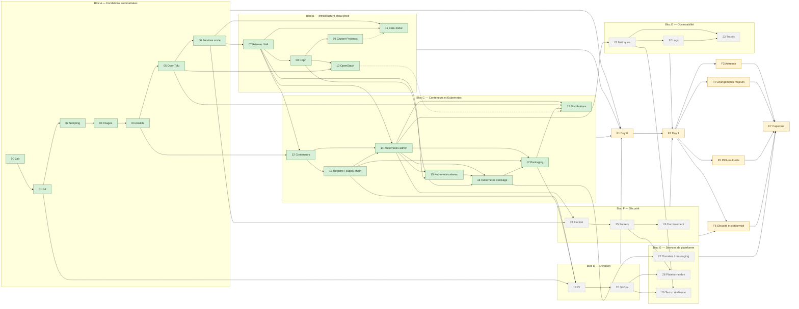

# Prérequis entre modules

> Ce fichier dit **dans quel ordre** suivre le workbook et **ce que chaque module laisse en place** pour les suivants. Les dépendances viennent de [`PLAN.md`](../PLAN.md) §5.2 et §5.3 ; les adresses, VMID et noms, de §4.5 et §4.8. En cas de doute, `PLAN.md` fait foi.

## 1. Graphe des dépendances

Une flèche `X → Y` se lit « Y suppose X terminé ». Les modules en vert sont **disponibles** ; les autres sont à venir (produits bloc par bloc). Les finaux dépendent de blocs entiers.

Lecture rapide :

- Le **bloc A** est une chaîne stricte : chaque module consomme ce que le précédent a livré (forge → outils → images → configuration → infrastructure déclarée → services socle).
- Après le module 07 (bordure redondante), deux grandes branches s'ouvrent : **infrastructure** (08 → 09, 10, 11) et **conteneurs** (12 → 13 → 14 → 15-18), qui ne se rejoignent qu'au module 16 (Ceph pour Kubernetes) et dans les finaux.
- Dans le **bloc B**, le module 08 (Ceph) est le pivot : le cluster Proxmox (09) et OpenStack (10) consomment `ceph-par1`. Le module 11 suppose la bordure du 07 (relais DHCP du VLAN 60) et réutilise, en pointillé, l'installateur automatique de Proxmox VE du module 09 (M11-E14) ; il peut se faire avant 08-10 en sautant cet exercice.
- Le **bloc C** est une chaîne : conteneurs (12) → registre (13) → cluster `k8s-par1` (14) → réseau (15) → stockage (16) → packaging (17) → distributions (18). Il suppose du bloc B la bordure redondante du module 07 (`socle-v2`, contrôle d'entrée de M12 : `lab/bin/check 07 46` ; BGP et répartiteurs au M15) et, pour le module 16, `ceph-par1` (M08). Le module 18 utilise le profil openstack (M10) pour un seul exercice facultatif (M18-E16, en pointillé).

## 2. Bloc A : ce que chaque module suppose et ce qu'il laisse en place

Le contrôle d'entrée d'un module est le **mini-projet du module précédent** : `lab/bin/check <NN-1> <dernier exercice>` doit être vert (par exemple `lab/bin/check 05 46` avant le module 06). Tous les fichiers de `~/.config/workbook/` sont sur `adm01`, dans un dossier en 700, en 600, jamais dans un dépôt.

| Module | Suppose acquis | Hôtes et objets Proxmox laissés en place | Projets GitLab | Comptes et jetons | Fichiers sous `~/.config/workbook/` |
|---|---|---|---|---|---|
| **00** Lab | Administration Linux et réseau (évaluée en E01, E02) ; `pve01` installé ; photos de `hp01` à préserver | `pve01` préparé : stockages `local-nvme`, `ssd-lab`, `hdd-bulk`, pool `lab`, bridge `vmbr1`, zone SDN `lab` et ses VNets ; `gw01` (1000, routeur nftables, NAT, NTP, WireGuard `wg0`/`wg1`) ; `adm01` (1001, 10.10.10.10) ; `dns01` (1002, 10.10.20.10, dnsmasq DNS + DHCP du VLAN 99) ; template 9000 `tpl-debian13` ; `hp01` réinstallé en `pbs01` (PAR2, 10.20.10.10, datastore `ds-lab`, stockage `pbs-par2`) | aucun (dépôt Git **local** `~/medisphere`, étiqueté `socle-v0`) | Proxmox : `wb-admin@pve` (groupe `wb-admins`), `wb-automation@pve!lab` (rôle `WBAutomation`) | `pve-api.env` (E17), `pve-root-ca.pem` (copie de l'autorité de `pve01`, E17) |
| **01** Git | M00-E50 vert ; agent SSH chargé ; `lab/lab.env` sur `adm01` | `git01` (1004, 10.10.20.12, GitLab CE 19.4) ; `runner01` (1007, 10.10.20.15, exécuteur `shell`, étiquettes `shell` et `socle`) ; CA provisoire dans `~/pki-provisoire/` ; Node.js 24 sur `adm01` et `runner01` ; sauvegarde de GitLab vers `pbs01` (secrets dans `/etc/wb-backup/` de `git01`) | `plateforme/medisphere` (ex-`~/medisphere`, ADR-0010…, RB-010 à RB-013), `plateforme/ci-templates` (`qualite.yml`, `release.yml`) ; groupe `formation` (bac à sable) | GitLab : `root` (bris de glace), `<MOI>` (admin), `claire.morel`, `karim.benali`, `sophie.laurent`, `julien.petit`, `nadia.roussel`, `lucas.martin` ; jeton `glrt-` du runner | `gitlab-checks.token` (`read_api`), `gitlab-admin.token` (`api`, courte durée ; `admin_mode` à partir de E31) |
| **02** Scripting | Forge, runner, pre-commit et semantic-release du M01 | Outils sur `adm01` et `runner01` (ShellCheck 0.11, shfmt, jq 1.8, yq mikefarah, uv, Task, bats) ; `medictl` installé depuis le registre de paquets ; timer `ms-verif-sauvegardes` sur `adm01` ; étiquettes Proxmox `socle` / `role-…` sur les VMs du socle | `plateforme/outils` (`bin/ms-*`, `lib/ms-commun.sh`, `medictl`, releases `vX.Y.Z`) ; ADR-0020 dans `plateforme/medisphere` | Proxmox : jeton en lecture seule `wb-automation@pve!lecture` | `pve-root-ca.pem` remplacé par l'ancre conforme (E08), `pve-lecture.env`, `pbs-lecture.env` (E26) |
| **03** Images | `plateforme/outils` et sa CI ; template 9000 | Packer 1.16 sur `adm01` puis `runner01` ; ancre de `pve01` dans le magasin système (`pve01-root-ca.crt`) ; templates 9001 `tpl-debian13-base`, 9002 `tpl-rocky10-base`, images dorées 9010-9029 (Debian 13) et 9030-9049 (Rocky 10), étiquette `current` sur une version par famille ; flux `vsandbox` → `adm01`/`runner01` TCP 8100-8199 et `runner01` → `pve01` 8006 (IPSet `automation`) | `plateforme/images` (build hebdomadaire planifié) ; ADR-0030, RB-030, RB-031 | Proxmox : `wb-packer@pve!packer` (rôles `WBPacker`, `WBLectureISO`) | `pve-packer.env` |
| **04** Ansible | Images dorées `current` ; outils et CI des M01-M02 | Configuration du socle **en code** (rôles `base`, `ssh_durci`, `pare_feu` pour `gw01`, `gitlab_runner`, `dnsmasq`, rôle de l'hôte `git01`) ; inventaire dynamique Proxmox ; `sem01` (2041) **détruite** en fin de module ; flux `runner01` → `adm01`/`gw01` TCP 22 | `plateforme/ansible` (collection `medisphere.socle`, Molecule, pipeline d'application protégé, détection de dérive planifiée) ; ADR-0040, RB-040, RB-041 | Proxmox : `wb-ansible@pve!ansible` (rôles `WBAnsible`, `WBAnsibleCluster`) ; clé SSH `ansible-ci` du pipeline | `pve-ansible.env`, `ansible-vault.pass` (identité `lab`), `ansible-vault-critique.pass` (identité `critique`) ; `semaphore-checks.token` (inutile après la destruction de `sem01`) |
| **05** OpenTofu | Rôles Ansible et inventaire dynamique du M04 ; image dorée `current` | `s3-01` (1006, 10.10.20.14, SeaweedFS, S3 HTTPS sur 8333, compartiment `tofu-state` versionné) ; OpenTofu 1.13 sur `adm01` et `runner01` ; socle (`adm01`, `dns01`, `git01`, `runner01`, `s3-01`) décrit dans l'état `socle`, `prevent_destroy` ; `gw01` hors IaC (ADR-0051) ; VMs 2050-2059 détruites | `plateforme/infra` (plan en MR, apply protégé, dérive planifiée), `plateforme/tofu-modules` (module `vm-debian`, versions `vX.Y.Z`) ; ADR-0050, ADR-0051, RB-050, RB-051 | Proxmox : `wb-tofu@pve!tofu` (rôle `WBTofu`) ; identité S3 d'OpenTofu sur `s3-01` | `pve-tofu.env`, `s3-tofu.env`, `s3-admin.env`, `tofu-chiffrement.pass` |
| **06** Services socle | Pipelines de `plateforme/infra` et `plateforme/ansible` (M05-E46 vert) | `ca01` (1003, 10.10.20.11, step-ca, ACME, CA SSH) ; `nbx01` (1005, 10.10.20.13, NetBox 4.6) ; `dns02` (1008, 10.10.20.16) ; `dns01` passé à PowerDNS (autoritaire + récurseur) et Kea DHCP en HA avec `dns02` ; **dnsmasq et CA provisoire retirés** ; racine de la PKI hors ligne dans `~/pki-racine` (chiffrée) ; NTS sur `gw01` ; certificats SSH d'hôte et d'utilisateur ; documentation étiquetée `socle-v1` | Rôles `step_ca`, `netbox`, `powerdns_auth`, `powerdns_recursor`, `kea_dhcp4`, `kea_ddns`… dans `plateforme/ansible` ; NetBox devient l'inventaire Ansible par défaut ; synchronisations dans `plateforme/outils` ; ADR-0060, RB-060 à RB-064 | NetBox : `wb-checks`, `<MOI>`, `svc-automatisation`, `svc-supervision` ; step-ca : provisioners `admin`, `acme`, `sshpop` ; Kea : `kea-api`, `supervision` | `step-admin.pass`, `netbox-checks.token`, `netbox-moi.token`, `netbox-auto.token`, `netbox-tofu.env`, `netbox-ansible.env`, `netbox-supervision.token`, `powerdns-api.env`, `kea-supervision.env` |

### État d'entrée du bloc B

À la fin du bloc A, le **socle v1** comprend neuf VMs permanentes (`gw01`, `adm01`, `dns01`, `ca01`, `git01`, `nbx01`, `s3-01`, `runner01`, `dns02`) et `pbs01` sur PAR2 ; toute nouvelle VM passe par OpenTofu (`plateforme/infra`), est configurée par Ansible (`plateforme/ansible`), reçoit son adresse de NetBox, son nom de PowerDNS et ses certificats de step-ca. Le contrôle `lab/bin/check 06 46` vérifie l'ensemble, y compris les acquis des modules 01 à 05.

### Variables de `lab/lab.env` du bloc A

`lab/lab.env.example` fait référence. Variables utilisées par les vérifications et les pannes des modules 00 à 06 : `WB_PVE_HOST`, `WB_PBS_HOST`, `WB_SSH_OPTS`, `WB_TIMEOUT`, `WB_LAN_MAISON`, `WB_PBS_LAN`, `WB_STORAGE_NVME`, `WB_STORAGE_SSD`, `WB_STORAGE_BULK`, `WB_PHOTOS_DIR`, `WB_PHOTOS_FULLCHECK` (M00) ; `WB_DEPOT`, `WB_SRC`, `WB_MOI`, `WB_GITLAB_URL`, `WB_GITLAB_TOKEN_FILE`, `WB_GITLAB_ADMIN_TOKEN_FILE` (M01) ; `WB_SEMAPHORE_URL`, `WB_SEMAPHORE_TOKEN_FILE` (M04) ; `WB_S3_ENDPOINT` (M05) ; `WB_NETBOX_URL`, `WB_NETBOX_TOKEN_FILE` (M06).

## 3. Bloc B : ce que chaque module suppose et ce qu'il laisse en place

Comme au bloc A, le contrôle d'entrée d'un module est le mini-projet du précédent : `lab/bin/check 07 46` (`socle-v2`), `08 46` (`stockage-v1`), `09 46` (`virtualisation-v1`, vert **pendant la recette** seulement : le cluster est détruit ensuite), `10 46` (`cloud-v1`), `11 25` (`provisioning-v1`). Chaque étiquette est posée sur `plateforme/medisphere`. Les fichiers sous `~/.config/workbook/` sont sur `adm01`, en 600.

| Module | Suppose acquis | Hôtes et objets Proxmox laissés en place | Projets GitLab | Comptes et jetons | Fichiers sous `~/.config/workbook/` |
|---|---|---|---|---|---|
| **07** Réseau / HA | `socle-v1` (M06-E46 vert) ; deux adresses libres du LAN maison réservées (`<IP-GW02-WAN>`, `<IP-GW-WAN-VIP>`) | **Socle v2** (étiquette `socle-v2`) : `gw02` (1009, `.3` sur chaque VLAN routé), `lb01`/`lb02` (1010/1011, 10.10.70.10/.11, VIP 10.10.70.200, HAProxy 3.2, GitLab et NetBox publiés, 443 redirigé depuis la VIP WAN) ; `gw01` passé en `.2` ; VRRP v3 unicast (VIP `.1` par VLAN routé, VRID = VLAN, VIP WAN VRID 250, `nopreempt`), `conntrackd` (FTFW, VLAN 10), tunnels `wg0`/`wg1`/`wg2` sur le maître (Lyon en attente) ; FRR 10.7 AS 65000 sur la bordure ; `vmbr1` et VLAN 30/31/51 en **MTU 9000** ; maquette 2070-2079 **détruite** (état `m07-maquette` vide) ; VNets `vfab1-8` gardées ou retirées (choix noté) | Aucun nouveau : rôles `keepalived`, `haproxy`, `frr`, `conntrackd`, `wireguard` dans `plateforme/ansible`, matrice commune `group_vars/role_routeur/pare_feu.yml` ; `gw02`, `lb01`, `lb02` dans l'état `socle` ; `ms-verif-reseau`, `ms-verif-services`, `ms-matrice-flux` dans `plateforme/outils` ; ADR-0070, RB-070 à RB-072 | Compte SSH `supervision` sur les passerelles et les répartiteurs (commande forcée) ; mots de passe des statistiques HAProxy ; clés WireGuard des passerelles (Vault `critique`, identiques sur `gw01` et `gw02`) ; certificats ACME des répartiteurs | `ssh-supervision-reseau` (clé de supervision), `haproxy-stats.env` |
| **08** Ceph | `socle-v2` (MTU 9000 sur les VLAN 30 et 31) ; image dorée Rocky 10 `current` (M03) | `ceph-par1` **conservé, arrêtable** : `ceph01-03` (2081-2083, Rocky 10, 6 Go chacun), Tentacle **20.2.4** par cephadm (Podman), 3 MON, 2 MGR, 9 OSD chiffrés, msgr2 `secure` ; pools des consommateurs `images`, `volumes`, `vms`, `backups`, `k8s-rbd` ; CephFS (MDS actif + secours, sous-volumes des équipes) ; RGW derrière l'ingress (VIP 10.10.30.200, `rgw.par1.medisphere.internal`) ; client `cephcli01` (2085, 10.10.30.20) ; `ceph04` (2084) **détruit** ; sauvegarde vers `pbs01` `par1/ceph` | **`plateforme/ceph`** (spécifications, `allocations.yaml`, outils, pipeline de dérive) ; module `vm-noeud` (`plateforme/tofu-modules` v2.2.0) ; rôles `ceph_noeud`, `ceph_client` ; `ms-verif-ceph` ; ADR-0080, RB-080 et suivants, politique de stockage dans `docs/stockage/` | Ceph : `client.admin` (hôtes `_admin` seulement), `client.glance`, `client.cinder`, `client.cinder-backup`, `client.k8s` (trousseaux en Vault, **non distribués**), `client.sauvegarde`, identités des équipes ; compte SSH `cephadm` ; tableau de bord : `admin` et compte personnel en lecture ; comptes RGW de MédiDoc (`medidoc-racine` en Vault `critique`, `medidoc-app`, `medidoc-audit`) ; step-ca : provisioners `ceph-ingress`, `ceph-dashboard` ; PBS : `wb-backup@pbs!cephcli01` | `ceph-dashboard.pass`, `ceph-ingress/` (certificat du point d'entrée), `step-ceph-ingress.pass`, `s3-medidoc-app.env`, `s3-medidoc-audit.env` |
| **09** Cluster Proxmox | `stockage-v1` ; procédure d'arrêt de `ceph-par1` ; virtualisation imbriquée possible sur `pve01` | **Rien de permanent** : `hv-par1` (`hv01-03`, 2091-2093) recetté puis **détruit** par le code ; `corosync-qnetd` désinstallé de `pbs01`, port 5403 refermé ; sur `pve01` : ISO `proxmox-ve_9.2-1.iso` vérifiée, `proxmox-auto-install-assistant` et `xorriso` ; espace PBS `par1/hv` purgé ou conservé (décision écrite au M09-E46) | `plateforme/infra` : `envs/hv/` (ISO par nœud, Taskfile de reconstruction chronométrée), `hv-invites` ; rôles `pve_noeud`, `pve_cluster`, `pve_pare_feu`… ; `ms-verif-cluster`, `ms-capacite-cluster` ; ADR-0090, RB-090 à RB-092 et suivants dans `docs/virtualisation/` | Comptes du cluster (`wb-tofu-hv@pve!tofu`, `wb-supervision@pve!hv`, TOTP des humains) disparus avec lui, recréés par le code ; PBS : `wb-hv@pbs!hv-par1` (portée `par1/hv`) ; clé de chiffrement des sauvegardes en Vault `critique` et sur papier | `hv-root.pass`, `hv-par1-root-ca.pem`, `pve-tofu-hv.env`, `pve-hv-supervision.env` (conservés pour la reconstruction, sans objet tant que le cluster n'existe pas) |
| **10** OpenStack | `stockage-v1` (`ceph-par1` démarré, pools et identités d'OpenStack) ; OpenTofu (M05) ; VLAN 50-52 et MTU 9000 du VLAN 51 (M07) | Profil **openstack** recréable : `osctl01` (2101, 16 Go), `oscmp01-02` (2102-2103, 8 Go chacun), arrêtés ou détruits après la recette ; OpenStack 2026.1 par Kolla-Ansible 22, OVN, Octavia (fournisseur OVN), VIP 10.10.50.200/.201 (VRID 150, TLS step-ca renouvelé chaque jour) ; `ext-net` 10.10.52.0/24 ; domaine `medisphere`, projets `plateforme`, `mediagenda-dev`, `mediagenda-prod` ; `client.nova` ajoutée sur `ceph-par1` (M10-E10) ; base sauvegardée sur `pbs01` `par1/openstack` | **`plateforme/openstack`** (`globals.yml`, `passwords.yml` chiffré `critique`, `outils/deployer.sh`, étiquettes `deploye-*`, CI d'invariants) ; module `openstack-env-app` (`plateforme/tofu-modules`) ; **`mediagenda/recette-infra`** (libre-service de MédiAgenda) ; `ms-verif-openstack`, `ms-capacite-openstack` ; ADR-0100, ADR-0101, RB-100 et suivants dans `docs/cloud/` | Keystone : `admin`, `<MOI>`, `karim.benali`, `julien.petit`, groupes `equipe-plateforme`/`equipe-mediagenda`, comptes de service `svc-tofu`, `svc-supervision`, `svc-ci-<équipe>` (application credentials expirantes) ; PBS : `wb-backup@pbs!osctl01` | `openstack-tofu.env` ; hors de ce dossier : `~/.config/openstack/clouds.yaml` (clouds `medisphere-admin`, `-plateforme`, `-mediagenda-dev`) et `secure.yaml` (600) |
| **11** Bare-metal | `socle-v2` (relais DHCP sur les deux passerelles) ; Kea, NetBox, step-ca (M06) ; installateur automatique de Proxmox VE (M09, pour M11-E14) | `pxe01` (2111, 10.10.60.10 : TFTP, nginx HTTPS, iPXE 2.0 construit avec la racine MédiSphère) ; `bm01-04` (2112-2115) recréées vides (`planned`) ou détruites selon `usine.md` ; Kea : sous-réseau `id: 60` et classes PXE, relais du VLAN 60 ; `maas01` (2116) et `m11-build` (2117) **détruites** (sauf ADR-0110 qui garde MAAS) ; template 9050 `tpl-ubuntu2404` gardé ou supprimé (justifié) ; `hp01` inventorié dans NetBox (série, BIOS, iLO), **jamais réinstallé** | **`plateforme/provisioning`** (gabarits, rendu depuis NetBox, validation `ksvalidator`, déploiement vers `pxe01`, job `provisionner`, inventaire planifié) ; rôles `pxe`, `pve_reponses` ; ADR-0110, ADR-0111, RB-110, RB-111 dans `docs/provisioning/` | Proxmox : `wb-provision@pve!provision` (rôle `WBProvision`, VMs 2112-2115) ; `wb-maas@pve` et `WBMaas` **supprimés** ; iLO : `wb-redfish` (droits minimaux, IPMI sur IP coupé) ; NetBox : droits de `svc-automatisation` étendus (équipements) | `pve-provision.env`, `ilo-hp01.env`, `ilo-hp01.pem` ; `maas-api.key` et `pve-maas.env` **supprimés** avec MAAS |

### Profils mémoire du bloc B

Règle : socle + **un seul** profil lourd. Le socle v2 compte ≈ 27 Go (socle v1 + `gw02`, `lb01`, `lb02`, 1 Go chacun).

| Module | Profil | En plus du socle | Total approx. |
|---|---|---|---|
| 07 | socle + maquette | 2070-2079 (≈ 10 Go toutes allumées) | ≈ 37 Go |
| 08 | infra (Ceph) | `ceph01-03` 18 Go, `cephcli01` 2 Go, `ceph04` 6 Go de E18 au mini-projet | ≈ 47 à 55 Go |
| 09 | infra (cluster) | `hv01-03` 36 Go ; `ceph01-03` arrêtées (sauf M09-E12) | ≈ 63 Go |
| 10 | openstack | `osctl01` 16 Go, `oscmp01-02` 16 Go, `ceph01-03` 18 Go | ≈ 77 Go |
| 11 | socle + provisioning | `pxe01`, `bm01-04`, `maas01` (≈ 16 Go) | ≈ 43 Go |

### État d'entrée du bloc C

À la fin du bloc B, le socle v2 (douze VMs permanentes : `gw01`, `gw02`, `adm01`, `dns01`, `dns02`, `ca01`, `git01`, `nbx01`, `s3-01`, `runner01`, `lb01`, `lb02`) tourne seul avec `pbs01` ; `ceph-par1` est conservé et arrêtable (Kubernetes le consomme au module 16, avec l'identité `client.k8s` et le pool `k8s-rbd` déjà prêts) ; les profils lourds **infra** (`hv-par1`) et **openstack** sont détruits ou arrêtés et se recréent par le code (états `hv` et `openstack`, Taskfile de reconstruction, `outils/deployer.sh`) ; la chaîne de provisioning (`pxe01`) peut installer les futurs nœuds. La bordure est prête pour le BGP de Kubernetes (plage d'écoute 10.10.40.0/24, préfixe 10.10.41.0/24 accepté, AS 65040 au module 15). Les modules du bloc C ne supposent du bloc B que la bordure (`socle-v2`) et, pour le 16, `ceph-par1`.

### Variables de `lab/lab.env` du bloc B

`lab/lab.env.example` fait référence. Variables ajoutées par les modules 07 à 11 : `WB_GW01_WAN`, `WB_GW02_WAN`, `WB_GW_WAN_VIP` (M07) ; `WB_CEPH_ADMIN`, `WB_CEPH_CLIENT` (M08, aussi lues par M09-E12 et M10) ; aucune au M09 ; `WB_OS_CLOUD`, `WB_OS_CLOUD_PLATEFORME`, `WB_OS_CLOUD_DEV` (M10) ; `WB_ILO_ENV_FILE`, `WB_MAAS_URL`, `WB_MAAS_KEY_FILE`, `WB_M11_MAAS_CONSERVE` (M11).

## 4. Bloc C : ce que chaque module suppose et ce qu'il laisse en place

Le contrôle d'entrée d'un module est le mini-projet du précédent : `lab/bin/check 07 46` avant le module 12, puis `12 46` (`conteneurs-v1`), `13 25` (`registre-v1`), `14 46` (`k8s-v1`), `15 46` (`k8s-reseau-v1`), `16 46` (`k8s-stockage-v1`), `17 25` (`packaging-v1`) ; le module 18 se ferme sur `18 25` (`distributions-v1`), qui rejoue `14 46`. Chaque étiquette est posée sur `plateforme/medisphere`. Les fichiers sous `~/.config/workbook/` sont sur `adm01`, en 600. Les détails figés du bloc sont dans [`PLAN.md`](../PLAN.md) §4.10, les versions et leurs changements de comportement dans [`versions-bloc-C.md`](versions-bloc-C.md).

| Module | Suppose acquis | Hôtes et objets laissés en place | Projets GitLab | Comptes et jetons | Fichiers sous `~/.config/workbook/` |
|---|---|---|---|---|---|
| **12** Conteneurs | `socle-v2` (M07-E46 vert) ; images dorées Debian 13 et Rocky 10 `current` (M03) ; module `vm-noeud` (M08, M10) ; Kea et DDNS, step-ca (M06) ; `ceph-par1` arrêté | **`runner02`** (1012, 10.10.20.17, état `socle`) : Docker 29, runner `runner02-docker` (exécuteur `docker`, étiquettes `docker` et `socle`, jamais privilégié, constructions par BuildKit sans démon privilégié), groupe `docker` vide, sauvegardé par PBS ; `ctr01-03` et `legacy01` (2121-2124, état `m12-conteneurs`) **détruites** après la recette, sauf `ctr01` gardée jusqu'à la fin de M13-E03 (`WB_M12_CTR01_CONSERVE=1`, avec le registre de travail `registry:3` sur `ctr01:5000`) ; espace PBS `par1/conteneurs` ; `vm-noeud` **v2.4.0** (carte en DHCP) ; VMID Molecule 2046, 2047 | `mediagenda/api`, `medidoc/medidoc`, `medinotif/worker`, `legacy/legacy-rdv` (Dockerfile, `compose.yaml`, pipeline de construction) ; `plateforme/images-base` (images `bibliotheque/{debian,python,php-apache}`, pipeline planifié le lundi à 04:00) ; `mediagenda/annuaire` (MédiAnnuaire, M12-E34) ; `plateforme/ci-templates` : `templates/image.yml` (job caché `.image-construction`), `templates/images-autorisees.yml` ; rôles `docker_engine`, `podman_hote`, `legacy_rdv`, `registre_travail`, `gitlab_runner` (exécuteur docker), `selinux_conteneurs`, `audit_conteneurs`, `supervision_conteneurs`, `sauvegarde_conteneurs`, `pile_recette` ; `ms-verif-conteneurs` ; `docs/conteneurs/` (ADR-0120, normes, RB-120 à RB-125) | Jeton `glrt-` de `runner02` ; registre de travail : comptes `ci` et `plateforme` (disparus avec `ctr01`) ; PBS : `wb-backup@pbs!ctr01` ; compte SSH `supervision` des hôtes de conteneurs ; groupes GitLab `mediagenda`, `medidoc`, `medinotif`, `legacy` ; UID des applications : MédiAgenda 10001, MédiNotif 10002, MédiAnnuaire 10003 | `registre-travail.env` (`WB_REGISTRE_ENV`, jusqu'à la migration vers Harbor), `registre-ci.curl`, `ssh-supervision-conteneurs` |
| **13** Registre / supply chain | `conteneurs-v1` (M12-E46 vert) ; `runner02` ; `ctr01` et ses images jusqu'à E03 ; step-ca ACME (M06) ; module `vm-debian` (M05) | **`reg01`** (1013, 10.10.20.18, état `socle`, `vm-debian` étendu par `disques_donnees`) : `/data` 200 Gio XFS sur `hdd-bulk`, Harbor **2.15.3** hors ligne (`/opt/harbor-dist/<version>`, lien `/opt/harbor`), CNAME `registry.par1.medisphere.internal`, certificat ACME ; objets de Harbor dans l'état OpenTofu `registre` (fournisseur `goharbor/harbor` 3.12.5) : projets `medisphere`, `plateforme`, `bibliotheque`, `charts` (vide jusqu'au M17), caches `dockerhub`, `quay`, `ghcr`, `k8s`, politiques (signature exigée, images critiques bloquées, immuabilité `v*`, rétention, quotas) ; espace PBS `par1/registre` ; flux VLAN 40 et 99 → `reg01` 443, `reg01` → `pbs01` 8007, métriques 9090 depuis MGMT ; `reg02` (2131, 10.10.99.31) **détruite** (états `m13-registre` et `registre-reg02` vides) | `plateforme/renovate-runner` (v26.1.0), `plateforme/renovate` (pipeline planifié), `plateforme/renovate-config` ; `plateforme/ci-templates` : `templates/supply-chain.yml`, `templates/verification.yml` ; image outillée `plateforme/outils-supply-chain:1.0.0` ; rôles `harbor`, `outils_supply_chain`, `sauvegarde_harbor` ; `ms-verif-registre` ; `docs/registre/` (`cosign.pub`, `signing-config.json`, ADR-0130, RB-130 à RB-135) | Harbor : `admin` (bris de glace, Vault `critique`), `<MOI>`, `karim.benali`, `julien.petit`, `lucas.martin` ; robots système `k8s-pull`, `wb-checks` (lecture), `renovate`, `supervision` ; robots de projet `medisphere+ci`, `bibliotheque+ci`, `plateforme+ci` ; utilisateur `wb-pannes` **supprimé** ; clé Cosign (Vault `critique` et variable protégée) ; GitLab : compte `renovate-bot`, variable d'instance `MEDISPHERE_ROOT_CA` (type fichier), variables de groupe `HARBOR_ROBOT_USER`, `HARBOR_ROBOT_TOKEN`, `COSIGN_PRIVATE_KEY`, `COSIGN_PASSWORD` ; PBS : `wb-backup@pbs!reg01` | `harbor-checks.env`, `harbor-moi.env` ; `harbor-reg02-checks.env` et `harbor-pannes.env` supprimés en E25 ; `registre-travail.env` sans objet après la migration |
| **14** Kubernetes admin | `registre-v1` (M13-E25 vert : caches, `robot$k8s-pull`, image signée de MédiAgenda) ; `keepalived` et `haproxy` (M07) ; `vm-noeud` ≥ v2.3 (MAC imposées) ; `ceph-par1` arrêté | **`k8s-par1`** conservé, arrêtable (état `envs/k8s`) : `k8s-cp01-03` (2141-2143, 10.10.40.51-53), `k8s-w01-03` (2144-2146, 10.10.40.61-63), carte `eth0`, zones `par1-baie-a/b/c`, taint `dedie=bdd:NoSchedule` sur `k8s-w03` ; Kubernetes **1.36.5** (installé en 1.35.9), containerd.io 2.3, etcd empilé, VIP **10.10.40.200:8443** (`k8s-api.par1.medisphere.internal`, VRID 140) ; Cilium 1.20 avec kube-proxy conservé, metrics-server ; audit, Secrets chiffrés (`secretbox`) ; `etcd-instantane.timer` → `s3-01` `etcd-k8s-par1` ; PBS `par1/k8s` ; espaces `wb-system`, `wb-essais`, `wb-diagnostic`, `mediagenda-dev`, `mediagenda-recette`, `medidoc-dev` ; VAP `medisphere-images`, PriorityClasses `medisphere-*` ; MédiAgenda (`mediagenda-api`, Service port 80, PostgreSQL et Valkey jetables) ; `k8s-w04` (2147) **détruit** ; VMID Molecule 2149 | **`plateforme/k8s`** (`cluster/`, `composants/`, `espaces/`, `rbac/`, `admission/`, `outils/`, `secrets/`, `Taskfile.yml`) ; `mediagenda/api` : `k8s/essais`, `k8s/dev`, `k8s/recette` ; rôles `containerd`, `k8s_noeud`, `k8s_plan_controle`, `k8s_travailleur`, `outils_k8s`, `etcd_instantane`, `k8s_audit`, `k8s_chiffrement` ; `docs/kubernetes/` (ADR-0140, ADR-0141, RB-140 à RB-149, journal et post-mortems) | Identité `<MOI>` (certificat client 7 jours, groupe `medisphere:plateforme-admins`) ; groupes `medisphere:mediagenda-devs`, `medisphere:medidoc-devs`, `medisphere:lecture` ; compte de service `wb-system/wb-checks` (ClusterRole agrégée `wb-checks`, base `wb-checks-base`, jamais les Secrets) ; `admin.conf` et `super-admin.conf` en Vault `critique` ; identité S3 `etcd-k8s` (sans droit de suppression), clé `age` des instantanés ; Secret `harbor-pull` (robot `k8s-pull`) | `k8s-checks.kubeconfig`, `harbor-k8s-pull.env`, `s3-etcd.env` ; hors de ce dossier : `~/.kube/config` (contexte `k8s-par1`) |
| **15** Kubernetes réseau | `k8s-v1` (M14-E46 vert) ; FRR AS 65000 sur la bordure (M07) ; `lb01`/`lb02` ; PowerDNS autoritaire en 5300 et step-ca ACME (M06) | Cilium en **remplacement de kube-proxy** (`proxy.disabled: true` dans kubeadm), VXLAN chiffré par WireGuard, Hubble relay et UI (`hubble.apps.par1.medisphere.internal`) ; pool LB IPAM `lb-par1` **10.10.41.10-199** (.10 `gw-par1`, .11 `gw-partenaires`, .20-49 essais, .50-199 services durables) ; BGP AS 65040 ↔ `gw01`/`gw02` (AS 65000) ; Gateway API v1.6.1 ; Gateway **`gw-par1`** (espace `passerelles`, 10.10.41.10, joker `apps-joker`) et `gw-partenaires` (10.10.41.11, TLS *passthrough* vers `relais-mtls`) ; cert-manager 1.21 (`step-ca-acme`), ExternalDNS 0.23 ; zone **`apps.par1.medisphere.internal`** (signée, `dns01`/`dns02`, RFC 2136) ; espaces `passerelles`, `cert-manager`, `external-dns`, `supervision` ; MédiDoc publié dans `medidoc-dev` (compartiment `medidoc-dev` de `s3-01`) ; flux de la bordure (VLAN 40 → `dns01` 5300, `ca01` → 10.10.41.10:80, `lb01`/`lb02` → 10.10.41.10:443, VLAN 40 → `ca01` 443, `K8S_TRAV` → `s3-01` 8333) ; `m15-essai` (2151) **détruite** | `plateforme/k8s` : `composants/cilium`, `coredns`, `gateway-api`, `cert-manager`, `external-dns`, `reseau` ; `ms-verif-k8s-reseau` ; `docs/kubernetes/reseau/` (ADR-0150, RB-150 à RB-153, `matrice-flux-cluster.md`, `publier-une-application.md`) | Clés TSIG `externaldns-k8s` et `certmanager-k8s` (Vault `lab`, limitées à la zone) ; compte ACME de cert-manager ; compte `supervision/ms-supervision` ; ClusterRole `wb-checks-reseau` ; autorité « MédiSphère Partenaires » et certificat `partenaire-centre-test-01` | `k8s-supervision.kubeconfig`, `s3-medidoc-dev.env`, `ca-partenaires.key`, `ca-partenaires.pass`, `partenaire-centre-test-01.crt` et `.key` ; hors de ce dossier : `~/.kube/m15-essai.conf` (supprimé avec la VM) |
| **16** Kubernetes stockage | `k8s-reseau-v1` (M15-E46 vert ; cert-manager pour le plugin Barman Cloud) ; `stockage-v1` (`ceph-par1` démarré, pool `k8s-rbd`, `client.k8s` en type de clé `aes`, CephFS) ; `s3-01` (M05) ; compte RGW `medidoc-app` (M08) | Carte **`eth1`** des travailleurs sur le VLAN 30 (10.10.30.81-83, MTU 9000, MAC `bc:24:11:30:00:61-63`, netplan `60-stockage.yaml`), étiquette `medisphere.internal/stockage-ceph=oui` ; ceph-csi 3.18.1 (espace `ceph-csi`), external-snapshotter 8.6.0 ; classes `ceph-rbd` (par défaut), `ceph-rbd-retain`, `cephfs`, `ceph-rbd-chiffre` ; classes d'instantanés `ceph-rbd-snap`, `cephfs-snap` ; Velero 1.18 (espace `velero`, `velero-k8s-par1` sur `s3-01`) ; CloudNativePG 1.30 (`cnpg-system`) et plugin Barman Cloud 0.15, cluster **`mediagenda-db`** (3 instances, `ObjectStore` `cnpg-s3`, `cnpg-k8s-par1`) ; Valkey de recette (une instance, `ceph-rbd-chiffre`) ; MédiDoc sur le RGW (`medidoc-documents`) ; Rook, Longhorn et leurs disques **retirés** | `plateforme/k8s` (`composants/ceph-csi`, `snapshot-controller`, Velero, CloudNativePG, `outils/ceph-csi-secrets.sh`, `secrets/ceph-csi.yml` en Vault `critique`) ; `plateforme/ceph` (`allocations.yaml`) ; rôle `k8s_reseau_stockage` ; `ms-verif-k8s-stockage` ; `docs/kubernetes/stockage/` (ADR-0160, RB-160 à RB-167, `politique-sauvegarde.md`) | Ceph : `client.k8s-cephfs` (groupe de sous-volumes `csi`) ; SeaweedFS : `velero`, `cnpg` ; ClusterRole `wb-checks-stockage` ; compte de supervision du stockage | `s3-velero.env`, `s3-cnpg.env`, `k8s-supervision-stockage.kubeconfig`, `s3-medidoc-app.env` (M08, réutilisé) ; `s3-longhorn-essai.env` supprimé avec Longhorn |
| **17** Packaging | `k8s-stockage-v1` (M16-E46 vert) ; Harbor (projet `charts`) et Cosign (M13) ; Helm 4.3 (installé au M14) | Chart **`mediagenda` 0.5.0** et suivants (bibliothèque `medisphere-commun`, dépendance Valkey 0.12.0), publiés et signés dans `oci://registry.par1.medisphere.internal/charts` (miroir `charts/valkey`) ; objets renommés `mediagenda` (Service port 80) dans `mediagenda-dev`, `mediagenda-recette` et **`mediagenda-prod`** (nouvel espace, `mediagenda.apps.par1.medisphere.internal`, CNPG à 3 instances) ; aucune release Helm applicative ; plateforme : neuf releases sous Helmfile (`cilium`, `cert-manager`, `external-dns`, `ceph-csi-rbd`, `ceph-csi-cephfs`, `cnpg`, `plugin-barman-cloud`, `velero`, `metrics-server`) et la release `emetteurs` (ClusterIssuer) ; sur `adm01` : Kustomize 5.8.2, Helmfile 1.8.1, ct 3.15.0, plugins helm-unittest et helm-diff | **`mediagenda/chart`**, **`mediagenda/deploiement`** (base rendue et vérifiée : `chart.env`, `outils/rendre-base.sh` ; overlays `dev`, `recette`, `prod` ; components) ; `plateforme/k8s` : `helmfile.yaml`, `releases/*.yaml.gotmpl`, `environnements/par1.yaml`, `charts/emetteurs` ; `docs/kubernetes/packaging/` (ADR-0170, RB-170 à RB-173) | Robots Harbor `robot$charts+ci`, `robot$charts+lecture` ; variables de CI `HARBOR_CHARTS_*`, `HARBOR_CHARTS_RO_*` | aucun nouveau (les checks qui lisent l'état Helm passent par `WB_K8S_ADMIN_KUBECONFIG`, en lecture) |
| **18** Distributions | `packaging-v1` (M17-E25 vert) ; `k8s-v1` vert avant son arrêt ; `vm-noeud` v2.4 (M12) ; Packer (M03) ; cache Harbor (M13) ; profil openstack pour M18-E16 (facultatif) | **Rien de permanent** : VMs 2181-2188, `k3s-ha01..03` (5191-5193), VMs de `capi-essai` (5180-5189) et VMs de contrôle (5188, 5189) **détruites** (état `envs/m18` vide) ; templates 9060 `tpl-capi-ubuntu2404-k136` et 9061 `tpl-capi-ubuntu2404-k136-2` gardés ou supprimés selon l'ADR-0180 ; compartiment `etcd-m18` de `s3-01` selon l'ADR ; flux provisoires retirés (8006 et IPSet `capi` de `pve01`, `vsandbox` → 10.10.40.150-169 et .210 en 6443, `vsandbox` → `s3-01` 8333, flux de E16) ; `k8s-par1` redémarré et vert | **`plateforme/distributions`** (`kind/`, `k3d/`, `k3s/`, `rke2/`, `talos/`, `capi/`, Taskfile `demo:construire` / `demo:detruire`) ; `plateforme/images` : dossier `capi/` ; rôles `outils_distributions`, `k3s`, `rke2`, playbook `m18.yml` ; `docs/kubernetes/distributions/` (`comparatif.md`, `mesures.md`, `demontage.md`, ADR-0180, RB-180 à RB-185) | Proxmox : `wb-capi@pve!capi` (rôles `WBCapi`, `WBCapiAudit`, stockage `capi-iso`) gardé ou supprimé selon l'ADR ; identité S3 `etcd-m18` selon l'ADR ; jetons k3s et RKE2 et bundle de secrets Talos en Vault `lab` (gardés si l'ADR garde l'option) | `m18/` (kubeconfigs, `talosconfig`, `talos-secrets.yaml`) vidé sauf ce que l'ADR garde ; `pve-capi.env` selon l'ADR ; `s3-etcd-m18.env` |

### Profils mémoire du bloc C

Règle : socle + **un seul** profil lourd. Le socle v3 compte ≈ 37 Go (socle v2 + `runner02` 4 Go + `reg01` 6 Go).

| Module | Profil | En plus du socle | Total approx. |
|---|---|---|---|
| 12 | socle + conteneurs | `ctr01-03`, `legacy01` (4 × 2 Go) ; `runner02` entre au socle en E20 | ≈ 35 à 39 Go |
| 13 | socle v3 | `ctr01` (2 Go) jusqu'à E03, `reg02` (4 Go) au palier 3 | ≈ 37 à 43 Go |
| 14 | k8s | `k8s-cp01-03` (3 × 4 Go), `k8s-w01-03` (3 × 8 Go) ; `k8s-w04` (8 Go) en E17 | ≈ 73 à 81 Go |
| 15 | k8s | `k8s-par1` ; `m15-essai` (4 Go) le temps de E19 | ≈ 73 à 77 Go |
| 16 | k8s + infra | `k8s-par1` (36 Go) et `ceph-par1` (3 × 6 Go) ; Rook et Longhorn chargent les travailleurs, jamais ensemble | ≈ 91 Go |
| 17 | k8s + infra | comme au M16 (volumes de MédiAgenda sur `ceph-par1`) | ≈ 91 Go |
| 18 | socle + essais | `k8s-par1` **arrêté** ; `m18-dev01` (8 Go) et une seule famille d'essais à la fois, ≤ 30 Go en tout | ≈ 45 à 61 Go |

### État d'entrée du bloc D

À la fin du bloc C, le **socle v3** compte quatorze VMs permanentes (le socle v2, `runner02` et `reg01`) et `pbs01` ; **Harbor** est la frontière de toutes les images (caches des registres publics, images signées par Cosign avec SBOM et provenance, charts OCI signés dans `charts`) ; **`k8s-par1`** (Kubernetes 1.36, Cilium sans kube-proxy, BGP vers la bordure, Gateway `gw-par1` sur `*.apps.par1.medisphere.internal`, certificats et noms automatiques, ceph-csi vers `ceph-par1`, Velero, CloudNativePG) porte MédiAgenda en dev, en recette et en production, déployée par le rendu vérifié du chart et les overlays de `mediagenda/deploiement`, et toute la plateforme est décrite par le Helmfile de `plateforme/k8s`. `ceph-par1` reste nécessaire dès que `k8s-par1` tourne (volumes) : ordre de démarrage `ceph-par1` puis `k8s-par1`, ordre d'arrêt inverse. Ce qui reste manuel et que le bloc D reprend : l'application des changements depuis `adm01` (`task appliquer`, `helmfile apply`, `kubectl apply --server-side -k`), que le module 20 confie à Argo CD ; la CI qui tourne encore sur `runner02` (exécuteur docker), que le module 19 complète par des runners dans Kubernetes. Les métriques ne sont lues qu'en ligne de commande (`kubectl top`, Hubble, sondes `ms-verif-*`) jusqu'au module 21. Contrôles d'entrée : `lab/bin/check 17 25` et `lab/bin/check 14 46`.

### Variables de `lab/lab.env` du bloc C

`lab/lab.env.example` fait référence (section « Bloc C »). Variables principales : `WB_HARBOR_URL`, `WB_HARBOR_CHECKS_FILE` (M13) ; `WB_K8S_KUBECONFIG`, `WB_K8S_ADMIN_KUBECONFIG`, `WB_K8S_CP`, `WB_K8S_WORKERS` (M14, lues par tous les modules suivants). Variables facultatives, à ne poser que si tes valeurs diffèrent des défauts : `WB_M12_CTR01`, `WB_M12_CTR02`, `WB_M12_CTR03`, `WB_M12_RUNNER02`, `WB_M12_CTR01_NOM`, `WB_M12_CTR02_NOM`, `WB_M12_PORT_API` (18000), `WB_M12_PORT_DOC` (18080), `WB_M12_PROJET_IMAGE`, `WB_M12_CTR01_CONSERVE` (0), `WB_REGISTRE_ENV`, `WB_RACINE_PKI`, `WB_PBS_STORAGE` (`pbs-par2`) (M12) ; `WB_HARBOR_REG02_URL`, `WB_HARBOR_REG02_CHECKS_FILE`, `WB_M13_HARBOR_VERSION` (`v2.15.3`), `WB_HARBOR_PANNES_FILE`, `WB_M13_RUNNER`, `WB_M13_REG01`, `WB_M13_RUNNER_VMID` (1012) (M13) ; `WB_M14_IMAGE_AGENDA`, `WB_HARBOR_K8S_PULL_FILE`, `WB_M14_K8S_VERSION` (M14) ; `WB_M15_ESSAI_KUBECONFIG`, `WB_M15_IMAGE_SONDE` (M15) ; `WB_M16_API_URL`, `WB_M16_IMAGE_TEMOIN` (M16) ; aucune au M17 ; `WB_M18_DIR`, `WB_M18_DEV`, `WB_M18_K3S`, `WB_M18_RKE2`, `WB_M18_TALOS`, `WB_M18_RECETTE_URL`, `WB_M18_TEMPLATES_CONSERVES`, `WB_M18_WBCAPI_CONSERVE`, et `WB_OS_CLOUD_PLATEFORME` (M10) pour M18-E16 (M18). Les modules réutilisent aussi `WB_CEPH_ADMIN` (M08) au M16.
