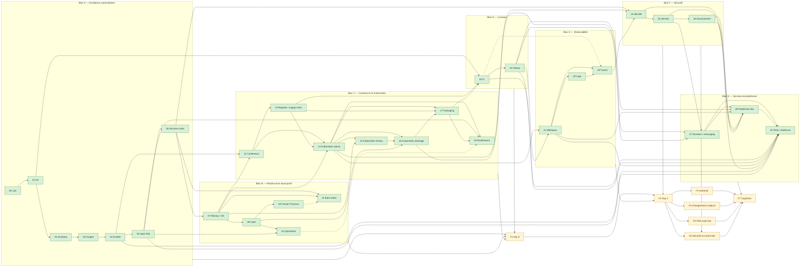

# Prérequis entre modules

> Ce fichier dit **dans quel ordre** suivre le workbook et **ce que chaque module laisse en place** pour les suivants. Les dépendances viennent de [`PLAN.md`](../PLAN.md) §5.2 et §5.3 ; les adresses, VMID et noms, de §4.5 et §4.8. En cas de doute, `PLAN.md` fait foi.

## 1. Graphe des dépendances

Une flèche `X → Y` se lit « Y suppose X terminé ». Les modules en vert sont **disponibles** ; les autres sont à venir (produits bloc par bloc). Les finaux dépendent de blocs entiers.

Lecture rapide :

- Le **bloc A** est une chaîne stricte : chaque module consomme ce que le précédent a livré (forge → outils → images → configuration → infrastructure déclarée → services socle).
- Après le module 07 (bordure redondante), deux grandes branches s'ouvrent : **infrastructure** (08 → 09, 10, 11) et **conteneurs** (12 → 13 → 14 → 15-18), qui ne se rejoignent qu'au module 16 (Ceph pour Kubernetes) et dans les finaux.
- Dans le **bloc B**, le module 08 (Ceph) est le pivot : le cluster Proxmox (09) et OpenStack (10) consomment `ceph-par1`. Le module 11 suppose la bordure du 07 (relais DHCP du VLAN 60) et réutilise, en pointillé, l'installateur automatique de Proxmox VE du module 09 (M11-E14) ; il peut se faire avant 08-10 en sautant cet exercice.
- Le **bloc C** est une chaîne : conteneurs (12) → registre (13) → cluster `k8s-par1` (14) → réseau (15) → stockage (16) → packaging (17) → distributions (18). Il suppose du bloc B la bordure redondante du module 07 (`socle-v2`, contrôle d'entrée de M12 : `lab/bin/check 07 46` ; BGP et répartiteurs au M15) et, pour le module 16, `ceph-par1` (M08). Le module 18 utilise le profil openstack (M10) pour un seul exercice facultatif (M18-E16, en pointillé).
- Les **blocs D et E** forment une seule chaîne : CI (19) → GitOps (20) → métriques (21) → journaux (22) → traces (23). Le module 21 suppose `gitops-v1` (ses composants sont des Applications d'Argo CD) et `mon01` (Mailpit, M19) ; le module 23 instrumente les applications par leurs pipelines du M19 (en pointillé). Le module 18 n'est requis par aucun d'eux : le bloc D part de `packaging-v1` (M17) et de `k8s-v1` (M14).
- Le **bloc F** est une chaîne : identité (24) → secrets (25) → durcissement (26). Il part de `traces-v1` (M23), donc de toute l'observabilité et de la livraison : le M24 branche en SSO les services des blocs A à E (GitLab, Argo CD, Grafana, Harbor, Proxmox, NetBox, le cluster) et réutilise la racine hors ligne et step-ca du M06, `lb01`/`lb02` du M07 ; le M25 s'authentifie par Keycloak (M24), sert la CI du M19 (`id_tokens`, runner protégé, Cosign), remplace les Secrets hors Git du M20 et donne des identifiants dynamiques au PostgreSQL de CloudNativePG (M16) ; le M26 vérifie les signatures Cosign (M13, clé de transit du M25), durcit les VMs inscrites dans l'annuaire (M24), étend Cilium (M15) et alerte par les piles des M21-M22.
- Le **bloc G** est une chaîne : données et messagerie (27) → plateforme développeurs (28) → tests et résilience (29). Il part de `durcissement-v1` (M26) et ajoute des services de plateforme dans `k8s-par1` sans nouvel hôte permanent. Le M27 approfondit le CloudNativePG du M16 (*pooler*, réplica de secours), livre ses migrations par le hook d'Argo CD du M20, et lit ses identifiants (PostgreSQL dynamiques, AMQP, Valkey) dans OpenBao (M25) ; le M28 fait suivre la charge à MédiAgenda (Rollout du M20, métriques du M21) et à MédiNotif (file RabbitMQ du M27), découpe le cluster en locataires dont les propriétaires sont les groupes OIDC du M24, et branche le portail sur Keycloak, OpenBao et les politiques du M26 ; le M29 teste ce que les modules précédents ont construit : rôles Ansible (M04) et module OpenTofu `vm-debian` (M05) en vrai, composant `validation` dans la CI du M19, politiques Rego à côté de celles du M26, charge mesurée sur les SLO du M21, chaos sur les espaces de recette du M27 et du M28.

## 2. Bloc A : ce que chaque module suppose et ce qu'il laisse en place

Le contrôle d'entrée d'un module est le **mini-projet du module précédent** : `lab/bin/check <NN-1> <dernier exercice>` doit être vert (par exemple `lab/bin/check 05 46` avant le module 06). Tous les fichiers de `~/.config/workbook/` sont sur `adm01`, dans un dossier en 700, en 600, jamais dans un dépôt.

| Module | Suppose acquis | Hôtes et objets Proxmox laissés en place | Projets GitLab | Comptes et jetons | Fichiers sous `~/.config/workbook/` |
|---|---|---|---|---|---|
| **00** Lab | Administration Linux et réseau (évaluée en E01, E02) ; `pve01` installé ; photos de `hp01` à préserver | `pve01` préparé : stockages `local-nvme`, `ssd-lab`, `hdd-bulk`, pool `lab`, bridge `vmbr1`, zone SDN `lab` et ses VNets ; `gw01` (1000, routeur nftables, NAT, NTP, WireGuard `wg0`/`wg1`) ; `adm01` (1001, 10.10.10.10) ; `dns01` (1002, 10.10.20.10, dnsmasq DNS + DHCP du VLAN 99) ; template 9000 `tpl-debian13` ; `hp01` réinstallé en `pbs01` (PAR2, 10.20.10.10, datastore `ds-lab`, stockage `pbs-par2`) | aucun (dépôt Git **local** `~/medisphere`, étiqueté `socle-v0`) | Proxmox : `wb-admin@pve` (groupe `wb-admins`), `wb-automation@pve!lab` (rôle `WBAutomation`) | `pve-api.env` (E17), `pve-root-ca.pem` (copie de l'autorité de `pve01`, E17) |
| **01** Git | M00-E50 vert ; agent SSH chargé ; `lab/lab.env` sur `adm01` | `git01` (1004, 10.10.20.12, GitLab CE 19.4) ; `runner01` (1007, 10.10.20.15, exécuteur `shell`, étiquettes `shell` et `socle`) ; CA provisoire dans `~/pki-provisoire/` ; Node.js 24 sur `adm01` et `runner01` ; sauvegarde de GitLab vers `pbs01` (secrets dans `/etc/wb-backup/` de `git01`) | `plateforme/medisphere` (ex-`~/medisphere`, ADR-0010…, RB-010 à RB-013), `plateforme/ci-templates` (`qualite.yml`, `release.yml`) ; groupe `formation` (bac à sable) | GitLab : `root` (bris de glace), `<MOI>` (admin), `claire.morel`, `karim.benali`, `sophie.laurent`, `julien.petit`, `nadia.roussel`, `lucas.martin` ; jeton `glrt-` du runner | `gitlab-checks.token` (`read_api`), `gitlab-admin.token` (`api`, courte durée ; `admin_mode` à partir de E31) |
| **02** Scripting | Forge, runner, pre-commit et semantic-release du M01 | Outils sur `adm01` et `runner01` (ShellCheck 0.11, shfmt, jq 1.8, yq mikefarah, uv, Task, bats) ; `medictl` installé depuis le registre de paquets ; timer `ms-verif-sauvegardes` sur `adm01` ; étiquettes Proxmox `socle` / `role-…` sur les VMs du socle | `plateforme/outils` (`bin/ms-*`, `lib/ms-commun.sh`, `medictl`, releases `vX.Y.Z`) ; ADR-0020 dans `plateforme/medisphere` | Proxmox : jeton en lecture seule `wb-automation@pve!lecture` | `pve-root-ca.pem` remplacé par l'ancre conforme (E08), `pve-lecture.env`, `pbs-lecture.env` (E26) |
| **03** Images | `plateforme/outils` et sa CI ; template 9000 | Packer 1.16 sur `adm01` puis `runner01` ; ancre de `pve01` dans le magasin système (`pve01-root-ca.crt`) ; templates 9001 `tpl-debian13-base`, 9002 `tpl-rocky10-base`, images dorées 9010-9029 (Debian 13) et 9030-9049 (Rocky 10), étiquette `current` sur une version par famille ; flux `vsandbox` → `adm01`/`runner01` TCP 8100-8199 et `runner01` → `pve01` 8006 (IPSet `automation`) | `plateforme/images` (build hebdomadaire planifié) ; ADR-0030, RB-030, RB-031 | Proxmox : `wb-packer@pve!packer` (rôles `WBPacker`, `WBLectureISO`) | `pve-packer.env` |
| **04** Ansible | Images dorées `current` ; outils et CI des M01-M02 | Configuration du socle **en code** (rôles `base`, `ssh_durci`, `pare_feu` pour `gw01`, `gitlab_runner`, `dnsmasq`, rôle de l'hôte `git01`) ; inventaire dynamique Proxmox ; `sem01` (2041) **détruite** en fin de module ; flux `runner01` → `adm01`/`gw01` TCP 22 | `plateforme/ansible` (collection `medisphere.socle`, Molecule, pipeline d'application protégé, détection de dérive planifiée) ; ADR-0040, RB-040, RB-041 | Proxmox : `wb-ansible@pve!ansible` (rôles `WBAnsible`, `WBAnsibleCluster`) ; clé SSH `ansible-ci` du pipeline | `pve-ansible.env`, `ansible-vault.pass` (identité `lab`), `ansible-vault-critique.pass` (identité `critique`) ; `semaphore-checks.token` (inutile après la destruction de `sem01`) |
| **05** OpenTofu | Rôles Ansible et inventaire dynamique du M04 ; image dorée `current` | `s3-01` (1006, 10.10.20.14, SeaweedFS, S3 HTTPS sur 8333, compartiment `tofu-state` versionné) ; OpenTofu 1.13 sur `adm01` et `runner01` ; socle (`adm01`, `dns01`, `git01`, `runner01`, `s3-01`) décrit dans l'état `socle`, `prevent_destroy` ; `gw01` hors IaC (ADR-0051) ; VMs 2050-2059 détruites | `plateforme/infra` (plan en MR, apply protégé, dérive planifiée), `plateforme/tofu-modules` (module `vm-debian`, versions `vX.Y.Z`) ; ADR-0050, ADR-0051, RB-050, RB-051 | Proxmox : `wb-tofu@pve!tofu` (rôle `WBTofu`) ; identité S3 d'OpenTofu sur `s3-01` | `pve-tofu.env`, `s3-tofu.env`, `s3-admin.env`, `tofu-chiffrement.pass` |
| **06** Services socle | Pipelines de `plateforme/infra` et `plateforme/ansible` (M05-E46 vert) | `ca01` (1003, 10.10.20.11, step-ca, ACME, CA SSH) ; `nbx01` (1005, 10.10.20.13, NetBox 4.6) ; `dns02` (1008, 10.10.20.16) ; `dns01` passé à PowerDNS (autoritaire + récurseur) et Kea DHCP en HA avec `dns02` ; **dnsmasq et CA provisoire retirés** ; racine de la PKI hors ligne dans `~/pki-racine` (chiffrée) ; NTS sur `gw01` ; certificats SSH d'hôte et d'utilisateur ; documentation étiquetée `socle-v1` | Rôles `step_ca`, `netbox`, `powerdns_auth`, `powerdns_recursor`, `kea_dhcp4`, `kea_ddns`… dans `plateforme/ansible` ; NetBox devient l'inventaire Ansible par défaut ; synchronisations dans `plateforme/outils` ; ADR-0060, RB-060 à RB-064 | NetBox : `wb-checks`, `<MOI>`, `svc-automatisation`, `svc-supervision` ; step-ca : provisioners `admin`, `acme`, `sshpop` ; Kea : `kea-api`, `supervision` | `step-admin.pass`, `netbox-checks.token`, `netbox-moi.token`, `netbox-auto.token`, `netbox-tofu.env`, `netbox-ansible.env`, `netbox-supervision.token`, `powerdns-api.env`, `kea-supervision.env` |

### État d'entrée du bloc B

À la fin du bloc A, le **socle v1** comprend neuf VMs permanentes (`gw01`, `adm01`, `dns01`, `ca01`, `git01`, `nbx01`, `s3-01`, `runner01`, `dns02`) et `pbs01` sur PAR2 ; toute nouvelle VM passe par OpenTofu (`plateforme/infra`), est configurée par Ansible (`plateforme/ansible`), reçoit son adresse de NetBox, son nom de PowerDNS et ses certificats de step-ca. Le contrôle `lab/bin/check 06 46` vérifie l'ensemble, y compris les acquis des modules 01 à 05.

### Variables de `lab/lab.env` du bloc A

`lab/lab.env.example` fait référence. Variables utilisées par les vérifications et les pannes des modules 00 à 06 : `WB_PVE_HOST`, `WB_PBS_HOST`, `WB_SSH_OPTS`, `WB_TIMEOUT`, `WB_LAN_MAISON`, `WB_PBS_LAN`, `WB_STORAGE_NVME`, `WB_STORAGE_SSD`, `WB_STORAGE_BULK`, `WB_PHOTOS_DIR`, `WB_PHOTOS_FULLCHECK` (M00) ; `WB_DEPOT`, `WB_SRC`, `WB_MOI`, `WB_GITLAB_URL`, `WB_GITLAB_TOKEN_FILE`, `WB_GITLAB_ADMIN_TOKEN_FILE` (M01) ; `WB_SEMAPHORE_URL`, `WB_SEMAPHORE_TOKEN_FILE` (M04) ; `WB_S3_ENDPOINT` (M05) ; `WB_NETBOX_URL`, `WB_NETBOX_TOKEN_FILE` (M06).

## 3. Bloc B : ce que chaque module suppose et ce qu'il laisse en place

Comme au bloc A, le contrôle d'entrée d'un module est le mini-projet du précédent : `lab/bin/check 07 46` (`socle-v2`), `08 46` (`stockage-v1`), `09 46` (`virtualisation-v1`, vert **pendant la recette** seulement : le cluster est détruit ensuite), `10 46` (`cloud-v1`), `11 25` (`provisioning-v1`). Chaque étiquette est posée sur `plateforme/medisphere`. Les fichiers sous `~/.config/workbook/` sont sur `adm01`, en 600.

| Module | Suppose acquis | Hôtes et objets Proxmox laissés en place | Projets GitLab | Comptes et jetons | Fichiers sous `~/.config/workbook/` |
|---|---|---|---|---|---|
| **07** Réseau / HA | `socle-v1` (M06-E46 vert) ; deux adresses libres du LAN maison réservées (`<IP-GW02-WAN>`, `<IP-GW-WAN-VIP>`) | **Socle v2** (étiquette `socle-v2`) : `gw02` (1009, `.3` sur chaque VLAN routé), `lb01`/`lb02` (1010/1011, 10.10.70.10/.11, VIP 10.10.70.200, HAProxy 3.2, GitLab et NetBox publiés, 443 redirigé depuis la VIP WAN) ; `gw01` passé en `.2` ; VRRP v3 unicast (VIP `.1` par VLAN routé, VRID = VLAN, VIP WAN VRID 250, `nopreempt`), `conntrackd` (FTFW, VLAN 10), tunnels `wg0`/`wg1`/`wg2` sur le maître (Lyon en attente) ; FRR 10.7 AS 65000 sur la bordure ; `vmbr1` et VLAN 30/31/51 en **MTU 9000** ; maquette 2070-2079 **détruite** (état `m07-maquette` vide) ; VNets `vfab1-8` gardées ou retirées (choix noté) | Aucun nouveau : rôles `keepalived`, `haproxy`, `frr`, `conntrackd`, `wireguard` dans `plateforme/ansible`, matrice commune `group_vars/role_routeur/pare_feu.yml` ; `gw02`, `lb01`, `lb02` dans l'état `socle` ; `ms-verif-reseau`, `ms-verif-services`, `ms-matrice-flux` dans `plateforme/outils` ; ADR-0070, RB-070 à RB-072 | Compte SSH `supervision` sur les passerelles et les répartiteurs (commande forcée) ; mots de passe des statistiques HAProxy ; clés WireGuard des passerelles (Vault `critique`, identiques sur `gw01` et `gw02`) ; certificats ACME des répartiteurs | `ssh-supervision-reseau` (clé de supervision), `haproxy-stats.env` |
| **08** Ceph | `socle-v2` (MTU 9000 sur les VLAN 30 et 31) ; image dorée Rocky 10 `current` (M03) | `ceph-par1` **conservé, arrêtable** : `ceph01-03` (2081-2083, Rocky 10, 6 Go chacun), Tentacle **20.2.4** par cephadm (Podman), 3 MON, 2 MGR, 9 OSD chiffrés, msgr2 `secure` ; pools des consommateurs `images`, `volumes`, `vms`, `backups`, `k8s-rbd` ; CephFS (MDS actif + secours, sous-volumes des équipes) ; RGW derrière l'ingress (VIP 10.10.30.200, `rgw.par1.medisphere.internal`) ; client `cephcli01` (2085, 10.10.30.20) ; `ceph04` (2084) **détruit** ; sauvegarde vers `pbs01` `par1/ceph` | **`plateforme/ceph`** (spécifications, `allocations.yaml`, outils, pipeline de dérive) ; module `vm-noeud` (`plateforme/tofu-modules` v2.2.0) ; rôles `ceph_noeud`, `ceph_client` ; `ms-verif-ceph` ; ADR-0080, RB-080 et suivants, politique de stockage dans `docs/stockage/` | Ceph : `client.admin` (hôtes `_admin` seulement), `client.glance`, `client.cinder`, `client.cinder-backup`, `client.k8s` (trousseaux en Vault, **non distribués**), `client.sauvegarde`, identités des équipes ; compte SSH `cephadm` ; tableau de bord : `admin` et compte personnel en lecture ; comptes RGW de MédiDoc (`medidoc-racine` en Vault `critique`, `medidoc-app`, `medidoc-audit`) ; step-ca : provisioners `ceph-ingress`, `ceph-dashboard` ; PBS : `wb-backup@pbs!cephcli01` | `ceph-dashboard.pass`, `ceph-ingress/` (certificat du point d'entrée), `step-ceph-ingress.pass`, `s3-medidoc-app.env`, `s3-medidoc-audit.env` |
| **09** Cluster Proxmox | `stockage-v1` ; procédure d'arrêt de `ceph-par1` ; virtualisation imbriquée possible sur `pve01` | **Rien de permanent** : `hv-par1` (`hv01-03`, 2091-2093) recetté puis **détruit** par le code ; `corosync-qnetd` désinstallé de `pbs01`, port 5403 refermé ; sur `pve01` : ISO `proxmox-ve_9.2-1.iso` vérifiée, `proxmox-auto-install-assistant` et `xorriso` ; espace PBS `par1/hv` purgé ou conservé (décision écrite au M09-E46) | `plateforme/infra` : `envs/hv/` (ISO par nœud, Taskfile de reconstruction chronométrée), `hv-invites` ; rôles `pve_noeud`, `pve_cluster`, `pve_pare_feu`… ; `ms-verif-cluster`, `ms-capacite-cluster` ; ADR-0090, RB-090 à RB-092 et suivants dans `docs/virtualisation/` | Comptes du cluster (`wb-tofu-hv@pve!tofu`, `wb-supervision@pve!hv`, TOTP des humains) disparus avec lui, recréés par le code ; PBS : `wb-hv@pbs!hv-par1` (portée `par1/hv`) ; clé de chiffrement des sauvegardes en Vault `critique` et sur papier | `hv-root.pass`, `hv-par1-root-ca.pem`, `pve-tofu-hv.env`, `pve-hv-supervision.env` (conservés pour la reconstruction, sans objet tant que le cluster n'existe pas) |
| **10** OpenStack | `stockage-v1` (`ceph-par1` démarré, pools et identités d'OpenStack) ; OpenTofu (M05) ; VLAN 50-52 et MTU 9000 du VLAN 51 (M07) | Profil **openstack** recréable : `osctl01` (2101, 16 Go), `oscmp01-02` (2102-2103, 8 Go chacun), arrêtés ou détruits après la recette ; OpenStack 2026.1 par Kolla-Ansible 22, OVN, Octavia (fournisseur OVN), VIP 10.10.50.200/.201 (VRID 150, TLS step-ca renouvelé chaque jour) ; `ext-net` 10.10.52.0/24 ; domaine `medisphere`, projets `plateforme`, `mediagenda-dev`, `mediagenda-prod` ; `client.nova` ajoutée sur `ceph-par1` (M10-E10) ; base sauvegardée sur `pbs01` `par1/openstack` | **`plateforme/openstack`** (`globals.yml`, `passwords.yml` chiffré `critique`, `outils/deployer.sh`, étiquettes `deploye-*`, CI d'invariants) ; module `openstack-env-app` (`plateforme/tofu-modules`) ; **`mediagenda/recette-infra`** (libre-service de MédiAgenda) ; `ms-verif-openstack`, `ms-capacite-openstack` ; ADR-0100, ADR-0101, RB-100 et suivants dans `docs/cloud/` | Keystone : `admin`, `<MOI>`, `karim.benali`, `julien.petit`, groupes `equipe-plateforme`/`equipe-mediagenda`, comptes de service `svc-tofu`, `svc-supervision`, `svc-ci-<équipe>` (application credentials expirantes) ; PBS : `wb-backup@pbs!osctl01` | `openstack-tofu.env` ; hors de ce dossier : `~/.config/openstack/clouds.yaml` (clouds `medisphere-admin`, `-plateforme`, `-mediagenda-dev`) et `secure.yaml` (600) |
| **11** Bare-metal | `socle-v2` (relais DHCP sur les deux passerelles) ; Kea, NetBox, step-ca (M06) ; installateur automatique de Proxmox VE (M09, pour M11-E14) | `pxe01` (2111, 10.10.60.10 : TFTP, nginx HTTPS, iPXE 2.0 construit avec la racine MédiSphère) ; `bm01-04` (2112-2115) recréées vides (`planned`) ou détruites selon `usine.md` ; Kea : sous-réseau `id: 60` et classes PXE, relais du VLAN 60 ; `maas01` (2116) et `m11-build` (2117) **détruites** (sauf ADR-0110 qui garde MAAS) ; template 9050 `tpl-ubuntu2404` gardé ou supprimé (justifié) ; `hp01` inventorié dans NetBox (série, BIOS, iLO), **jamais réinstallé** | **`plateforme/provisioning`** (gabarits, rendu depuis NetBox, validation `ksvalidator`, déploiement vers `pxe01`, job `provisionner`, inventaire planifié) ; rôles `pxe`, `pve_reponses` ; ADR-0110, ADR-0111, RB-110, RB-111 dans `docs/provisioning/` | Proxmox : `wb-provision@pve!provision` (rôle `WBProvision`, VMs 2112-2115) ; `wb-maas@pve` et `WBMaas` **supprimés** ; iLO : `wb-redfish` (droits minimaux, IPMI sur IP coupé) ; NetBox : droits de `svc-automatisation` étendus (équipements) | `pve-provision.env`, `ilo-hp01.env`, `ilo-hp01.pem` ; `maas-api.key` et `pve-maas.env` **supprimés** avec MAAS |

### Profils mémoire du bloc B

Règle : socle + **un seul** profil lourd. Le socle v2 compte ≈ 27 Go (socle v1 + `gw02`, `lb01`, `lb02`, 1 Go chacun).

| Module | Profil | En plus du socle | Total approx. |
|---|---|---|---|
| 07 | socle + maquette | 2070-2079 (≈ 10 Go toutes allumées) | ≈ 37 Go |
| 08 | infra (Ceph) | `ceph01-03` 18 Go, `cephcli01` 2 Go, `ceph04` 6 Go de E18 au mini-projet | ≈ 47 à 55 Go |
| 09 | infra (cluster) | `hv01-03` 36 Go ; `ceph01-03` arrêtées (sauf M09-E12) | ≈ 63 Go |
| 10 | openstack | `osctl01` 16 Go, `oscmp01-02` 16 Go, `ceph01-03` 18 Go | ≈ 77 Go |
| 11 | socle + provisioning | `pxe01`, `bm01-04`, `maas01` (≈ 16 Go) | ≈ 43 Go |

### État d'entrée du bloc C

À la fin du bloc B, le socle v2 (douze VMs permanentes : `gw01`, `gw02`, `adm01`, `dns01`, `dns02`, `ca01`, `git01`, `nbx01`, `s3-01`, `runner01`, `lb01`, `lb02`) tourne seul avec `pbs01` ; `ceph-par1` est conservé et arrêtable (Kubernetes le consomme au module 16, avec l'identité `client.k8s` et le pool `k8s-rbd` déjà prêts) ; les profils lourds **infra** (`hv-par1`) et **openstack** sont détruits ou arrêtés et se recréent par le code (états `hv` et `openstack`, Taskfile de reconstruction, `outils/deployer.sh`) ; la chaîne de provisioning (`pxe01`) peut installer les futurs nœuds. La bordure est prête pour le BGP de Kubernetes (plage d'écoute 10.10.40.0/24, préfixe 10.10.41.0/24 accepté, AS 65040 au module 15). Les modules du bloc C ne supposent du bloc B que la bordure (`socle-v2`) et, pour le 16, `ceph-par1`.

### Variables de `lab/lab.env` du bloc B

`lab/lab.env.example` fait référence. Variables ajoutées par les modules 07 à 11 : `WB_GW01_WAN`, `WB_GW02_WAN`, `WB_GW_WAN_VIP` (M07) ; `WB_CEPH_ADMIN`, `WB_CEPH_CLIENT` (M08, aussi lues par M09-E12 et M10) ; aucune au M09 ; `WB_OS_CLOUD`, `WB_OS_CLOUD_PLATEFORME`, `WB_OS_CLOUD_DEV` (M10) ; `WB_ILO_ENV_FILE`, `WB_MAAS_URL`, `WB_MAAS_KEY_FILE`, `WB_M11_MAAS_CONSERVE` (M11).

## 4. Bloc C : ce que chaque module suppose et ce qu'il laisse en place

Le contrôle d'entrée d'un module est le mini-projet du précédent : `lab/bin/check 07 46` avant le module 12, puis `12 46` (`conteneurs-v1`), `13 25` (`registre-v1`), `14 46` (`k8s-v1`), `15 46` (`k8s-reseau-v1`), `16 46` (`k8s-stockage-v1`), `17 25` (`packaging-v1`) ; le module 18 se ferme sur `18 25` (`distributions-v1`), qui rejoue `14 46`. Chaque étiquette est posée sur `plateforme/medisphere`. Les fichiers sous `~/.config/workbook/` sont sur `adm01`, en 600. Les détails figés du bloc sont dans [`PLAN.md`](../PLAN.md) §4.10, les versions et leurs changements de comportement dans [`versions-bloc-C.md`](versions-bloc-C.md).

| Module | Suppose acquis | Hôtes et objets laissés en place | Projets GitLab | Comptes et jetons | Fichiers sous `~/.config/workbook/` |
|---|---|---|---|---|---|
| **12** Conteneurs | `socle-v2` (M07-E46 vert) ; images dorées Debian 13 et Rocky 10 `current` (M03) ; module `vm-noeud` (M08, M10) ; Kea et DDNS, step-ca (M06) ; `ceph-par1` arrêté | **`runner02`** (1012, 10.10.20.17, état `socle`) : Docker 29, runner `runner02-docker` (exécuteur `docker`, étiquettes `docker` et `socle`, jamais privilégié, constructions par BuildKit sans démon privilégié), groupe `docker` vide, sauvegardé par PBS ; `ctr01-03` et `legacy01` (2121-2124, état `m12-conteneurs`) **détruites** après la recette, sauf `ctr01` gardée jusqu'à la fin de M13-E03 (`WB_M12_CTR01_CONSERVE=1`, avec le registre de travail `registry:3` sur `ctr01:5000`) ; espace PBS `par1/conteneurs` ; `vm-noeud` **v2.4.0** (carte en DHCP) ; VMID Molecule 2046, 2047 | `mediagenda/api`, `medidoc/medidoc`, `medinotif/worker`, `legacy/legacy-rdv` (Dockerfile, `compose.yaml`, pipeline de construction) ; `plateforme/images-base` (images `bibliotheque/{debian,python,php-apache}`, pipeline planifié le lundi à 04:00) ; `mediagenda/annuaire` (MédiAnnuaire, M12-E34) ; `plateforme/ci-templates` : `templates/image.yml` (job caché `.image-construction`), `templates/images-autorisees.yml` ; rôles `docker_engine`, `podman_hote`, `legacy_rdv`, `registre_travail`, `gitlab_runner` (exécuteur docker), `selinux_conteneurs`, `audit_conteneurs`, `supervision_conteneurs`, `sauvegarde_conteneurs`, `pile_recette` ; `ms-verif-conteneurs` ; `docs/conteneurs/` (ADR-0120, normes, RB-120 à RB-125) | Jeton `glrt-` de `runner02` ; registre de travail : comptes `ci` et `plateforme` (disparus avec `ctr01`) ; PBS : `wb-backup@pbs!ctr01` ; compte SSH `supervision` des hôtes de conteneurs ; groupes GitLab `mediagenda`, `medidoc`, `medinotif`, `legacy` ; UID des applications : MédiAgenda 10001, MédiNotif 10002, MédiAnnuaire 10003 | `registre-travail.env` (`WB_REGISTRE_ENV`, jusqu'à la migration vers Harbor), `registre-ci.curl`, `ssh-supervision-conteneurs` |
| **13** Registre / supply chain | `conteneurs-v1` (M12-E46 vert) ; `runner02` ; `ctr01` et ses images jusqu'à E03 ; step-ca ACME (M06) ; module `vm-debian` (M05) | **`reg01`** (1013, 10.10.20.18, état `socle`, `vm-debian` étendu par `disques_donnees`) : `/data` 200 Gio XFS sur `hdd-bulk`, Harbor **2.15.3** hors ligne (`/opt/harbor-dist/<version>`, lien `/opt/harbor`), CNAME `registry.par1.medisphere.internal`, certificat ACME ; objets de Harbor dans l'état OpenTofu `registre` (fournisseur `goharbor/harbor` 3.12.5) : projets `medisphere`, `plateforme`, `bibliotheque`, `charts` (vide jusqu'au M17), caches `dockerhub`, `quay`, `ghcr`, `k8s`, politiques (signature exigée, images critiques bloquées, immuabilité `v*`, rétention, quotas) ; espace PBS `par1/registre` ; flux VLAN 40 et 99 → `reg01` 443, `reg01` → `pbs01` 8007, métriques 9090 depuis MGMT ; `reg02` (2131, 10.10.99.31) **détruite** (états `m13-registre` et `registre-reg02` vides) | `plateforme/renovate-runner` (v26.1.0), `plateforme/renovate` (pipeline planifié), `plateforme/renovate-config` ; `plateforme/ci-templates` : `templates/supply-chain.yml`, `templates/verification.yml` ; image outillée `plateforme/outils-supply-chain:1.0.0` ; rôles `harbor`, `outils_supply_chain`, `sauvegarde_harbor` ; `ms-verif-registre` ; `docs/registre/` (`cosign.pub`, `signing-config.json`, ADR-0130, RB-130 à RB-135) | Harbor : `admin` (bris de glace, Vault `critique`), `<MOI>`, `karim.benali`, `julien.petit`, `lucas.martin` ; robots système `k8s-pull`, `wb-checks` (lecture), `renovate`, `supervision` ; robots de projet `medisphere+ci`, `bibliotheque+ci`, `plateforme+ci` ; utilisateur `wb-pannes` **supprimé** ; clé Cosign (Vault `critique` et variable protégée) ; GitLab : compte `renovate-bot`, variable d'instance `MEDISPHERE_ROOT_CA` (type fichier), variables de groupe `HARBOR_ROBOT_USER`, `HARBOR_ROBOT_TOKEN`, `COSIGN_PRIVATE_KEY`, `COSIGN_PASSWORD` ; PBS : `wb-backup@pbs!reg01` | `harbor-checks.env`, `harbor-moi.env` ; `harbor-reg02-checks.env` et `harbor-pannes.env` supprimés en E25 ; `registre-travail.env` sans objet après la migration |
| **14** Kubernetes admin | `registre-v1` (M13-E25 vert : caches, `robot$k8s-pull`, image signée de MédiAgenda) ; `keepalived` et `haproxy` (M07) ; `vm-noeud` ≥ v2.3 (MAC imposées) ; `ceph-par1` arrêté | **`k8s-par1`** conservé, arrêtable (état `envs/k8s`) : `k8s-cp01-03` (2141-2143, 10.10.40.51-53), `k8s-w01-03` (2144-2146, 10.10.40.61-63), carte `eth0`, zones `par1-baie-a/b/c`, taint `dedie=bdd:NoSchedule` sur `k8s-w03` ; Kubernetes **1.36.5** (installé en 1.35.9), containerd.io 2.3, etcd empilé, VIP **10.10.40.200:8443** (`k8s-api.par1.medisphere.internal`, VRID 140) ; Cilium 1.20 avec kube-proxy conservé, metrics-server ; audit, Secrets chiffrés (`secretbox`) ; `etcd-instantane.timer` → `s3-01` `etcd-k8s-par1` ; PBS `par1/k8s` ; espaces `wb-system`, `wb-essais`, `wb-diagnostic`, `mediagenda-dev`, `mediagenda-recette`, `medidoc-dev` ; VAP `medisphere-images`, PriorityClasses `medisphere-*` ; MédiAgenda (`mediagenda-api`, Service port 80, PostgreSQL et Valkey jetables) ; `k8s-w04` (2147) **détruit** ; VMID Molecule 2149 | **`plateforme/k8s`** (`cluster/`, `composants/`, `espaces/`, `rbac/`, `admission/`, `outils/`, `secrets/`, `Taskfile.yml`) ; `mediagenda/api` : `k8s/essais`, `k8s/dev`, `k8s/recette` ; rôles `containerd`, `k8s_noeud`, `k8s_plan_controle`, `k8s_travailleur`, `outils_k8s`, `etcd_instantane`, `k8s_audit`, `k8s_chiffrement` ; `docs/kubernetes/` (ADR-0140, ADR-0141, RB-140 à RB-149, journal et post-mortems) | Identité `<MOI>` (certificat client 7 jours, groupe `medisphere:plateforme-admins`) ; groupes `medisphere:mediagenda-devs`, `medisphere:medidoc-devs`, `medisphere:lecture` ; compte de service `wb-system/wb-checks` (ClusterRole agrégée `wb-checks`, base `wb-checks-base`, jamais les Secrets) ; `admin.conf` et `super-admin.conf` en Vault `critique` ; identité S3 `etcd-k8s` (sans droit de suppression), clé `age` des instantanés ; Secret `harbor-pull` (robot `k8s-pull`) | `k8s-checks.kubeconfig`, `harbor-k8s-pull.env`, `s3-etcd.env` ; hors de ce dossier : `~/.kube/config` (contexte `k8s-par1`) |
| **15** Kubernetes réseau | `k8s-v1` (M14-E46 vert) ; FRR AS 65000 sur la bordure (M07) ; `lb01`/`lb02` ; PowerDNS autoritaire en 5300 et step-ca ACME (M06) | Cilium en **remplacement de kube-proxy** (`proxy.disabled: true` dans kubeadm), VXLAN chiffré par WireGuard, Hubble relay et UI (`hubble.apps.par1.medisphere.internal`) ; pool LB IPAM `lb-par1` **10.10.41.10-199** (.10 `gw-par1`, .11 `gw-partenaires`, .20-49 essais, .50-199 services durables) ; BGP AS 65040 ↔ `gw01`/`gw02` (AS 65000) ; Gateway API v1.6.1 ; Gateway **`gw-par1`** (espace `passerelles`, 10.10.41.10, joker `apps-joker`) et `gw-partenaires` (10.10.41.11, TLS *passthrough* vers `relais-mtls`) ; cert-manager 1.21 (`step-ca-acme`), ExternalDNS 0.23 ; zone **`apps.par1.medisphere.internal`** (signée, `dns01`/`dns02`, RFC 2136) ; espaces `passerelles`, `cert-manager`, `external-dns`, `supervision` ; MédiDoc publié dans `medidoc-dev` (compartiment `medidoc-dev` de `s3-01`) ; flux de la bordure (VLAN 40 → `dns01` 5300, `ca01` → 10.10.41.10:80, `lb01`/`lb02` → 10.10.41.10:443, VLAN 40 → `ca01` 443, `K8S_TRAV` → `s3-01` 8333) ; `m15-essai` (2151) **détruite** | `plateforme/k8s` : `composants/cilium`, `coredns`, `gateway-api`, `cert-manager`, `external-dns`, `reseau` ; `ms-verif-k8s-reseau` ; `docs/kubernetes/reseau/` (ADR-0150, RB-150 à RB-153, `matrice-flux-cluster.md`, `publier-une-application.md`) | Clés TSIG `externaldns-k8s` et `certmanager-k8s` (Vault `lab`, limitées à la zone) ; compte ACME de cert-manager ; compte `supervision/ms-supervision` ; ClusterRole `wb-checks-reseau` ; autorité « MédiSphère Partenaires » et certificat `partenaire-centre-test-01` | `k8s-supervision.kubeconfig`, `s3-medidoc-dev.env`, `ca-partenaires.key`, `ca-partenaires.pass`, `partenaire-centre-test-01.crt` et `.key` ; hors de ce dossier : `~/.kube/m15-essai.conf` (supprimé avec la VM) |
| **16** Kubernetes stockage | `k8s-reseau-v1` (M15-E46 vert ; cert-manager pour le plugin Barman Cloud) ; `stockage-v1` (`ceph-par1` démarré, pool `k8s-rbd`, `client.k8s` en type de clé `aes`, CephFS) ; `s3-01` (M05) ; compte RGW `medidoc-app` (M08) | Carte **`eth1`** des travailleurs sur le VLAN 30 (10.10.30.81-83, MTU 9000, MAC `bc:24:11:30:00:61-63`, netplan `60-stockage.yaml`), étiquette `medisphere.internal/stockage-ceph=oui` ; ceph-csi 3.18.1 (espace `ceph-csi`), external-snapshotter 8.6.0 ; classes `ceph-rbd` (par défaut), `ceph-rbd-retain`, `cephfs`, `ceph-rbd-chiffre` ; classes d'instantanés `ceph-rbd-snap`, `cephfs-snap` ; Velero 1.18 (espace `velero`, `velero-k8s-par1` sur `s3-01`) ; CloudNativePG 1.30 (`cnpg-system`) et plugin Barman Cloud 0.15, cluster **`mediagenda-db`** (3 instances, `ObjectStore` `cnpg-s3`, `cnpg-k8s-par1`) ; Valkey de recette (une instance, `ceph-rbd-chiffre`) ; MédiDoc sur le RGW (`medidoc-documents`) ; Rook, Longhorn et leurs disques **retirés** | `plateforme/k8s` (`composants/ceph-csi`, `snapshot-controller`, Velero, CloudNativePG, `outils/ceph-csi-secrets.sh`, `secrets/ceph-csi.yml` en Vault `critique`) ; `plateforme/ceph` (`allocations.yaml`) ; rôle `k8s_reseau_stockage` ; `ms-verif-k8s-stockage` ; `docs/kubernetes/stockage/` (ADR-0160, RB-160 à RB-167, `politique-sauvegarde.md`) | Ceph : `client.k8s-cephfs` (groupe de sous-volumes `csi`) ; SeaweedFS : `velero`, `cnpg` ; ClusterRole `wb-checks-stockage` ; compte de supervision du stockage | `s3-velero.env`, `s3-cnpg.env`, `k8s-supervision-stockage.kubeconfig`, `s3-medidoc-app.env` (M08, réutilisé) ; `s3-longhorn-essai.env` supprimé avec Longhorn |
| **17** Packaging | `k8s-stockage-v1` (M16-E46 vert) ; Harbor (projet `charts`) et Cosign (M13) ; Helm 4.3 (installé au M14) | Chart **`mediagenda` 0.5.0** et suivants (bibliothèque `medisphere-commun`, dépendance Valkey 0.12.0), publiés et signés dans `oci://registry.par1.medisphere.internal/charts` (miroir `charts/valkey`) ; objets renommés `mediagenda` (Service port 80) dans `mediagenda-dev`, `mediagenda-recette` et **`mediagenda-prod`** (nouvel espace, `mediagenda.apps.par1.medisphere.internal`, CNPG à 3 instances) ; aucune release Helm applicative ; plateforme : neuf releases sous Helmfile (`cilium`, `cert-manager`, `external-dns`, `ceph-csi-rbd`, `ceph-csi-cephfs`, `cnpg`, `plugin-barman-cloud`, `velero`, `metrics-server`) et la release `emetteurs` (ClusterIssuer) ; sur `adm01` : Kustomize 5.8.2, Helmfile 1.8.1, ct 3.15.0, plugins helm-unittest et helm-diff | **`mediagenda/chart`**, **`mediagenda/deploiement`** (base rendue et vérifiée : `chart.env`, `outils/rendre-base.sh` ; overlays `dev`, `recette`, `prod` ; components) ; `plateforme/k8s` : `helmfile.yaml`, `releases/*.yaml.gotmpl`, `environnements/par1.yaml`, `charts/emetteurs` ; `docs/kubernetes/packaging/` (ADR-0170, RB-170 à RB-173) | Robots Harbor `robot$charts+ci`, `robot$charts+lecture` ; variables de CI `HARBOR_CHARTS_*`, `HARBOR_CHARTS_RO_*` | aucun nouveau (les checks qui lisent l'état Helm passent par `WB_K8S_ADMIN_KUBECONFIG`, en lecture) |
| **18** Distributions | `packaging-v1` (M17-E25 vert) ; `k8s-v1` vert avant son arrêt ; `vm-noeud` v2.4 (M12) ; Packer (M03) ; cache Harbor (M13) ; profil openstack pour M18-E16 (facultatif) | **Rien de permanent** : VMs 2181-2188, `k3s-ha01..03` (5191-5193), VMs de `capi-essai` (5180-5189) et VMs de contrôle (5188, 5189) **détruites** (état `envs/m18` vide) ; templates 9060 `tpl-capi-ubuntu2404-k136` et 9061 `tpl-capi-ubuntu2404-k136-2` gardés ou supprimés selon l'ADR-0180 ; compartiment `etcd-m18` de `s3-01` selon l'ADR ; flux provisoires retirés (8006 et IPSet `capi` de `pve01`, `vsandbox` → 10.10.40.150-169 et .210 en 6443, `vsandbox` → `s3-01` 8333, flux de E16) ; `k8s-par1` redémarré et vert | **`plateforme/distributions`** (`kind/`, `k3d/`, `k3s/`, `rke2/`, `talos/`, `capi/`, Taskfile `demo:construire` / `demo:detruire`) ; `plateforme/images` : dossier `capi/` ; rôles `outils_distributions`, `k3s`, `rke2`, playbook `m18.yml` ; `docs/kubernetes/distributions/` (`comparatif.md`, `mesures.md`, `demontage.md`, ADR-0180, RB-180 à RB-185) | Proxmox : `wb-capi@pve!capi` (rôles `WBCapi`, `WBCapiAudit`, stockage `capi-iso`) gardé ou supprimé selon l'ADR ; identité S3 `etcd-m18` selon l'ADR ; jetons k3s et RKE2 et bundle de secrets Talos en Vault `lab` (gardés si l'ADR garde l'option) | `m18/` (kubeconfigs, `talosconfig`, `talos-secrets.yaml`) vidé sauf ce que l'ADR garde ; `pve-capi.env` selon l'ADR ; `s3-etcd-m18.env` |

### Profils mémoire du bloc C

Règle : socle + **un seul** profil lourd. Le socle v3 compte ≈ 37 Go (socle v2 + `runner02` 4 Go + `reg01` 6 Go).

| Module | Profil | En plus du socle | Total approx. |
|---|---|---|---|
| 12 | socle + conteneurs | `ctr01-03`, `legacy01` (4 × 2 Go) ; `runner02` entre au socle en E20 | ≈ 35 à 39 Go |
| 13 | socle v3 | `ctr01` (2 Go) jusqu'à E03, `reg02` (4 Go) au palier 3 | ≈ 37 à 43 Go |
| 14 | k8s | `k8s-cp01-03` (3 × 4 Go), `k8s-w01-03` (3 × 8 Go) ; `k8s-w04` (8 Go) en E17 | ≈ 73 à 81 Go |
| 15 | k8s | `k8s-par1` ; `m15-essai` (4 Go) le temps de E19 | ≈ 73 à 77 Go |
| 16 | k8s + infra | `k8s-par1` (36 Go) et `ceph-par1` (3 × 6 Go) ; Rook et Longhorn chargent les travailleurs, jamais ensemble | ≈ 91 Go |
| 17 | k8s + infra | comme au M16 (volumes de MédiAgenda sur `ceph-par1`) | ≈ 91 Go |
| 18 | socle + essais | `k8s-par1` **arrêté** ; `m18-dev01` (8 Go) et une seule famille d'essais à la fois, ≤ 30 Go en tout | ≈ 45 à 61 Go |

### État d'entrée du bloc D

À la fin du bloc C, le **socle v3** compte quatorze VMs permanentes (le socle v2, `runner02` et `reg01`) et `pbs01` ; **Harbor** est la frontière de toutes les images (caches des registres publics, images signées par Cosign avec SBOM et provenance, charts OCI signés dans `charts`) ; **`k8s-par1`** (Kubernetes 1.36, Cilium sans kube-proxy, BGP vers la bordure, Gateway `gw-par1` sur `*.apps.par1.medisphere.internal`, certificats et noms automatiques, ceph-csi vers `ceph-par1`, Velero, CloudNativePG) porte MédiAgenda en dev, en recette et en production, déployée par le rendu vérifié du chart et les overlays de `mediagenda/deploiement`, et toute la plateforme est décrite par le Helmfile de `plateforme/k8s`. `ceph-par1` reste nécessaire dès que `k8s-par1` tourne (volumes) : ordre de démarrage `ceph-par1` puis `k8s-par1`, ordre d'arrêt inverse. Ce qui reste manuel et que le bloc D reprend : l'application des changements depuis `adm01` (`task appliquer`, `helmfile apply`, `kubectl apply --server-side -k`), que le module 20 confie à Argo CD ; la CI qui tourne encore sur `runner02` (exécuteur docker), que le module 19 complète par des runners dans Kubernetes. Les métriques ne sont lues qu'en ligne de commande (`kubectl top`, Hubble, sondes `ms-verif-*`) jusqu'au module 21. Contrôles d'entrée : `lab/bin/check 17 25` et `lab/bin/check 14 46`.

### Variables de `lab/lab.env` du bloc C

`lab/lab.env.example` fait référence (section « Bloc C »). Variables principales : `WB_HARBOR_URL`, `WB_HARBOR_CHECKS_FILE` (M13) ; `WB_K8S_KUBECONFIG`, `WB_K8S_ADMIN_KUBECONFIG`, `WB_K8S_CP`, `WB_K8S_WORKERS` (M14, lues par tous les modules suivants). Variables facultatives, à ne poser que si tes valeurs diffèrent des défauts : `WB_M12_CTR01`, `WB_M12_CTR02`, `WB_M12_CTR03`, `WB_M12_RUNNER02`, `WB_M12_CTR01_NOM`, `WB_M12_CTR02_NOM`, `WB_M12_PORT_API` (18000), `WB_M12_PORT_DOC` (18080), `WB_M12_PROJET_IMAGE`, `WB_M12_CTR01_CONSERVE` (0), `WB_REGISTRE_ENV`, `WB_RACINE_PKI`, `WB_PBS_STORAGE` (`pbs-par2`) (M12) ; `WB_HARBOR_REG02_URL`, `WB_HARBOR_REG02_CHECKS_FILE`, `WB_M13_HARBOR_VERSION` (`v2.15.3`), `WB_HARBOR_PANNES_FILE`, `WB_M13_RUNNER`, `WB_M13_REG01`, `WB_M13_RUNNER_VMID` (1012) (M13) ; `WB_M14_IMAGE_AGENDA`, `WB_HARBOR_K8S_PULL_FILE`, `WB_M14_K8S_VERSION` (M14) ; `WB_M15_ESSAI_KUBECONFIG`, `WB_M15_IMAGE_SONDE` (M15) ; `WB_M16_API_URL`, `WB_M16_IMAGE_TEMOIN` (M16) ; aucune au M17 ; `WB_M18_DIR`, `WB_M18_DEV`, `WB_M18_K3S`, `WB_M18_RKE2`, `WB_M18_TALOS`, `WB_M18_RECETTE_URL`, `WB_M18_TEMPLATES_CONSERVES`, `WB_M18_WBCAPI_CONSERVE`, et `WB_OS_CLOUD_PLATEFORME` (M10) pour M18-E16 (M18). Les modules réutilisent aussi `WB_CEPH_ADMIN` (M08) au M16.

## 5. Blocs D et E : ce que chaque module suppose et ce qu'il laisse en place

Le contrôle d'entrée d'un module est le mini-projet du précédent : `lab/bin/check 17 25` et `14 46` avant le module 19, puis `19 46` (`ci-v1`), `20 46` (`gitops-v1`), `21 46` (`metriques-v1`), `22 25` (`journaux-v1`) ; le bloc E se ferme sur `23 25` (`traces-v1`). Le module 21 contrôle aussi `19 03` (Mailpit), le module 22 rejoue `20 46`, le module 23 rejoue `21 46`. Chaque étiquette est posée sur `plateforme/medisphere`. Les fichiers sous `~/.config/workbook/` sont sur `adm01`, en 600. Les détails figés des deux blocs sont dans [`PLAN.md`](../PLAN.md) §4.11, les versions et leurs changements de comportement dans [`versions-bloc-DE.md`](versions-bloc-DE.md).

| Module | Suppose acquis | Hôtes et objets laissés en place | Projets GitLab | Comptes et jetons | Fichiers sous `~/.config/workbook/` |
|---|---|---|---|---|---|
| **19** CI | `packaging-v1` (M17-E25 vert : chart, `mediagenda/deploiement`) et `k8s-v1` (M14-E46) ; Harbor, Cosign, Trivy, SBOM (M13) ; GitLab 19.4.3 ou plus, gabarits CI (M01) ; ≈ 8 Go libres sur `pve01` | **`mon01`** (1014, 10.10.20.19, état `socle`) : Mailpit 1.31 (SMTP 25 STARTTLS, `smtp.par1.medisphere.internal`, HTTPS 8025), GitLab y envoie ses courriels ; travailleurs `k8s-w01-03` à **10 Go** (`vm.max_map_count` relevé) ; GitLab CE **19.5** (KAS activé) ; runners **`k8s-par1`** (étiquettes `k8s`, `kubernetes`, jobs dans `ci-jobs`) et **`k8s-par1-protege`** (`ref_protected`, étiquette `protege`, jobs dans `ci-jobs-protege`, seul à signer et promouvoir) sous Helmfile (`gitlab-runner`) ; `runner02` gardé pour l'étiquette `docker` ; **`buildkitd`** *rootless* partagé (espace `buildkit`, TLS mutuel, cache `plateforme/cache-buildkit`) ; agent GitLab **`k8s-par1`** (espace `gitlab-agent`, accès à `mediagenda-dev` et `wb-essais`) ; compartiment `ci-cache` de `s3-01` ; cache Harbor `gitlab` ; Jenkins et SonarQube **retirés** (releases, espaces, base `sonarqube-db`, DNS) ; flux `K8S_TRAV` → `git01` 443, VLAN 20 et K8S → `mon01` 25, MGMT → `mon01` 8025 | `plateforme/ci-templates` **v2.x** en composants CI/CD au catalogue (`construction-image`, `qualite`, `securite`, `promotion`, `deploiement`) ; les cinq projets applicatifs (`mediagenda/api`, `mediagenda/chart`, `mediagenda/deploiement`, `medidoc/medidoc` et `medidoc/deploiement`, `mediagenda/annuaire`) sur les composants `@vX.Y.Z` ; `formation/ci-labo` ; `formation/ci-pannes` gardé ou supprimé (décision écrite) ; `plateforme/k8s` : `espaces/{gitlab-runner,ci-jobs,ci-jobs-protege,buildkit}`, `releases/50-ci.yaml.gotmpl`, `charts/buildkitd`, **`outils/secrets-k8s.sh`** ; rôle `mailpit` ; `docs/livraison/ci/` (ADR-0190, RB-190 à RB-198, `etat-ci-v1.md`, `normes-pipeline.md`), `docs/socle/messagerie.md` | Jetons `glrt-` des deux runners (créés par l'API, Vault `critique`) ; compte GitLab **`ci-promotion`** (jeton de projet `api` sur `mediagenda/deploiement`) ; `DEPLOIEMENT_TOKEN` et robots Harbor de CI protégés ; clé Cosign dans le seul Secret `ci-jobs-protege/cosign-medisphere` (variables de groupe `COSIGN_*` **supprimées**) ; compte de service `ci-job` sans droit ; Mailpit : `<MOI>`, `wb-checks` (lecture) ; identité S3 `ci-cache` ; ClusterRole `wb-checks-livraison` ; adresses `plateforme@`, `astreinte@`, `securite@`, `<prénom.nom>@medisphere.internal` | `mailpit-checks.env`, `s3-ci-cache.env` ; `gitlab-create-runner.token` et `gitlab-api-ecriture.token` (courte durée, révoqués après usage) ; `sonar-checks.token` et `jenkins-checks.env` supprimés ou sans effet après le retrait |
| **20** GitOps | `ci-v1` (M19-E46 vert : promotion par MR, agent, retrait de Jenkins et de SonarQube) ; Gateway `gw-par1`, cert-manager (M15) ; chart et overlays (M17) ; ≈ 12 Go libres | **Argo CD 3.5** (release Helmfile `argocd`, espace `argocd`, HA, `argocd.apps.par1.medisphere.internal`, notifications vers Mailpit, webhooks de GitLab, sauvegarde dans le compartiment `argocd-sauvegardes` de `s3-01`) ; **Argo Rollouts 1.10** (espace `argo-rollouts`, Application Argo CD, plugin Gateway API 0.17) ; MédiAgenda `dev`, `recette` (canary), `prod` (canary, synchronisation manuelle, fenêtres et gel) et MédiDoc `dev` sous ApplicationSets ; plus aucun `kubectl apply` sur les espaces applicatifs (agent limité à `wb-essais`) ; `lyo-k3s01` (2201) et `flux01` (2202) **détruites** (état `envs/m20` vide, flux de bordure retirés) | **`plateforme/gitops`** (`racine/`, `projets/`, `plateforme/`, `applications/`, `valeurs/`) ; **`plateforme/charts-miroir`** (charts tiers recopiés et signés dans Harbor `charts/`) ; `formation/gitops-labo` ; `formation/flux-labo` archivé ; `mediagenda/deploiement` (validation seule, porte `verifier-overlays`, `outils/promouvoir.sh`, component `protection-donnees`) ; `docs/livraison/gitops/` (ADR-0200, RB-200, RB-201, `promotion.md`, `rbac.md`, `recette-gitops-v1.md`…) | Argo CD : `admin` désactivé, comptes locaux `<MOI-ARGO>`, `karim-benali` (admin), `julien-petit`, `nadia-roussel`, **`ci-lecture`** (jeton, lecture) ; jetons de déploiement GitLab `argocd-lecture` (`read_repository`) par groupe (`plateforme`, `mediagenda`, `medidoc`, `formation`) et secret des webhooks, en Vault `critique` ; identité S3 `argocd-sauvegardes` ; ClusterRole `wb-checks-livraison` étendue (Applications, Rollouts) ; Secret de cluster `cluster-lyo-k3s01` **retiré** | `argocd-checks.token`, `s3-argocd-sauvegardes.env`, `argocd-webhook-gitlab.secret`, `gitlab-moi-api.token` (courte durée) ; `m20/` (kubeconfigs de `lyo-k3s01` et `flux01`, jetons d'amorçage) vidé avec les VMs ; hors de ce dossier : `~/.config/argocd/config` (session de la CLI) |
| **21** Métriques | `gitops-v1` (M20-E46 vert : Argo CD, `charts-miroir`, Rollouts) ; `mon01` et Mailpit (M19-E03) ; RGW de `ceph-par1` (M08) ; espace `supervision` (M15) ; ≈ 10 Go libres ; `promtool`, `amtool` sur `adm01` | **kube-prometheus-stack** (Application Argo CD, espace `supervision`) : Prometheus `kps` 2 réplicas (15 j, `ceph-rbd`, sidecar Thanos), Alertmanager `kps`, **Grafana 13.2** (`grafana.apps.par1.medisphere.internal`), node-exporter (`supervision-noeuds`) ; Services LB **10.10.41.60** (Thanos Query, 9090) et **10.10.41.61** (Alertmanager, 9093), MGMT et `mon01` seulement ; **Thanos 0.42** (Store, Compactor, compartiment RGW `thanos-k8s-par1`) ; **Pyrra 0.10** (`slo.apps.par1.medisphere.internal`, SLO de MédiAgenda et MédiDoc) ; ClusterAnalysisTemplate `taux-erreur-mediagenda` pour les canaries ; node_exporter TLS sur toutes les VMs, exportateurs natifs ; **`mon01`** : Prometheus et Alertmanager témoins, blackbox, pve-exporter, *dead man's switch* sur le Watchdog | **`plateforme/observabilite`** (règles, `ScrapeConfig`, routes, tableaux, SLO, Thanos, tests `promtool`) ; `plateforme/gitops` (`plateforme/kube-prometheus-stack.yaml`, `observabilite.yaml`…) ; état OpenTofu `observabilite-grafana` (dossiers, équipes) dans `plateforme/infra` ; rôles `node_exporter`, `supervision_temoin` ; composant `supervision` des dépôts `…/deploiement` ; `docs/observabilite/metriques/` (ADR-0210, `politique-alerte.md`, `politique-budget-erreur.md`, RB-210 à RB-219, `supervision-v1.md`) | Grafana : `admin` (bris de glace, hors Git), `<MOI>`, comptes des équipes `plateforme`, `mediagenda`, `medidoc`, comptes de service **`wb-checks`** (Viewer) et `tofu` (Admin) ; Proxmox : `wb-supervision@pve!prometheus` (`PVEAuditor`) ; utilisateur RGW `thanos` ; ClusterRole `wb-checks-observabilite` ; récepteurs `plateforme@`, `astreinte@`, `mediagenda@`, `medidoc@` | `grafana-checks.token`, `grafana-tofu.token`, `grafana-admin.env`, `s3-thanos.env`, `pve-supervision.env` ; hors de ce dossier : `~/.config/amtool/config.yml` |
| **22** Journaux | `metriques-v1` (M21-E46 vert : Grafana, Alertmanager, `plateforme/observabilite`) ; `gitops-v1` ; journal d'audit de l'API (M14-E27) ; AWS CLI (M16) ; ≈ 10 Go libres | **Loki 3.7** monolithique (Application `loki`, espace `journaux`, compartiment RGW `loki-k8s-par1` versionné), multi-locataire `plateforme` (14 j), `mediagenda` et `medidoc` (30 j), `audit` (1 an), `essai` (24 h) ; Service LB **10.10.41.62**:3100 ; **Alloy 1.21** en DaemonSet (pods, journald, audit de l'API, événements) et sur toutes les VMs du socle ; règles du *ruler* vers Alertmanager ; sources Grafana par locataire (`Loki — audit` dans l'organisation **Sécurité**) ; `opensearch-essai`, `journaux-essai` et Fluent Bit **retirés** | `plateforme/observabilite` (`loki/`, `alloy/`, `requetes/`) ; `plateforme/gitops` (`plateforme/loki.yaml`, `alloy.yaml`) ; rôle `alloy`, playbook `journaux-vms.yml` ; `mediagenda/api` (journaux JSON, `request_id`) ; `docs/observabilite/journaux/` (ADR-0220, `politique-journaux.md`, RB-220 à RB-224, comparatifs) | Utilisateur RGW `loki` ; compte système `alloy` sur les VMs ; organisation Grafana Sécurité (source `audit` créée par OpenTofu) | `s3-loki.env` |
| **23** Traces | `journaux-v1` (M22-E25 vert) et `metriques-v1` ; pipelines des applications (M19) ; `aws` et `yq` sur `adm01` ; ≈ 10 Go libres | **OpenTelemetry Operator** (espace `opentelemetry-operator-system`) ; Collectors `otel-agent` (DaemonSet) et `otel-passerelle` (2 réplicas) dans **`traces`** ; Service LB **10.10.41.63** (`otlp.apps.par1.medisphere.internal`, 4317/4318, TLS et jeton par émetteur) ; **Tempo 3.1** (compartiment RGW `tempo-k8s-par1`, 14 j, metrics-generator vers Prometheus) ; **Pyroscope 2.4** (`pyroscope-k8s-par1`) ; MédiAgenda (dev, recette, prod) et MédiDoc (dev, recette) instrumentées dans le code ; liens exemplars, `trace_id` dans les journaux ; Jaeger et l'auto-instrumentation d'essai **retirés** | `plateforme/observabilite` (`otel/`, `tempo/`, `grafana/sources-tempo.yaml`, tableau `m23-slo-traces`) ; `plateforme/gitops` (`plateforme/opentelemetry-operator.yaml`, `otel.yaml`, `tempo.yaml`, Pyroscope) ; `mediagenda/api`, `medidoc/medidoc` (SDK) ; component `telemetrie` des dépôts `…/deploiement` ; `docs/observabilite/traces/` (ADR-0230, `conventions-telemetrie.md`, `conformite.md`, `capacite-securite.md`, RB-230 à RB-233) | Utilisateurs RGW `tempo`, `pyroscope` (et une identité de lecture) ; jetons OTLP par émetteur (Vault `critique`, Secret `traces/otlp-jetons`) ; compte de service `otel-agent` (lecture des métadonnées Kubernetes) | `s3-tempo.env`, `s3-pyroscope.env`, `otlp-essai.token` (émetteur `adm01-essai`) |

### Profils mémoire des blocs D et E

Règle : socle + **un seul** composant temporaire à la fois. Le socle v4 compte ≈ 40 Go (socle v3 + `mon01` 3 Go). Le profil de travail des deux blocs est fixe : socle v4 + `ceph-par1` (3 × 6 Go) + `k8s-par1` (3 × 4 + 3 × 10 Go) ≈ **100 Go** ; les composants des modules s'ajoutent **dans** les travailleurs.

| Module | Profil | En plus dans le cluster ou à côté | Total approx. |
|---|---|---|---|
| 19 | socle v4 + infra + k8s | runners, `buildkitd` ; SonarQube (≈ 3 Gio, E16) **ou** Jenkins (≈ 2 Gio avec un agent, E19-E20), jamais ensemble | ≈ 100 Go |
| 20 | socle v4 + infra + k8s | Argo CD (≈ 1,1 à 2,6 Gio), Argo Rollouts ; `lyo-k3s01` **ou** `flux01` (2 Go chacune, VMs) | ≈ 100 à 102 Go |
| 21 | socle v4 + infra + k8s | kube-prometheus-stack (≈ 2,5 Gio de requêtes au palier 1), Thanos, Pyrra ; témoin sur `mon01` | ≈ 100 Go |
| 22 | socle v4 + infra + k8s | Loki (1 à 2 Gio), Alloy (≈ 130 Mio par nœud) ; Fluent Bit (E10) **ou** OpenSearch (≈ 3 Go, E15) | ≈ 100 Go |
| 23 | socle v4 + infra + k8s | opérateur, Collectors, Tempo (≈ 3 Go en tout), Pyroscope ; Jaeger (≈ 1 Go, E15) | ≈ 100 Go |

### État d'entrée du bloc F

À la fin du bloc E, le **socle v4** compte quinze VMs permanentes (le socle v3 et `mon01`) et `pbs01` ; `ceph-par1` et `k8s-par1` (travailleurs à 10 Go) forment le profil de travail permanent (≈ 100 Go), démarrés dans cet ordre. **La livraison** : chaque projet applicatif construit, analyse, signe et promeut ses images par les composants CI/CD de `plateforme/ci-templates`, sur des runners Kubernetes cloisonnés (la clé de signature n'est montée que pour les références protégées) ; **Argo CD** applique `plateforme/gitops` (racine, AppProjects, ApplicationSets), la production se synchronise à la main dans une fenêtre, les canaries d'Argo Rollouts sont jugés par Prometheus ; la couche de base du cluster reste sous Helmfile ; **un module ajoute un service de plateforme** par un chart recopié dans `plateforme/charts-miroir`, des valeurs dans `plateforme/gitops/valeurs/` et une Application dans `plateforme/gitops/plateforme/`. **L'observabilité** : métriques (Prometheus, Thanos, Grafana, Pyrra, témoin et *dead man's switch* sur `mon01`), journaux (Loki multi-locataire, Alloy partout, audit de l'API conservé un an) et traces et profils (OpenTelemetry, Tempo, Pyroscope) sont corrélés et alertent par courriel (Mailpit). Ce que le bloc F reprend : les **comptes locaux** (GitLab, Argo CD, Grafana, Mailpit, Harbor) passent au SSO de Keycloak (`idp01`, M24) ; les **Secrets** créés hors Git par `plateforme/k8s/outils/secrets-k8s.sh` depuis Ansible Vault `critique` passent à Vault/OpenBao et External Secrets (`vault01-03`, M25) ; la vérification des signatures à l'admission et la sécurité à l'exécution (Kyverno, Falco, Tetragon) arrivent au M26, avec l'audit et les journaux de Loki comme sources. Contrôles d'entrée : `lab/bin/check 23 25`, `lab/bin/check 22 25`, `lab/bin/check 21 46` et `lab/bin/check 20 46`.

### Variables de `lab/lab.env` des blocs D et E

`lab/lab.env.example` fait référence (section « Blocs D et E »). Variables principales, dont les défauts conviennent au lab et que les modules suivants relisent : `WB_MAILPIT_URL`, `WB_MAILPIT_CHECKS_FILE`, `WB_S3_CI_CACHE_FILE` (M19) ; `WB_ARGOCD_URL`, `WB_ARGOCD_TOKEN_FILE` (M20) ; `WB_PROM_URL`, `WB_AM_URL`, `WB_GRAFANA_URL`, `WB_GRAFANA_TOKEN_FILE` (M21) ; `WB_LOKI_URL` (M22). Variables facultatives, à ne poser que si tes valeurs diffèrent des défauts : `WB_M19_LABO` (`formation/ci-labo`), `WB_M19_TEMOIN` (`formation/ci-pannes`), `WB_M19_RUNNER` (`k8s-par1`), `WB_M19_MON01`, `WB_M19_S3`, `WB_M19_SONAR_URL`, `WB_M19_SONAR_TOKEN_FILE`, `WB_M19_JENKINS_URL`, `WB_M19_JENKINS_CHECKS_FILE`, `WB_M19_HARBOR_ADMIN_FILE`, `WB_M19_IMAGE_BUILDKIT` (M19) ; `WB_M20_APP_DEV`, `WB_M20_APP_RECETTE`, `WB_M20_APP_PROD`, `WB_M20_APP_LABO`, `WB_M20_APP_ROLLOUTS`, `WB_M20_NS_DEV`, `WB_M20_NS_RECETTE`, `WB_M20_NS_PROD`, `WB_M20_NS_ROLLOUTS`, `WB_M20_OVERLAY_DEV`, `WB_M20_OVERLAY_RECETTE`, `WB_M20_FLUX01`, `WB_M20_LYO`, `WB_M20_LYO_HOTE` (10.10.99.61), `WB_M20_S3_SAUVEGARDES_ENV`, `WB_M20_E34_DIR`, `WB_M20_DELAI_FUSION` (900), `WB_M20_OBSERVATION` (60) (M20) ; `WB_M21_VMS_SOCLE` (15), `WB_M21_HOTES_TLS`, `WB_M21_NOEUDS` (6), `WB_M21_MON01`, `WB_M21_TEMOIN_URL`, `WB_M21_TEMOIN_AM_URL`, `WB_M21_S3_THANOS_FILE`, `WB_M21_RGW_URL`, `WB_M21_SLO_URL`, `WB_M21_RECETTE_URL`, `WB_M21_IMAGE_CURL`, `WB_M21_IMAGE_PYTHON`, `WB_M21_VMS_PANNE` (M21) ; `WB_M22_VMS_SOCLE`, `WB_M22_MEDIAGENDA_URL`, `WB_M22_S3_LOKI_ENV`, `WB_M22_RGW_URL`, `WB_M22_FICHIER_LOKI`, `WB_M22_FICHIER_ALLOY`, `WB_M22_FICHIER_ALLOY_CONFIG`, `WB_M22_FICHIER_SOURCES` (M22) ; `WB_M23_TEMPO_UID`, `WB_M23_PYROSCOPE_UID`, `WB_M23_S3_TEMPO`, `WB_RGW_ENDPOINT`, `WB_M23_ATTR_ENV`, `WB_M23_IMAGE_AGENDA`, `WB_M23_TRAFIC_URL`, `WB_M23_APPEL_DOC` (M23). Les modules réutilisent aussi `WB_MOI`, `WB_DEPOT`, `WB_SRC`, `WB_GITLAB_ADMIN_TOKEN_FILE` (pannes), `WB_K8S_*`, `WB_HARBOR_*`, `WB_S3_ENDPOINT` et `WB_RACINE_PKI` (M23-E16).

## 6. Bloc F : ce que chaque module suppose et ce qu'il laisse en place

Le contrôle d'entrée d'un module est le mini-projet du précédent : `lab/bin/check 23 25` (`traces-v1`), `07 46` et `06 46` avant le module 24, puis `24 46` (`identite-v1`) et `06 46` avant le module 25, `25 46` (`secrets-v1`) et `24 46` avant le module 26 ; le bloc se ferme sur `26 46` (`durcissement-v1`). Chaque étiquette est posée sur `plateforme/medisphere`. Les fichiers sous `~/.config/workbook/` sont sur `adm01`, en 600. Les détails figés du bloc sont dans [`PLAN.md`](../PLAN.md) §4.12, les versions et leurs changements de comportement dans [`versions-bloc-F.md`](versions-bloc-F.md).

| Module | Suppose acquis | Hôtes et objets laissés en place | Projets GitLab | Comptes et jetons | Fichiers sous `~/.config/workbook/` |
|---|---|---|---|---|---|
| **24** Identité | `traces-v1` (M23-E25 vert) et tout ce qu'il suppose ; racine hors ligne `~/pki-racine` et step-ca (M06), PowerDNS, NetBox ; `lb01`/`lb02` (M07) ; RBAC et kubeadm (M14) ; comptes locaux d'Argo CD (M20) et de Grafana (M21) ; locataire Loki `audit` (M22) ; ≈ 7 Go libres ; `ldap-utils` sur `adm01` | **`ipa01`** (1031, 10.10.20.31, Rocky 10, état `socle`) : FreeIPA 4.13, royaume Kerberos `PAR1.MEDISPHERE.INTERNAL`, base `dc=par1,dc=medisphere,dc=internal`, sans DNS intégré, CA **subordonnée** à « MédiSphère Root CA » (cérémonie), HBAC et sudo par groupe ; **`idp01`** (1030, 10.10.20.30) : Keycloak **26.8.1** (monté depuis 26.7.5 en E33), OpenJDK 25, PostgreSQL 17, publié en **`sso.par1.medisphere.internal`** par `lb01`/`lb02` (`/admin` et `/realms/master` réservés) ; royaume **`medisphere`** fédéré depuis `ipa01` (`READ_ONLY`), portée `groupes`, flux `navigateur-medisphere` (**OTP** pour `plateforme-admins` et `securite`), clés `rsa-2026-10` ; **SSO** de GitLab, Grafana, Argo CD (sans Dex), Harbor (mode OIDC), Proxmox VE, PBS, NetBox, Kubernetes (`AuthenticationConfiguration`, kubelogin, RBAC `oidc:*`, liaisons `medisphere:*` et certificats personnels du M14 **supprimés**) ; **OAuth2 Proxy 7.15** (espace `oauth2-proxy` devant Hubble, Pyroscope, Pyrra ; `mon01:8443` devant Mailpit) ; VMs du socle **inscrites** (SSSD, sauf `gw01`/`gw02`) et nœuds de `k8s-par1` ; certificats SSH d'utilisateur de 16 h (provisioner OIDC `keycloak` de step-ca) ; sauvegardes `ipa-backup` et Keycloak vers `identite-sauvegardes` et PBS `par1/identite` ; `idp02` et `idp-resto` **détruites** | **`plateforme/identite`** (`annuaire/` en Ansible `freeipa.ansible_freeipa`, `tofu/` en OpenTofu `keycloak/keycloak` ~> 5.10, état `identite` chiffré, `oauth2-proxy/`, `outils/` : revue des accès, synchronisation des appartenances GitLab) ; `plateforme/infra` (VMs, enregistrements `_kerberos`/`_ldap`) ; `plateforme/ansible` (rôles `freeipa_serveur`, `freeipa_client`, `keycloak`, `k8s_authentification`, `sauvegarde_identite`) ; `docs/securite/identite/` (`modele-autorisation.md`, `ceremonie-ca.md`, `master.md`, ADR-0240, ADR-0241, RB-240 à RB-246, `revue-acces/`, **`identite-v1.md`**) | Personnes de l'annuaire : `<MOI>`, `claire.morel`, `karim.benali`, `sophie.laurent`, `julien.petit`, `nadia.roussel`, `lucas.martin` ; groupes `plateforme-admins`, `plateforme`, `mediagenda`, `medidoc`, `securite`, `support`, `direction` ; comptes système `svc-keycloak`, `wb-checks` ; royaume `master` : `<MOI>-admin` (OTP), **`kc-secours`**, client `svc-tofu-keycloak` ; clients `gitlab`, `grafana`, `argocd`, `argocd-cli`, `harbor`, `proxmox`, `pbs`, `netbox`, `kubernetes`, `oauth2-proxy`, `step-ca`, `wb-checks`, `revue-acces` (secrets au Vault `critique`) ; comptes de **bris de glace** inventoriés (RB-240 : `admin` de l'annuaire, `root` de GitLab, `admin` de Grafana et de Harbor, `root@pam`, `admin.conf`, `admin` des VMs) ; comptes locaux de personnes d'Argo CD et de Grafana **supprimés** (`ci-lecture` reste) | `keycloak-checks.env`, `ipa-checks.env`, `keycloak-tofu.env` (pannes), `gitlab-synchro.env`, `s3-identite.env`, `tofu-chiffrement.pass` |
| **25** Secrets | `identite-v1` (M24-E46 vert : Keycloak, groupes de l'annuaire) ; `id_tokens`, runner protégé et Cosign (M19) ; Argo CD et `secrets-k8s.sh` (M20) ; CloudNativePG (M16) ; Ansible Vault (M04) ; step-ca et racine hors ligne (M06) ; ≈ 1 Go libre pour `vault01` (puis `vault02-03` et `kms01` au palier 3) | **`vault01-03`** (1021-1023, 10.10.20.21-23) : **OpenBao 2.7.1** (monté depuis 2.6.4 en E29) en grappe **Raft**, TLS ACME, VIP **10.10.20.200** `openbao.par1.medisphere.internal:8200` (keepalived VRID 120), audit déclaratif → Loki `audit`, aucun jeton racine vivant ; **`kms01`** (1024, 10.10.20.24) : OpenBao mononœud, seal **`transit`** (clé `autodescellement-par1`) de la grappe, lui-même scellé par Shamir (5 parts, seuil 3) ; moteurs `kv` (KV v2), `db-mediagenda` (identifiants PostgreSQL **dynamiques**, Services LB **10.10.41.64** recette et **.65** prod), `transit` (`sops-plateforme`, **`cosign-medisphere`**), `pki-services` (« MédiSphère Services CA », ClusterIssuer `openbao-services`, certificats de 48 h) ; méthodes `oidc`, `gitlab` (JWT, audience `openbao.medisphere.internal`), `k8s-par1`, `approle` ; **External Secrets Operator 2.13** (ClusterSecretStore `openbao`, un SecretStore par espace applicatif) et **Reloader** ; tous les Secrets de `secrets-k8s.conf` migrés en `ExternalSecret`, `secrets-k8s.sh` **retiré** (amorçage seulement) ; instantanés Raft horaires chiffrés `age` vers `openbao-instantanes`, PBS `par1/secrets` ; `bao-essai` et `bao-restauration` **détruites** | **`plateforme/secrets`** (`tofu/` en OpenTofu `hashicorp/vault` ~> 5.13, état `secrets` chiffré, `politiques/*.hcl` testées en CI, `outils/`) ; `plateforme/ansible` (rôles `openbao`, `openbao_client`, `openbao_kms`, `openbao_instantane`, `outils_openbao` ; `outils/vault-pass-client.sh`) ; `plateforme/ci-templates` (composant `securite` **v2.10.0**, signature par `hashivault://`) ; dépôts de déploiement (`ExternalSecret`) ; `docs/securite/secrets/` (`inventaire-secrets.md`, `garde-des-parts.md`, `politique-rotation.md`, ADR-0250, ADR-0251, RB-250 à RB-255, **`secrets-v1.md`**) ; `docs/registre/cosign.pub` (nouvelle clé) et `cosign-m13.pub` | Politiques `plateforme-admin`, `plateforme-lecture`, `securite-audit`, `mediagenda-*`, `wb-checks` (métadonnées seulement), `medictl` ; groupes externes tirés des groupes de l'annuaire ; rôles JWT `ci-<groupe>-<projet>` (+ `-promotion`, `ci-signature`, `ci-secrets-rotation`) ; rôles `eso-plateforme`, `eso-<espace>` ; AppRole `wb-checks`, `medictl`, `openbao-instantanes` ; client Keycloak **`openbao`** ; parts Shamir chiffrées par `age` pour Claire, Karim, Sophie, Nadia et `<MOI>` (Ansible Vault `critique`) ; **aucune variable de CI durable** contenant un secret dans les projets migrés | `openbao-checks.env`, `medictl-openbao.env`, `s3-openbao-instantanes.env`, `age/openbao-<MOI>.age` (ta clé de dépositaire, dossier 700) ; `ansible-vault*.pass`, `pve-api.env` et `pve-lecture.env` **supprimés** (secrets lus dans OpenBao) |
| **26** Durcissement | `secrets-v1` (M25-E46 vert : clé publique Cosign `docs/registre/cosign.pub`, secret Harbor de Kyverno dans `kv/plateforme/kyverno/harbor`) ; `identite-v1` (VMs inscrites, SSSD) ; rôles Ansible (M04) ; signatures Cosign (M13) ; audit, PSA, kubeadm (M14) ; Cilium (M15) ; alertes et Loki `audit` (M21, M22) ; 4 Go libres pour les VMs d'essai (E04 à E14) | Rôle **`durcissement`** appliqué par vagues à tout le socle (CIS Debian 13, CIS RHEL 10, ANSSI-BP-028 ; SSH, PAM, sudo, noyau, auditd → Loki, AIDE, AppArmor, SELinux *enforcing* sur Rocky) avec exceptions déclarées ; analyse **OpenSCAP** hebdomadaire (ComplianceAsCode 0.1.82, profils adaptés `/etc/medisphere/conformite/tailoring-{cis,anssi}.xml`), rapports vers `s3-01` `conformite`, métriques `medisphere_conformite_*` (textfile), score ≥ 85 % CIS niveau 1 ; **PSA `restricted`** partout (exceptions écrites) ; **Kyverno 1.19** (espace `kyverno`, politiques CEL, signatures exigées en recette et prod, `PolicyException` dans `kyverno-exceptions`) ; VAP/MAP natives ; **Falco 0.45** (`modern_ebpf`) + falcosidekick → Alertmanager et Loki `audit` ; **Tetragon 1.7** ; Cilium : WireGuard **`nodeEncryption`**, **pare-feu d'hôte** (`hote-commun`, `hote-plan-controle`, `hote-travailleurs`), quarantaine prête ; kubelets `serverTLSBootstrap`, `seccompDefault`, **kubelet-csr-approver** ; compartiment `preuves` ; `durci-deb` et `durci-rocky` **détruites** | **`plateforme/politiques`** (Kyverno avec tests `kyverno test` en CI, règles Falco, `TracingPolicy`, Application `politiques`) ; `plateforme/ansible` (rôle `durcissement`, `group_vars/*/durcissement.yml`) ; `plateforme/k8s` (`espaces/` avec étiquettes PSA, `composants/cilium/hote/`, `composants/reseau/politiques/quarantaine.yaml`) ; `plateforme/gitops` (`valeurs/kyverno`, `falco`, `tetragon`, `kubelet-csr-approver`) ; `docs/securite/durcissement/` (`modele-menace.md`, `referentiels.md`, **`exceptions.md`** registre signé `EXC-H/K/D-nnn`, ADR-0260, RB-260 à RB-265, **`durcissement-v1.md`**) | ClusterRole agrégée `wb-checks-securite` (politiques et rapports Kyverno, CRD de Tetragon, objets d'ESO sans les Secrets) ; identités S3 `conformite` (écriture, sur les VMs) et `conformite-lecture` ; compartiment `preuves` ; robot Harbor de lecture de Kyverno (secret dans OpenBao) | `s3-conformite.env` (`conformite-lecture`), `harbor-vulns.env`, `s3-preuves-depot.env` |

### Profils mémoire du bloc F

Règle : socle + **une seule** VM temporaire à la fois (sauf la paire `durci-deb`/`durci-rocky` du M26). Le socle v5 compte ≈ 51 Go (socle v4 + `idp01` 3 Go + `ipa01` 4 Go + `vault01-03` 3 × 1 Go + `kms01` 1 Go). Profil de travail : socle v5 + `ceph-par1` (3 × 6 Go) + `k8s-par1` (3 × 4 + 3 × 10 Go) ≈ **111 Go**, marge faible sur 128 Go : arrêter tout ce qui ne sert pas (aucun composant temporaire des blocs précédents ; `mon01` reste allumé).

| Module | Profil | En plus | Total approx. |
|---|---|---|---|
| 24 | socle v4 + `ipa01` + `idp01` + infra + k8s | OAuth2 Proxy dans le cluster ; `idp02` (2 Go, E24) **ou** `idp-resto` (E25) | ≈ 107 à 109 Go |
| 25 | socle v5 + infra + k8s | ESO, Reloader ; comparaisons SOPS, Sealed Secrets, CSI dans `wb-essais` ; `bao-essai` (2 Go, E30) **ou** `bao-restauration` (E26) | ≈ 111 à 113 Go |
| 26 | socle v5 + infra + k8s | Kyverno (≈ 1 Go), Falco (200 à 300 Mo par nœud), Tetragon, kubelet-csr-approver ; `durci-deb` + `durci-rocky` (2 × 2 Go, E04 à E14 ; seule exception à « une VM temporaire à la fois ») | ≈ 111 à 115 Go |

### État d'entrée du bloc G

À la fin du bloc F, le **socle v5** compte vingt et une VMs permanentes (le socle v4, `vault01-03`, `kms01`, `idp01`, `ipa01`) et `pbs01` ; `ceph-par1` et `k8s-par1` restent le profil de travail (≈ 111 Go). **L'identité** : chaque personne a un compte dans FreeIPA, se connecte à tous les services par Keycloak (OTP pour les administrateurs), reçoit des droits par ses groupes, entre sur les VMs par SSSD/HBAC/sudo et des certificats SSH de 16 h, sur le cluster par OIDC ; chaque service garde un compte de bris de glace éprouvé. **Les secrets** : OpenBao en grappe auto-descellée par `kms01` sert les personnes (OIDC), la CI (JWT de GitLab), les pods (ESO, méthode `k8s-par1`) et les machines (AppRole) ; identifiants PostgreSQL dynamiques, certificats de service courts, signature Cosign par `transit`. **Le durcissement** : parc mesuré chaque semaine contre CIS et ANSSI, admission Kyverno qui exige signatures, digest, limites et PSA `restricted`, détection Falco/Tetragon acheminée vers Alertmanager et Loki, chiffrement et pare-feu d'hôte entre nœuds. Ce que le bloc G reprend : **un nouveau service de plateforme** (M27 données et messagerie, M28 plateforme développeur, M29 tests et résilience) arrive avec son client Keycloak (en code dans `plateforme/identite`), ses secrets dans OpenBao livrés par `ExternalSecret` (identifiants dynamiques quand le moteur existe), des images signées et des pods conformes à `restricted` et aux politiques Kyverno (ou une `PolicyException` datée), ses règles Falco s'il en faut, et sa ligne dans la matrice des flux. Contrôles d'entrée : `lab/bin/check 26 46`, `lab/bin/check 25 46` et `lab/bin/check 24 46`.

### Variables de `lab/lab.env` du bloc F

`lab/lab.env.example` fait référence (section « Bloc F »). Variables principales, dont les défauts conviennent au lab et que les modules suivants relisent : `WB_KEYCLOAK_URL`, `WB_KEYCLOAK_CHECKS_FILE`, `WB_IPA_URL`, `WB_IPA_CHECKS_FILE` (M24) ; `WB_OPENBAO_URL`, `WB_OPENBAO_CHECKS_FILE` (M25). Variables facultatives, à ne poser que si tes valeurs diffèrent des défauts : `WB_STEP_CA_URL` ; `WB_M24_IPA`, `WB_M24_IDP`, `WB_M24_NBX01`, `WB_M24_MON01`, `WB_M24_CP`, `WB_M24_LB`, `WB_M24_INSCRITS`, `WB_M24_KC_ADMIN_FILE`, `WB_M24_AUTHN_FICHIER`, `WB_M24_ARRIVEE` (`emma.durand`), `WB_M24_DEPART` (`thomas.leroy`), `WB_M24_VM_SSSD`, `WB_M24_CA`, `WB_M24_CA_JSON`, `WB_M24_IPA_FQDN`, `WB_M24_O2P_INSTANCE`, `WB_M24_O2P_URL`, `WB_M24_KC_CONF`, `WB_M24_KC_TLS`, `WB_M24_HAPROXY_CFG`, `WB_M24_PG_CONFD` (M24) ; `WB_M25_VAULT01`, `WB_M25_NOEUDS`, `WB_M25_KMS`, `WB_M25_KMS_IP`, `WB_M25_DOMAINE`, `WB_M25_PORT`, `WB_M25_VERSION_CIBLE` (2.7.1), `WB_M25_TRAVAIL`, `WB_M25_SOPS_LABO`, `WB_M25_E13_SECRETS`, `WB_M25_S3_URL`, `WB_M25_S3_INSTANTANES_FILE`, `WB_M25_S3_ADMIN_FILE` (M25 ; les pannes lisent un jeton d'administration dans `BAO_TOKEN` ou `~/.vault-token`) ; `WB_M26_DURCI_DEB`, `WB_M26_DURCI_ROCKY`, `WB_M26_TEMOIN_DEB`, `WB_M26_TEMOIN_ROCKY`, `WB_M26_SOCLE`, `WB_M26_NOEUDS`, `WB_M26_TRAVAIL`, `WB_M26_HOTES_MESURE`, `WB_M26_S3_URL`, `WB_M26_S3_CONFORMITE_FILE`, `WB_M26_VMS_ECHANTILLON`, `WB_M26_VMS_SUDO`, `WB_M26_DERIVE_VM`, `WB_M26_ROCKY`, `WB_M26_MON01`, `WB_M26_NOEUD`, `WB_M26_CP`, `WB_M26_IMAGE_BB`, `WB_M26_IMAGE_PY` (M26). Les modules réutilisent aussi `WB_MOI`, `WB_DEPOT`, `WB_RACINE_PKI`, `WB_K8S_*`, `WB_HARBOR_*`, `WB_GRAFANA_*`, `WB_ARGOCD_*`, `WB_LOKI_URL`, `WB_PROM_URL`, `WB_AM_URL` et `WB_S3_ENDPOINT`.

## 7. Bloc G : ce que chaque module suppose et ce qu'il laisse en place

Le contrôle d'entrée d'un module est le mini-projet du précédent : `lab/bin/check 26 46` (`durcissement-v1`), `25 46` et `24 46` avant le module 27, puis `27 25` (`donnees-v1`) avant le module 28, `28 25` (`plateforme-dev-v1`) et `27 25` avant le module 29 ; le bloc se ferme sur `29 25` (`resilience-v1`). Chaque étiquette est posée sur `plateforme/medisphere`. Les fichiers sous `~/.config/workbook/` sont sur `adm01`, en 600. Les détails figés du bloc sont dans [`PLAN.md`](../PLAN.md) §4.13, les versions et leurs changements de comportement dans [`versions-bloc-G.md`](versions-bloc-G.md).

| Module | Suppose acquis | Hôtes et objets laissés en place | Projets GitLab | Comptes et jetons | Fichiers sous `~/.config/workbook/` |
|---|---|---|---|---|---|
| **27** Données et messagerie | `durcissement-v1` (M26-E46 vert : PSA `restricted`, Kyverno) ; CloudNativePG 1.30, plugin Barman Cloud et `mediagenda-db` (M16) ; Argo CD, ApplicationSets et hook de migration (M20) ; OpenBao, moteur `db-mediagenda`, ESO (M25) ; image de MédiNotif (M12) ; Prometheus et Loki (M21, M22) ; ≈ 4,5 Gi libres dans les travailleurs pour Kafka (E09-E10) et 3 Go pour `pg-patroni01..03` (E13) | **`mediagenda-db`** approfondi (recette, prod) : rôles et bases déclaratifs, `pg_stat_statements`, **Pooler `mediagenda-db-pooler-rw`** (PgBouncer, mode transaction ; MédiAgenda passe par lui en recette et en prod) ; réplica de secours **`mediagenda-db-secours`** (cluster réplica alimenté par le stockage objet, espace `mediagenda-secours`) ; **RabbitMQ 4.3** : Cluster Operator 2.23 et Messaging Topology Operator 1.20 (espace `rabbitmq-system`), grappe **`rabbitmq`** de trois nœuds (espace `messagerie`, files quorum, Khepri, TLS), interface **`https://rabbitmq.apps.par1.medisphere.internal`** (SSO), vhosts `medinotif-recette` et `medinotif-prod` (file `notifications`, rebut `notifications.rebut`), export nocturne des définitions (CronJob `messagerie/export-definitions` → `s3-01` `messagerie-definitions`) ; **MédiNotif** en recette et en prod (espaces `medinotif-recette`, `medinotif-prod`, ApplicationSet `medinotif`) ; MédiAgenda **publie** les demandes de notification ; migrations par **Flyway 13** (Job `mediagenda-migrations`, hook Sync vague −1, V3/V4 *expand/contract*) ; **Valkey 9.1** (ACL, TLS, `allkeys-lru`, exportateur) ; ClusterRole agrégée **`wb-checks-services`** ; tableau `m27-donnees`, règles `alertes-donnees.yaml` ; Kafka (`kafka-essai`, Strimzi 1.3) et `pg-patroni01..03` (2271-2273) **retirés** | **`plateforme/donnees`** (manifestes amont des opérateurs dans `vendor/`, grappe, topologie, sauvegarde des définitions) ; **`medinotif/deploiement`** (Kustomize, `ExternalSecret`) ; `mediagenda/api` (Flyway, publication AMQP), `mediagenda/deploiement` (components `valkey`, `notifications`, Pooler) ; `plateforme/k8s` (`espaces/medinotif-*`, `mediagenda-secours`) ; `plateforme/gitops` (Applications `rabbitmq-operateurs`, `rabbitmq`, `rabbitmq-topologie`, ApplicationSet `medinotif`) ; `plateforme/observabilite` ; `plateforme/infra` (`envs/m27`, état vide) ; `docs/donnees/` (ADR-0270, comparatifs, RB-270, RB-271, RB-274 à RB-279, `demonstration.md`) | Client Keycloak **`rabbitmq`** ; utilisateurs RabbitMQ `medinotif-<env>` (consommation), `mediagenda-<env>` (publication), **`wb-checks`** (étiquette `monitoring`, sans permission sur les messages), `sauvegarde-definitions` ; compte par défaut (Secret `messagerie/rabbitmq-default-user`) = bris de glace ; rôle dynamique `mediagenda-migrateur` d'OpenBao ; utilisateurs ACL de Valkey `mediagenda`, `exportateur`, `sonde`, `admin` (bris de glace) ; secrets `kv/medinotif/<env>/amqp`, `kv/mediagenda/<env>/amqp`, `kv/mediagenda/<env>/valkey`, `kv/plateforme/rabbitmq/wb-checks` | **`rabbitmq-checks.env`** (`RABBITMQ_USER`, `RABBITMQ_PASSWORD`) |
| **28** Plateforme développeurs | `donnees-v1` (M27-E25 vert : RabbitMQ, MédiNotif en prod) ; Argo CD et Argo Rollouts (M20) ; Prometheus (M21) ; Keycloak, groupes OIDC du cluster, FreeIPA (M24) ; OpenBao et ESO (M25) ; PSA et Kyverno (M26) ; CI et BuildKit (M19) ; Kubernetes ≥ 1.36.0 (exigé par Capsule 0.15) | **HPA** `mediagenda` (recette, prod, sur le Rollout) ; **KEDA 2.21** (espace `keda`) : `ScaledObject` `medinotif` sur la file `notifications` (minimum 0 en recette, ≥ 1 en prod), `TriggerAuthentication` par ESO ; **VPA 1.7.1** (espace `vpa`) en `Off` partout ; PriorityClasses `medisphere-critique`, `-standard`, `-lot` (+ `-ci`) ; **Capsule 0.15** (espace `capsule-system`), locataires **`mediagenda`**, **`medidoc`**, **`medinotif`** (Application `locataires`), cloison réseau et politiques `locataires-placement`, `locataires-pod-security` ; **Backstage 1.56** (espace `portail`, deux réplicas, base CNPG `portail-db`, **`https://portail.apps.par1.medisphere.internal`**, SSO), catalogue complet, TechDocs (compartiment `portail-techdocs` de `s3-01`), modèle **`nouveau-service`** ; `vc-essai` (vCluster 0.37), `medidoc-essai-isolation`, `medidoc-chemin-balise` **retirés**, compte `essai-medidoc` désactivé | **`plateforme/portail`** (application Backstage, image signée dans Harbor) ; **`plateforme/portail-modeles`** (modèles et squelettes) ; `plateforme/k8s` (`locataires/`, `espaces/keda`, `vpa`, `capsule-system`, `portail`) ; `plateforme/gitops` (Applications `keda`, `vpa`, `capsule`, `locataires`, `portail`) ; `medinotif/deploiement` (`overlays/<env>/keda/`), `mediagenda/deploiement` (component `autoscaling`) ; `plateforme/identite` (client `backstage`, compte `svc-portail`) ; `docs/plateforme-dev/` (ADR-0280, RB-280, RB-284 à RB-289, `etat-plateforme-dev-v1.md`, post-mortem INC-5523) | Client Keycloak **`backstage`** ; compte de service GitLab et compte système FreeIPA **`svc-portail`** ; utilisateurs RabbitMQ `keda-recette`, `keda-prod` (étiquette `management`, permissions `^$`) ; propriétaires des locataires = groupes `oidc:<groupe>` ; ClusterRole `portail-lecture-k8s` ; identités S3 `techdocs-ecriture` (CI) et `techdocs-lecture` ; jeton d'accès externe statique du portail (plugin `catalog`) | **`backstage-checks.token`**, `s3-techdocs.env` (`techdocs-lecture`) |
| **29** Tests et résilience | `plateforme-dev-v1` (M28-E25 vert : HPA, KEDA, locataires) ; `donnees-v1` (RabbitMQ, CNPG approfondi) ; SLO et Prometheus (M21) ; Argo CD (M20) ; composants CI/CD et `runner01` (M19) ; politiques, PSA, Falco (M26) ; rôles Ansible (M04) et module `vm-debian` (M05) ; 1 Go libre par VM de Terratest | Composant CI/CD **`validation`** (**v2.11.0** de `plateforme/ci-templates` : kubeconform 0.8, conftest 0.71 / OPA 1.21, `opa test`, Testinfra) consommé par `plateforme/k8s`, `plateforme/gitops`, `plateforme/infra`, `plateforme/ansible` ; paquet générique **`schemas-crd`** de `plateforme/k8s` ; politiques **Rego v1** dans `plateforme/politiques/rego/` ; tests **pytest-testinfra 10.2** (`plateforme/ansible/tests/infra/`, nocturnes) ; essai **Goss 0.4** (port 8099, sondé par `mon01`) ou retiré par décision écrite ; **Terratest 1.0** sur `vm-debian` (pipeline manuel, nettoyeur nocturne ; sous-pool Proxmox **`lab/terratest`**, aucune VM restante dans 2290-2299) ; **k6 1.8** sur `adm01`, **k6-operator 1.7** (espace `k6`), non-régression de performance nocturne, tableau `m29-charge-k6` ; **Chaos Mesh 2.8** (espace `chaos-mesh`, filtre d'espaces : `mediagenda-recette`, `medinotif-recette`, `wb-essais` seulement), expériences dans **`chaos-experiences`** (politique `medisphere-chaos-espaces`), aucune expérience active | **`plateforme/resilience`** (`charge/`, `chaos/`, `outils/chaos-arret.sh`, issues `journee-de-jeu`) ; `plateforme/politiques` (`rego/tofu/`, `rego/kubernetes/`, `rego/donnees/`) ; `plateforme/ci-templates` (composant `validation`) ; `plateforme/tofu-modules` (`vm-debian/test/`) ; `plateforme/ansible` (`tests/infra/`, rôle `goss`) ; `plateforme/gitops` (Applications `k6-operator`, `chaos-mesh`) ; `plateforme/infra` (`envs/m29`) ; `docs/qualite/` (`strategie-tests.md`, ADR-0290, RB-290 à RB-297, `journees-de-jeu/`, post-mortem INC-5623, `livraison-resilience-v1.md`) | Proxmox : **`wb-terratest@pve!terratest`** (droits limités au sous-pool `lab/terratest`) ; ClusterRole `wb-checks-services` étendue (k6-operator, Chaos Mesh) | **`pve-terratest.env`** |

### Profils mémoire du bloc G

Règle : socle + **un seul** composant ou groupe de VMs temporaire à la fois. Le socle v5 est inchangé (≈ 51 Go, aucun hôte permanent ajouté) ; profil de travail : socle v5 + `ceph-par1` + `k8s-par1` ≈ **111 Go**. Les services ajoutés vivent **dans** les travailleurs ; chaque module commence par un bilan de capacité (*requests* contre allouable des travailleurs).

| Module | Profil | En plus dans le cluster ou à côté | Total approx. |
|---|---|---|---|
| 27 | socle v5 + infra + k8s | RabbitMQ (3 × 1 Gi), Pooler, Valkey ; Kafka `kafka-essai` (≈ 4,5 Gi, E09-E10) **ou** `pg-patroni01..03` (3 × 1 Go, E13) | ≈ 111 à 114 Go |
| 28 | socle v5 + infra + k8s | KEDA, VPA, Capsule, Backstage (≈ 1 Gi + `portail-db`) ; `vc-essai` (≈ 1 Gi, E09 à la fin du palier 2) | ≈ 111 Go |
| 29 | socle v5 + infra + k8s | k6-operator, Chaos Mesh ; VMs de Terratest (1 Go chacune, détruites par le test, E08) | ≈ 111 à 112 Go |

### État d'entrée des workbooks finaux

À la fin du bloc G, le **socle v5** (vingt et une VMs permanentes et `pbs01`) et le profil de travail `ceph-par1` + `k8s-par1` sont inchangés en VMs ; le cluster porte en plus les services de plateforme. **Les données** : PostgreSQL de MédiAgenda par CloudNativePG derrière son *pooler*, réplica de secours alimenté par le stockage objet, migrations Flyway *expand/contract* livrées par Argo CD ; Valkey 9 en cache (ACL, TLS) ; RabbitMQ 4.3 en grappe de files quorum, topologie déclarative, MédiNotif en production. **La plateforme développeurs** : MédiAgenda (HPA) et MédiNotif (KEDA, sur la profondeur de la file) suivent leur charge, VPA recommande, les équipes ont chacune un locataire Capsule avec quotas et priorités, Backstage tient le catalogue, la documentation et le chemin balisé « nouveau service ». **Les tests et la résilience** : chaque MR d'infrastructure passe par le composant `validation` (kubeconform, conftest, Testinfra), les rôles et le module `vm-debian` sont testés en vrai la nuit, la non-régression de performance compare chaque nuit à une référence, et le chaos ne vise que la recette et `wb-essais`, avec des journées de jeu dont les actions sont suivies. Contrôles d'entrée : `lab/bin/check 29 25`, `lab/bin/check 28 25` et `lab/bin/check 27 25` (et ceux des blocs précédents, chacun selon les dépendances du final visé).

### Variables de `lab/lab.env` du bloc G

`lab/lab.env.example` fait référence (section « Bloc G »). Variables principales, dont les défauts conviennent au lab et que les finaux relisent : `WB_RABBITMQ_URL`, `WB_RABBITMQ_CHECKS_FILE` (M27) ; `WB_BACKSTAGE_URL`, `WB_BACKSTAGE_TOKEN_FILE` (M28). Variables facultatives, à ne poser que si tes valeurs diffèrent des défauts : `WB_M27_TRAVAIL`, `WB_M27_ENV_RECETTE`, `WB_M27_ENV_PROD`, `WB_M27_DOC_DONNEES`, `WB_M27_VERSION_RABBITMQ`, `WB_M27_VALKEY_VERSION` (9.1), `WB_M27_PROJET_DONNEES`, `WB_M27_PROJET_MEDINOTIF_DEPLOIEMENT`, `WB_M27_PROJET_API`, `WB_M27_LOKI_LOCATAIRE`, `WB_M27_IMAGE_AGENDA`, `WB_M27_TRAFIC_URL`, `WB_M27_APP_AGENDA`, `WB_M27_APP_NOTIF`, `WB_M27_VALKEY_ADMIN_USER`, `WB_M27_VALKEY_ADMIN_SECRET`, `WB_M27_VALKEY_ADMIN_CLE` (M27) ; `WB_M28_PORTAIL_URL`, `WB_M28_S3_TECHDOCS`, `WB_M28_APP_MEDINOTIF_RECETTE`, `WB_M28_IMAGE_BB`, `WB_M28_E21_WEBHOOK` (à laisser vide sauf décision explicite) (M28) ; `WB_M29_RECETTE_URL`, `WB_M29_PROJET_RESILIENCE`, `WB_M29_TEMOIN_URL`, `WB_M29_CHAOS_NS`, `WB_M29_VERSION_VALIDATION` (v2.11.0), `WB_M29_GOSS_HOTES`, `WB_M29_PROJET_POLITIQUES`, `WB_M29_PROJET_INFRA`, `WB_M29_PROJET_CI_TEMPLATES`, `WB_M29_COMPOSANT_VALIDATION`, `WB_M29_CONFTEST_ARGS`, `WB_M29_E19_PLAN`, `WB_M29_E19_ETAT`, `WB_M29_PROJET_GITOPS`, `WB_M29_FICHIER_VALEURS_CHAOS`, `WB_M29_PROJET_DEPLOIEMENT`, `WB_M29_FICHIER_KUSTO_RECETTE`, `WB_M29_PROJET_TOFU_MODULES`, `WB_M29_TERRATEST_TMP`, `WB_M29_E22_HOTES`, `WB_M29_TESTINFRA_CMD` (M29). Les modules réutilisent aussi `WB_MOI`, `WB_ROOT`, `WB_PVE_HOST`, `WB_TIMEOUT`, `WB_RACINE_PKI`, `WB_K8S_*`, `WB_GITLAB_*`, `WB_GRAFANA_*`, `WB_KEYCLOAK_CHECKS_FILE`, `WB_IPA_CHECKS_FILE`, `WB_LOKI_URL`, `WB_PROM_URL` et `WB_S3_ENDPOINT`.

## 8. Finaux F1 à F4 : ce que chaque final suppose et ce qu'il laisse en place

Le contrôle d'entrée de F1 est l'état de fin du bloc G (`lab/bin/check 29 25`, `28 25`, `27 25`, `26 46`, `25 46`, `24 46`) ; celui de chaque final suivant est la recette du précédent. Chaque étiquette est posée sur `plateforme/medisphere`. Détails figés : [`PLAN.md`](../PLAN.md) §4.14 ; versions cibles de F4 : [`versions-finaux-F1-F4.md`](versions-finaux-F1-F4.md).

| Final | Suppose acquis | Ce qu'il laisse en place | Recette |
|---|---|---|---|
| **F1** Day 0 | état de fin du bloc G ; usine de provisioning du M11 (`pxe01`) | `k8s-par1` **reconstruit à blanc** depuis le code (mêmes noms, adresses, VMID ; `k8s-w03` installé par l'usine, variable `noeuds_usine` de `envs/k8s`) ; `lb02` et `dns02` recréées ; bases CNPG archivées sous `<serverName>-day0` ; scripts `plateforme/k8s/outils/day0/` ; `docs/day0/` (carte d'amorçage, filet, retour arrière, rapport, RB-310, ADR-0310) | `lab/bin/check F1 14` (`day0-v1`) |
| **F2** Day 1 | `day0-v1` | projet **`plateforme/equipes`** (« équipe en code ») ; équipes `medivisio` (service `medivisio/consultation` en dev, recette, prod) et `data` (`statistiques-db`, moteur OpenBao `db-data`, Service LB **10.10.41.66**, extraction pseudonymisée poussée par MédiAgenda dans `data-extractions`) ; prestataire `ext-axiomdev` accueilli puis **parti** (comptes désactivés, espace `mediagenda-axiomdev` retiré) ; outils `ms-showback`, `ms-verif-equipe` ; `docs/accueil/` | `lab/bin/check F2 13` (`day1-v1`) |
| **F3** Astreinte | `day1-v1` | rien de nouveau hors des corrections de la semaine (règles d'alerte, inhibitions, runbooks RB-330 à RB-338, politique `prod-gestes-interactifs`) ; `docs/exploitation/` (procédure d'incident, main courante, post-mortems, rapport de semaine) | `lab/bin/check F3 16` (`astreinte-v1`) |
| **F4** Changements | `day1-v1` (F3 conseillé) | sonde de continuité (TestRun `sonde-continuite`, groupes `continuite-*` du témoin, tableau `f4-changement-en-cours`) ; composants montés (Kubernetes, plateforme, Ceph, OpenStack selon les go/no-go écrits) ; `ftp-part01` (3402, 10.10.20.45) et `stats01` (3403, 10.10.20.46, arrêtée) migrées, `legacy-rdv01` (3401) **décommissionnée** ; Legacy-RDV sur Kubernetes (mariadb-operator 26.6, locataire `legacy`, nom des cabinets `rdv.par1.medisphere.internal`) ; `docs/changements/` | `lab/bin/check F4 14` (`changements-v1`) |

Mémoire : profil de travail des blocs F et G (≈ 111 Go) dans tous les cas ; F1 ajoute `pxe01` (1 Go) en phase 2 ; F4 ajoute les VMs migrées (≤ 4 Go) et fait la montée d'OpenStack `k8s-par1` arrêté (≈ 101 Go).
