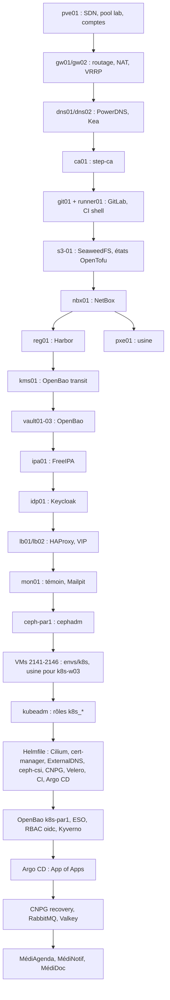

# Carte d'amorçage de MédiSphère (PLAT-3101)

> Propriétaire : équipe Plateforme · Relecture : Karim Benali, Sophie Laurent · Version de référence (corrigé F1-S01).
> Périmètre : toute la plateforme du site PAR1 (socle v5, `ceph-par1`, `k8s-par1`), depuis un `pve01` nu et `pbs01` intact.
> Les durées marquées **(m)** sont mesurées (mini-projets, tests chronométrés) ; **(e)** est une estimation, justifiée en note.
> Aucune valeur secrète dans ce document : seulement des emplacements.

## 1. Ordre de construction

| # | Brique | Dépend de | Construite par (dépôt, outil) | Prête quand | Durée |
|---|---|---|---|---|---|
| 0 | `pve01` (SDN `lab`, pool `lab`, comptes `wb-*`, stockages) | — | à la main (M00) puis rôles `pve_*` | `pvesh get /cluster/sdn/vnets` liste les 13 VNets | 1 h (e) |
| 1 | `gw01`, `gw02` | 0 | `gw01` à la main (M00, ADR-0051) ; `gw02` état `socle` + rôles `pare_feu`, `keepalived`, `frr`, `wireguard` | VIP `.1` sur chaque VLAN, `wg0` vers `pbs01` | 2 h (e) |
| 2 | `dns01`, `dns02` | 1 | état `socle` + `playbooks/dns01.yml` (`powerdns_auth`, `powerdns_recursor`, `kea_dhcp4`) | `dig @10.10.20.10 git01.par1.medisphere.internal` ; zones signées | 1 h 30 (m, M06-E46) |
| 3 | `ca01` | 2 | état `socle` + rôle `step_ca` ; **racine hors ligne** (§3) | `step ca health` ; ACME répond | 1 h (e) |
| 4 | `git01`, `runner01` | 2, 3 | état `socle` + rôles `gitlab`, `gitlab_runner` ; **dépôts restaurés** depuis la sauvegarde GitLab (PBS + `gitlab-backup`) | runner `shell` en ligne, `plateforme/*` lisibles | 3 h (e : restauration ≈ 1 h) |
| 5 | `s3-01` | 2, 3, 4 | état `socle` (état **local** d'amorçage, puis migré, RB-051) + rôle `seaweedfs` | compartiments `tofu-state`, `etcd-k8s-par1`, `velero-k8s-par1`, `cnpg-k8s-par1` lisibles | 1 h (m, M05) |
| 6 | `nbx01` | 2, 3, 5 | état `socle` + rôle `netbox` ; base restaurée | API répond au jeton `wb-checks` | 1 h 30 (e) |
| 7 | `reg01` (Harbor) | 3, 5 | état `socle` + rôle `harbor` + état `registre` ; données restaurées (RB-131) | caches et projets ; signatures vérifiées sur un échantillon | 2 h (e) |
| 8 | `kms01` puis `vault01-03` | 2, 3, 5 | rôles `openbao_kms`, `openbao` ; **descellement Shamir de `kms01`** (§3) ; instantané Raft de `openbao-instantanes` ; état `secrets` | `bao status` : `Sealed false` sur les trois nœuds | 2 h (m, M25-E26 : restauration 1 h 10) |
| 9 | `ipa01`, `idp01` | 3, 8 | rôles `freeipa_serveur`, `keycloak` ; `ipa-backup` restauré ; état `identite`, `annuaire/` | connexion SSO + OTP d'un compte de test | 3 h (e) |
| 10 | `lb01`, `lb02`, `mon01` | 3, 9 | état `socle` + rôles `haproxy`, `keepalived`, `mailpit`, `supervision_temoin` | `sso.par1.medisphere.internal` répond par la VIP | 1 h 30 (m, F1-S05 pour une VM) |
| 11 | `pxe01` | 2, 3, 6 | état `envs/provisioning` + rôle `pxe` + job `deployer` | `lab/bin/check 11 25` | 1 h (m, M11-E25) |
| 12 | `ceph-par1` | 1, 2, 3 | état `envs/ceph` + `plateforme/ceph` (cephadm) ; **volumes conservés** (on ne reconstruit Ceph que si ses disques sont perdus) | `HEALTH_OK` | 4 h (e) si perdu ; 0 sinon |
| 13 | VMs `k8s-*` (2141-2146) | 1, 2, 6, 7 ; 11 pour `k8s-w03` | état `envs/k8s` (module `vm-noeud`, `usine.tf`) | VMs démarrées, SSH | 30 min (e) + 30 min usine |
| 14 | cluster kubeadm | 7, 8 (images, secrets d'amorçage), 9 (OIDC) | `playbooks/k8s-noeuds.yml`, `k8s-cluster.yml` | six nœuds `Ready`, VIP 10.10.40.200:8443 | 1 h 30 (e) |
| 15 | couche de base | 7, 12, 14 | `helmfile apply` de `plateforme/k8s` (ordre des releases, CRD d'abord) + `outils/secrets-k8s.sh` (amorçage) | toutes les releases `deployed`, Gateway `gw-par1` programmée | 1 h (e) |
| 16 | identité et secrets du cluster | 8, 9, 15 | état `secrets` (méthode `k8s-par1` : nouvelle CA, émetteur) ; ESO, ClusterSecretStore `openbao` ; RBAC `oidc:*` ; Kyverno | tout `ExternalSecret` `Ready` | 1 h (e) |
| 17 | plateforme | 15, 16 | Argo CD : application racine de `plateforme/gitops` | toutes les Applications `Synced/Healthy` | 2 h (e : synchronisation par vagues) |
| 18 | données | 5, 17 | CNPG `bootstrap.recovery` depuis `cnpg-k8s-par1` ; topologie RabbitMQ + import des définitions ; Valkey vide (cache) | comptes de `reference-avant.md` retrouvés | 1 h (m, M16 : restauration CNPG 25 min) |
| 19 | applications et première livraison | 17, 18 | Argo CD (ApplicationSets) ; MR → CI → promotion | MédiAgenda sert la prod, canary terminé | 1 h (e) |

**Total** : socle complet depuis rien ≈ 25 h de travail (e) ; **reconstruction de `k8s-par1` seul** (étapes 13 à 19, socle debout) ≈ **8 h 30** (e), chemin critique 13 → 14 → 15 → 16 → 17 → 18.

## 2. Dépendances circulaires

| Cycle | Comment on le casse aujourd'hui | Pour le casser mieux |
|---|---|---|
| **GitLab héberge le code de GitLab** (rôle `gitlab`, état `socle`) | copies de travail de `plateforme/ansible` et `plateforme/infra` sur `adm01` (`~/src`), `tofu` et `ansible-playbook` lancés depuis `adm01` ; dépôts restaurés depuis la sauvegarde GitLab | miroir en lecture des dépôts de plateforme sur `pbs01` (PAR2), testé chaque mois |
| **Harbor sert les images de Harbor** et du cluster | installateur **hors ligne** de Harbor (archive conservée sur `hdd-bulk`), images de Harbor embarquées ; cluster : caches `dockerhub`, `quay`, `ghcr`, `k8s` repeuplés depuis Internet | archive de l'installateur et des images de la couche de base dans `s3-01` (compartiment dédié), versionnée |
| **OpenBao lit les mots de passe Ansible Vault, et Ansible installe OpenBao** | `outils/vault-pass-client.sh` retombe sur `~/.config/workbook/ansible-vault*.pass` d'`adm01` quand le coffre est fermé (bris de glace M25) | copie scellée des deux mots de passe au coffre physique (§3), contrôlée chaque trimestre |
| **`vault01-03` sont descellés par `kms01`**, lui-même scellé par Shamir | 3 parts sur 5 détenues par trois personnes différentes | quatrième détenteur à PAR2 |
| **ESO a besoin d'OpenBao, qui a besoin de la méthode `k8s-par1`, qui a besoin du cluster** (CA, émetteur, jeton de relecture) | script d'amorçage `secrets-k8s.sh` (racine MédiSphère, identité d'ESO) ; méthode reconfigurée par l'état `secrets` **après** l'installation du cluster, avec la nouvelle CA | étape explicite de l'état `secrets` paramétrée par la CA lue dans le nouveau `admin.conf` |
| **Keycloak pour se connecter à tout** (GitLab, Argo CD, Proxmox, cluster) | comptes de bris de glace RB-240 : `root` GitLab, `root@pam`, `admin.conf`, `admin` local des VMs, compte `admin` du royaume `master` | test trimestriel de chaque compte de bris de glace |
| **Sauvegardes sur `s3-01` et `pbs01`**, dont la restauration exige les outils restaurés | `pbs01` est physique (PAR2) et indépendant du lab virtuel ; `s3-01` reconstruit tôt (étape 5) ; clés `age` hors ligne | copie de `s3-01` vers PAR2 (F5) |
| **DNS du lab servi par des VMs que le DNS nomme** | adresses IP en dur dans les runbooks de reconstruction des étapes 1 à 3 | — (acceptable) |

## 3. Secrets hors du code

| Secret | Emplacement | Détenteurs | Vérification (sans exposer) | Si perdu |
|---|---|---|---|---|
| Parts Shamir de `kms01` (5, seuil 3) | enveloppes scellées n° 1 à 5 : coffre DSI (PAR1) ×2, coffre PAR2 ×1, Claire, Karim | Claire, Karim, Sophie | inventaire des scellés chaque trimestre (pas d'ouverture) | `kms01` irrécupérable : ré-initialisation, perte des clés de transit → chiffrements `transit` perdus |
| Clé racine « MédiSphère Root CA » (`~/pki-racine`, chiffrée) | support hors ligne au coffre + copie à PAR2 | Sophie, Karim | cérémonie annuelle : empreinte de la racine publiée = celle du support | plus d'intermédiaire nouveau ; tout le lab à re-signer |
| Mots de passe des identités Ansible Vault `lab` et `critique` | `kv/plateforme/ansible-vault/{lab,critique}` ; copie scellée au coffre ; `~/.config/workbook/` d'`adm01` | équipe Plateforme | `ansible-vault view` d'un fichier témoin par le pipeline | fichiers `vault-*.yml` illisibles |
| Clés privées `age` (etcd, instantanés Raft d'OpenBao) | `~/.config/workbook/` d'`adm01` ; copie scellée | Karim | déchiffrement d'un instantané récent (S04) | instantanés illisibles |
| Phrase de chiffrement des états OpenTofu | `kv/plateforme/tofu/*` ; copie scellée | équipe Plateforme | `tofu plan` d'un état | états illisibles (reconstruction par import) |
| Comptes de bris de glace (RB-240) | gestionnaire de mots de passe hors ligne ; `admin.conf` et `super-admin.conf` en Ansible Vault `critique` | Claire, Karim | test trimestriel tracé | plus d'accès si l'IdP tombe |
| Clé Cosign (`transit/cosign-medisphere`) | dans OpenBao (non exportable) | — | signature d'essai par le runner protégé | nouvelle clé, politiques Kyverno à mettre à jour |
| Jetons d'automatisation (`wb-tofu`, `wb-ansible`, `wb-provision`…) | variables protégées de CI, `~/.config/workbook/` | équipe Plateforme | pipelines verts | régénérés depuis `root@pam` |

## 4. Non couvert

- Perte de `pve01` lui-même (matériel) : final F5 (PRA).
- Restauration de GitLab depuis PAR2 sans PAR1 : F5.
- Réinstallation de `pbs01` : jamais (il porte les sauvegardes).
