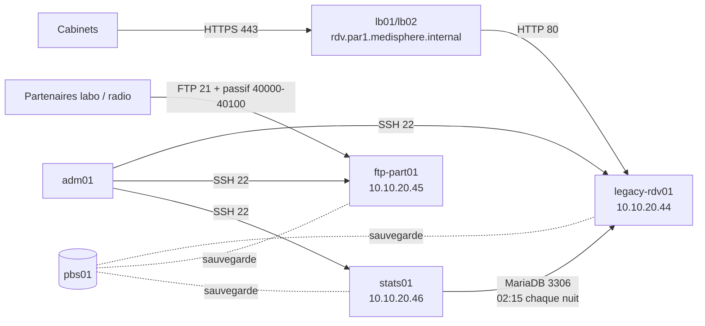

# Migration du VMware d'InfoGér vers Proxmox VE (CHG-3409)

> Statut : **validé** le <DATE> par Claire Morel (responsable infrastructure) et Sophie Laurent (RSSI) ; Nadia Roussel (support) informée.
> Fiche de mise en œuvre : [CHG-3410](fiches/CHG-3410.md). Inventaire découvert : [inventaire-reel.csv](inventaire-reel.csv).
> Exemple de référence (F4-S09) : les nombres exacts dépendent de la date de fabrication de l'export.

## 1. Contrôle de la livraison

| VM | Manifeste | Sommes « du courriel » | Disque | Remarques |
|---|---|---|---|---|
| `legacy-rdv01` | conforme | conformes | VMDK *streamOptimized*, 8 Gio virtuels | — |
| `ftp-part01` | conforme | conformes | idem | — |
| `stats01` | conforme | conformes | idem | — |

Le manifeste voyage avec les fichiers : il prouve la cohérence, pas l'authenticité. Les sommes reçues par un autre canal (courriel du support InfoGér, archivé dans le ticket CHG-3409) sont la seule preuve que l'export n'a pas été modifié depuis InfoGér.

Matériel déclaré (descripteurs OVF 1.0, matériel virtuel `vmx-19`, type `debian12_64Guest`) :

| VM | vCPU | Mémoire | Contrôleur | Carte | MAC | Micrologiciel |
|---|---|---|---|---|---|---|
| `legacy-rdv01` | 2 | 2048 Mo | `VirtualSCSI` (pvscsi) | `VmxNet3` | 00:50:56:8a:21:01 | EFI, Secure Boot désactivé |
| `ftp-part01` | 1 | 1024 Mo | `VirtualSCSI` (pvscsi) | `VmxNet3` | 00:50:56:8a:30:01 | EFI, Secure Boot désactivé |
| `stats01` | 1 | 1024 Mo | `lsilogic` | `VmxNet3` | 00:50:56:8a:40:01 | BIOS |

Ce qui posera problème à l'import (`qm importovf`, Proxmox VE 9) : la commande ne reprend que le nom, les cœurs, la mémoire et les disques (placés sur le contrôleur SCSI par défaut de Proxmox) ; **ni la carte réseau, ni le micrologiciel, ni le type de système** (l'assistant d'import de l'interface, lui, lit aussi le modèle de carte et le micrologiciel). Une VM EFI importée en BIOS par défaut peut ne pas démarrer : micrologiciel à reposer à la main, disque EFI sans clés préchargées (Secure Boot désactivé à l'origine). La carte doit être recréée en `virtio` ; le nom d'interface changera (`ens192`, emplacement PCI 192 chez VMware → `ens18` chez Proxmox).

## 2. Inventaire découvert

Audit hors ligne (`inspecter-export.sh` : `virt-inspector`, `virt-cat`, `guestfish --ro` sur les VMDK, aucun démarrage). Détail : [inventaire-reel.csv](inventaire-reel.csv). Écarts avec la fiche d'InfoGér :

- `stats01` **a** une adresse (192.168.50.40) et **dépend** de `legacy-rdv01` (lecture de la base chaque nuit à 02:15, compte MariaDB `stats` limité à l'hôte 192.168.50.40, nom `legacy-rdv01.infoger.local` résolu par `/etc/hosts`). Personne ne lit ses fichiers depuis la suppression du partage de la direction (2020).
- `legacy-rdv01` : la base écoute sur **toutes** les interfaces (port 3306) ; un vidage SQL **non chiffré** de la base est fait chaque nuit dans `/var/backups/infoger/` (7 jours gardés) : ce sont des données de santé à inclure dans le décommissionnement.
- `legacy-rdv01` : environ 2 600 rendez-vous ; environ 290 pièces jointes **référencées** en base mais seulement environ 120 **présentes** sur le disque (la purge nocturne efface les fichiers de plus d'un an sans mettre la base à jour) : la différence n'est pas une perte due à la migration, elle existe avant. Rendez-vous témoins `dr-temoin` (identifiants 9001 à 9003) repérés pour les contrôles de la bascule.
- `ftp-part01` : FTP **en clair** (TLS « prévu en 2022 »), adresse passive annoncée en dur (`pasv_address=192.168.50.30`), deux comptes partenaires avec un shell `nologin` ajouté à `/etc/shells` pour satisfaire PAM.
- Toutes : cloud-init désactivé, `open-vm-tools` actif, compte `infoger` (sudo avec mot de passe, clé SSH d'InfoGér), SSH limité à `AllowUsers infoger`, `root` verrouillé. Aucun identifiant transmis : la reprise de main se fera hors ligne (disque de la VM arrêtée), pas par cloud-init.

Secrets trouvés en clair (non recopiés ici) : mot de passe du compte applicatif dans `/var/www/legacy-rdv/config.php` (celui de 2014), mot de passe du compte `stats` dans `/etc/stats/stats.cnf` de `stats01`. Traitement : changés à la migration (stats) ou à la sortie de la VM (F4-S12), puis effacés avec les disques (F4-S14).

## 3. Dépendances et flux

Si `legacy-rdv01` change d'adresse avant `stats01` : la statistique de la nuit échoue (nom résolu par `/etc/hosts` vers l'ancienne adresse). Si `stats01` change d'adresse avant que le compte `stats` soit re-adressé : refus d'accès (`'stats'@'10.10.20.46'` inconnu). Les deux changent dans la même vague.

## 4. Vagues

| Vague | VMs | Pourquoi | Fenêtre |
|---|---|---|---|
| 1 | `ftp-part01` | indépendante, faible risque, valide la méthode (import, EFI, renommage d'interface, reprise de main) | mardi 20:00-21:00 (fenêtre du mardi), partenaires prévenus J-7 (dépôts refusés pendant la fenêtre, à refaire après) |
| 2 | `legacy-rdv01` **et** `stats01` | couplées (base, compte `stats`, nom) ; les cabinets ne travaillent pas le samedi matin | samedi 08:00-10:00 (fenêtre longue du samedi), cabinets prévenus J-7 par Nadia (bandeau, courriel) |

Re-adressage : 192.168.50.21/.30/.40 → **10.10.20.44/.45/.46**, passerelle 10.10.20.1, résolveurs 10.10.20.10 et 10.10.20.16, domaine `par1.medisphere.internal`. Ce qui doit suivre dans les VMs : `/etc/network/interfaces` (et le nom `ens18`), `/etc/resolv.conf`, `/etc/hosts`, `pasv_address` de vsftpd, `host` de `/etc/stats/stats.cnf` (vers `legacy-rdv01.par1.medisphere.internal`), compte MariaDB `'stats'@'192.168.50.40'` → `'stats'@'10.10.20.46'`. Noms DNS et NetBox par OpenTofu (`envs/f4-infoger`). Nom des cabinets : `rdv.par1.medisphere.internal`, CNAME vers la VIP des répartiteurs, servi par `lb01`/`lb02` dès la vague 2.

## 5. Critères, retour arrière, mesures (par vague)

**Go** : export vérifié ; sauvegarde PBS de la veille de tout ce qui est touché ; flux ouverts (répartiteurs → 10.10.20.44:80, `adm01` → 21 et 40000-40100 de 10.10.20.45) ; sonde de continuité verte depuis 24 h ; personne d'astreinte disponible.
**No-go** : une somme qui ne correspond pas, un incident en cours, la sonde rouge.
**Succès** (observables) : agent QEMU qui répond, adresses et noms corrects, page d'accueil de Legacy-RDV par `rdv.par1.medisphere.internal`, dépôt FTP passif de test, statistique de la nuit non vide ; `tofu plan` vide.
**Retour arrière** : VM importée arrêtée et supprimée (`qm destroy` après sauvegarde), ré-import depuis l'export intact (20 min par VM) ; publication de `rdv` retirée des répartiteurs (variable, 5 min). Point de non-retour : aucun, tant que l'export est intact et que Legacy-RDV n'a pas reçu d'écriture côté MédiSphère qui n'existe pas dans l'export — après la vague 2, les nouveaux rendez-vous rendent le retour vers l'export **destructeur** : le retour arrière devient « réparer en avant ».
**Mesures** : sonde de Legacy-RDV par `rdv` (disponibilité, latence) et dépôt FTP passif de test sur `ftp-part01`, relevés avant, pendant et après chaque vague, dans la fiche.

## 6. Ce qui ne migre pas tel quel

| Écart aux standards | Décision |
|---|---|
| Debian 12 (hors référentiel CIS Debian 13 du rôle `durcissement`) | exception EXC-H déclarée jusqu'au décommissionnement de chaque VM ; mises à jour de sécurité automatiques ; `legacy-rdv01` remplacée par Kubernetes (F4-S12/S13) |
| `open-vm-tools`, pas d'agent QEMU | corrigé à la migration |
| Compte et clé d'InfoGér, `AllowUsers infoger` | corrigé à la migration (compte verrouillé, clé supprimée, `admin` + clé d'`adm01`) |
| Mot de passe de 2014 dans `config.php` | inchangé sur la VM jusqu'à F4-S12 (la base n'écoute qu'en local pour ce compte) ; mort à la sortie de la VM |
| MariaDB sur toutes les interfaces | limité par le pare-feu local (3306 depuis 10.10.20.46 seulement) jusqu'à F4-S13 |
| FTP en clair | exception déclarée, date de revue J+90 ; FTPS ou SFTP à négocier avec les partenaires (hors F4) |
| Répartiteurs → `legacy-rdv01` en HTTP | exception déclarée jusqu'à la bascule (F4-S13) |
| Journaux en fichiers | collecte journald + fichiers par le rôle `alloy` |
| Vidages SQL locaux non chiffrés | conservés tant que la VM vit (copie de secours), effacés au décommissionnement (F4-S14) |
