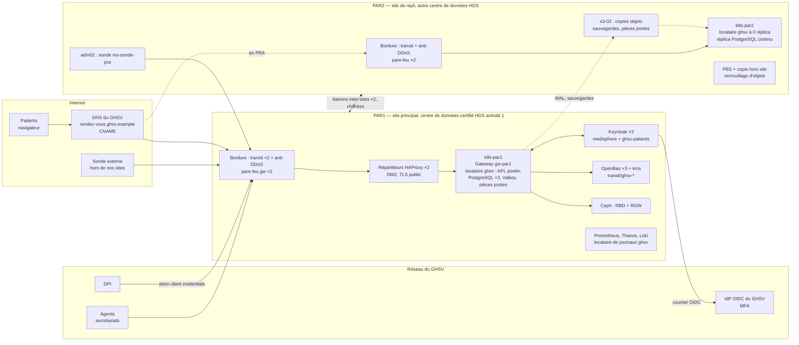

# Architecture cible de production — offre GHSV

> PLAT-3703 (F7-S03). Auteur : équipe Plateforme. Relu par Karim Benali (ensemble) et Sophie Laurent (exposition, isolation).
> Entrées : [`exigences.md`](exigences.md) (`NF-nn`), [`analyse-cdc.md`](analyse-cdc.md) (`H-nn`), réponses du GHSV (`R-nn`), mesures de la plateforme. Décisions détaillées : ADR-0370 à ADR-0374 (`adr/`).
> Les valeurs entre crochets `[lab de référence]` sont celles du corrigé du workbook : **remplace-les par tes mesures** (méthode au §5.1).

## 1. Principes

1. **Même plateforme, même code** : le GHSV est un locataire de la plateforme de production de MédiSphère (ADR-0370), avec les briques que le lab démontre (Proxmox VE, Ceph, Kubernetes et Cilium, CloudNativePG, Keycloak, OpenBao, Argo CD, Prometheus/Thanos/Loki, PBS). Aucun produit nouveau, sauf pour ce que le lab n'a pas : l'exposition à Internet.
2. **Deux sites actifs/passif** : PAR1 sert, PAR2 est un site de repli **à pleine capacité** pour le GHSV (NF-08), tiède (applications à 0 réplica, données répliquées en continu), comme au F5.
3. **Isolation par les données, les clés et les accès**, pas par le matériel (ADR-0370, ADR-0371).
4. **Tout se mesure de l'extérieur** : sondes depuis PAR2 et depuis un point hors de nos sites (NF-01).

## 2. Vue d'ensemble

**Flux**
- **Patients** : `rendez-vous.ghsv.example` (zone du GHSV) est un CNAME vers `ghsv.clients.medisphere.example` (zone publique de MédiSphère, TTL 60 s), qui pointe l'adresse publique de PAR1, ou de PAR2 en PRA. TLS terminé sur les répartiteurs (certificat public ACME), re-chiffré jusqu'à la Gateway.
- **DPI** : même nom (`/api/v1`), jeton OAuth 2.0 *client credentials* émis par notre Keycloak (client `ghsv-dpi`, portées `rdv:lecture` et `rdv:ecriture`, ADR-0372), plus liste d'adresses sources du GHSV sur les répartiteurs.
- **Agents** : interface des agents → Keycloak (royaume `medisphere`, fournisseur d'identité `ghsv-idp`) → IdP du GHSV (MFA chez lui) → retour ; aucun mot de passe d'agent chez nous.
- **Données vers PAR2** : WAL et sauvegardes de base par le stockage objet (topologie distribuée CloudNativePG du F5), objets (pièces jointes, sauvegardes Velero) copiés vers `s3-02`, images vers `reg02`, dépôts Git vers les miroirs d'`adm02`.

## 3. PAR1 — site principal

| Couche | Production | Remarques |
|---|---|---|
| Hébergement | 2 baies dans un centre de données certifié HDS activité 1 (H-A1), alimentations A+B, ≈ 8 kW par baie | contrat d'hébergement existant (hypothèse) |
| Bordure | 2 accès Internet de deux opérateurs (transit), protection volumétrique contre le déni de service de l'opérateur ; 2 routeurs-pare-feu physiques Linux/nftables en VRRP (le `gw01`/`gw02` du lab, sur matériel) | adresses publiques en propre ou de l'hébergeur (H-A3) |
| DMZ | 2 répartiteurs HAProxy (VMs, keepalived, VIP publique), limites de débit par adresse, seules les routes publiées (contrat A1, interfaces) passent, en-têtes de sécurité | pare-feu applicatif : non retenu en v1 (§8) |
| Calcul et stockage | **6 hyperviseurs** Proxmox VE 9.2 en grappe, Ceph 20.2 hyperconvergé (H-A2) : chacun 1 × 32 cœurs, 512 Go, 2 × NVMe 960 Go (système), 4 × NVMe 7,68 To (OSD), 4 × 25 GbE | existant ; **aucun ajout pour le GHSV** (§5) |
| Réseau interne | 2 commutateurs 25 GbE (MLAG), VLAN du plan d'adressage du lab, réseau Ceph dédié | existant |
| Kubernetes | `k8s-par1` : 3 nœuds de contrôle, 8 travailleurs (16 vCPU, 64 Go) ; Cilium (BGP vers les routeurs), Gateway `gw-par1`, Capsule, Kyverno, Falco/Tetragon | locataire `ghsv` (ADR-0370) |
| Données du GHSV | `Cluster` CloudNativePG dédié dans `ghsv-prod` : 3 instances (1 primaire, 2 réplicas, un synchrone dans le site), pooler PgBouncer ×2 ; Valkey dédié (cache) ; compartiment RGW dédié aux pièces jointes (nom proposé `ghsv-pieces-jointes`), chiffrement côté serveur par la clé `transit/ghsv-*` (ADR-0371) | |
| Identité | Keycloak en grappe de **3 nœuds** (base PostgreSQL en haute disponibilité) : royaume `medisphere` (personnels, fournisseur d'identité `ghsv-idp` pour les agents, client `ghsv-dpi`) et royaume dédié `ghsv-patients` (comptes locaux, ADR-0372) | dans le lab : `idp01` seul (M24) |
| Secrets | OpenBao 3 nœuds + `kms01` (auto-descellement) ; moteur `transit` : clés `ghsv-*` | |
| Observabilité | Prometheus ×2 + Thanos, Loki avec un **locataire de journaux `ghsv`** (rétention 365 j) et copie quotidienne en verrouillage d'objets (F6), Alertmanager, Grafana (dossier GHSV pour le rapport mensuel) | |
| Sauvegardes | PBS à PAR2 (VMs), Velero et Barman Cloud vers le stockage objet, copie hors site (§4) | |

## 4. PAR2 — site de repli

| Couche | Production | Remarques |
|---|---|---|
| Hébergement | 1 baie dans un **autre** centre de données certifié HDS activité 1, à plus de 50 km de PAR1 et hors de la zone inondable de la Seine (H-A4) | aujourd'hui (hypothèse H-A5) : PBS et un petit nœud, comme `hp01` |
| Bordure | 1 accès Internet (opérateur différent de PAR1) avec protection contre le déni de service ; 2 routeurs-pare-feu | **nouveau** : sans lui, aucun patient ne joint PAR2 en PRA |
| Calcul et stockage | **3 hyperviseurs** Proxmox VE + Ceph (1 × 32 cœurs, 256 Go, 4 × NVMe 7,68 To, 4 × 25 GbE) ; PBS existant | **nouveau** (§5.3) |
| Kubernetes | `k8s-par2` : 3 nœuds de contrôle légers, 3 travailleurs (16 vCPU, 64 Go) ; Cilium (BGP ou annonces L2 selon le réseau de l'hébergeur) ; Argo CD sur les miroirs d'`adm02` | dans le lab : un nœud de 5 Go |
| Données | réplica continu du `Cluster` du GHSV en topologie distribuée (2 instances) ; `s3-02` (SeaweedFS) reçoit les copies d'objets ; `reg02` | |
| Identité, secrets | Keycloak de repli (2 nœuds, base répliquée) ; `bao-par2` et `kms01` restaurés (procédure du F5) | |
| Sauvegarde hors site | copie des sauvegardes dans un troisième lieu de l'EEE (stockage objet avec verrouillage d'objets, chiffré par nos clés) : règle 3-2-1, et protection contre un rançongiciel qui atteindrait PAR1 et PAR2 | **nouveau** |

### 4.1 Bascule du GHSV vers PAR2 et retour

ADR-0373 : décision par la cellule de crise (critères du F5) ; promotion du réplica PostgreSQL (`promotionToken` si PAR1 est encore joignable, promotion forcée sinon) ; mise à l'échelle des applications du locataire ; vérifications (sondes, témoin de RPO) ; bascule du CNAME public `ghsv.clients.medisphere.example` vers l'adresse de PAR2 ; information du GHSV ; réconciliation des rendez-vous (RB-371). Retour : comme au F5 (ancien primaire reconstruit en réplica, retour contrôlé par jetons).

## 5. Dimensionnement

### 5.1 Mesure du coût par requête

Méthode (recette de MédiAgenda, données factices du M29) : TestRun du M29-E14 à deux paliers stables de 10 minutes (`TAUX_CIBLE=20` puis `40`), `testid` `capa-ghsv-20` et `capa-ghsv-40` ; sur chaque palier, débit servi (`sum(rate(mediagenda_http_requests_total{namespace="mediagenda-recette"}[5m]))`), CPU par composant (`sum by (container) (rate(container_cpu_usage_seconds_total{namespace="mediagenda-recette"}[5m]))`), mémoire de travail, nombre de pods (HPA), p95/p99 serveur.

| Palier | Débit servi | Pods API | CPU API | CPU PostgreSQL (primaire) | CPU pooler + Valkey | p95 / p99 serveur |
|---|---|---|---|---|---|---|
| 20 it/s | `[≈ 80 req/s]` | `[2]` | `[0,62 vCPU]` | `[0,21 vCPU]` | `[0,05 vCPU]` | `[78 ms / 140 ms]` |
| 40 it/s | `[≈ 158 req/s]` (référence M29 : 158,4) | `[4]` | `[1,18 vCPU]` | `[0,39 vCPU]` | `[0,08 vCPU]` | 112 ms / 205 ms (référence M29) |

Coût marginal `[lab de référence]` : API ≈ **0,72 vCPU** et PostgreSQL ≈ **0,23 vCPU pour 100 req/s** ; mémoire stable (≈ 180 Mo par pod d'API, PostgreSQL dominé par son cache).

### 5.2 Du coût mesuré au besoin du GHSV

| Étape | Facteur | Justification |
|---|---|---|
| Capacité à tenir | 300 req/s | NF-07 (pointe d'octobre de l'année 5) |
| Mélange de requêtes | × 1,0 | le parcours du M29 écrit à 50 % (création + annulation sur ≈ 4 requêtes) ; le GHSV ≈ 15 % (H-01) : on garde le parcours, plus lourd, comme borne haute |
| Processeurs de production / lab | × 1,3 | le Xeon E-2378G du lab a une fréquence élevée ; un processeur serveur à 32 cœurs est plus lent par cœur (prudence, à remesurer sur le matériel livré) |
| Utilisation cible | ÷ 0,5 | HPA à 70 % des `requests`, marge pour un nœud perdu et les pics de quelques secondes |

| Composant du locataire | Calcul | PAR1 (réservé) | PAR2 (réservé) |
|---|---|---|---|
| API MédiAgenda | 0,72 × 3 × 1,3 ÷ 0,5 ≈ 5,6 | 6 vCPU (HPA 4 à 10 pods de 1 vCPU, 512 Mio) | 6 vCPU (0 réplica en veille) |
| PostgreSQL | 0,23 × 3 × 1,3 ÷ 0,5 ≈ 1,8 par instance | 3 instances × 2 vCPU, 8 Gio, 50 Gio | 2 × 2 vCPU, 8 Gio |
| Pooler, Valkey | mesure + marge | 1,5 vCPU, 2 Gio | 1 vCPU, 2 Gio |
| Pièces jointes (service et RGW) | ≈ 2,5 Mo par dépôt, < 2 dépôts/s en pointe | 1 vCPU, 2 Gio ; **3 To utiles → 9 To bruts** (réplication ×3) | `s3-02` : 3 To utiles (+ marge 50 %) |
| Keycloak (part GHSV : patients et agents) | connexions en pointe à mesurer (hachage des mots de passe coûteux) | 6 vCPU, 12 Gio (moitié de la grappe) | 4 vCPU, 8 Gio |
| Observabilité (part) | 57 M requêtes/mois de journaux, séries du locataire | 2 vCPU, 8 Gio, 0,2 To | 1 vCPU, 4 Gio |
| **Total GHSV** | | **≈ 23 vCPU, ≈ 60 Gio, ≈ 10 To bruts** | **≈ 19 vCPU, ≈ 45 Gio, ≈ 5 To** |

### 5.3 Serveurs

- **PAR1** : la grappe existante (6 × 32 cœurs = 384 fils, 3 To de mémoire, ≈ 36 To Ceph utilisables à 70 % avec un hôte perdu) en a largement la place : le GHSV y représente ≈ 6 % du calcul, 2 % de la mémoire et 9 % du stockage. **Aucun serveur ajouté** ; la marge N+1 existante est vérifiée par la revue de capacité trimestrielle.
- **PAR2** : la capacité de repli du GHSV (≈ 19 vCPU) **plus** celle des autres services couverts par le PRA du F5 (MédiAgenda, MédiDoc, Legacy-RDV, socle de repli) dépasse ce qu'offre un nœud de secours. **3 hyperviseurs** (le minimum pour une grappe Proxmox et Ceph à 3 répliques sans QDevice externe), dimensionnés à 256 Go, chacun capable de perdre un voisin pendant un PRA en mode dégradé écrit (NF-08 sans N+1).
- Conclusion : **ce n'est pas la charge du GHSV qui dimensionne, c'est la redondance** (PAR2 à pleine capacité, Keycloak en grappe, deux accès Internet). C'est ce que le chiffrage doit montrer (S05).

## 6. Exposition à Internet

| Élément | Choix | Pourquoi |
|---|---|---|
| Noms | `rendez-vous.ghsv.example` (GHSV) → CNAME → `ghsv.clients.medisphere.example` (TTL 60 s) | le GHSV garde son nom ; la bascule PRA se fait dans **notre** zone, sans dépendre de son DNS |
| DNS public | zone `medisphere.example` servie par deux fournisseurs DNS de l'EEE (secondaires), primaire caché chez nous | un seul fournisseur DNS = un point unique de défaillance |
| Certificats | AC publique par ACME (défi HTTP-01 sur le nom du GHSV, possible puisque le CNAME pointe chez nous), renouvellement automatique, supervision de l'échéance ; durées de vie des certificats publics en baisse : l'automatisation est obligatoire | les AC internes (step-ca, OpenBao) ne sont pas reconnues par les navigateurs des patients |
| Déni de service | protection volumétrique des opérateurs de transit (couches 3-4) ; limites de débit par adresse et par route sur les répartiteurs (couche 7) ; file d'attente plutôt que refus pour l'interface des patients en pic | ENF-02, ENF-09 |
| Filtrage | seules les routes publiées passent ; `/docs` et `/metrics` de l'API jamais publiés ; API du DPI limitée aux adresses du GHSV | surface d'attaque minimale |
| Bourrage d'identifiants | protections de Keycloak (détection de force brute), limites de débit sur les points de connexion du royaume `ghsv-patients` | ESC-05 |

## 7. Ce qui change par rapport au lab

| Élément | Lab | Production | Conséquence |
|---|---|---|---|
| Hyperviseurs | `pve01` seul, Ceph et Proxmox **imbriqués** | 6 + 3 serveurs physiques, Ceph sur NVMe | une panne matérielle ne coupe plus tout ; mesures de performance à refaire |
| Site de repli | `hp01` : 16 Go, un nœud de 5 Go, applications à 0 réplica | 3 hyperviseurs, capacité complète du GHSV | PRA réel (NF-08), coût (S05) |
| Interconnexion | tunnel WireGuard sur le réseau domestique | 2 liaisons d'opérateurs différents, chiffrées (WireGuard ou IPsec sur des liens de niveau 2/3) | latence et débit garantis ; plus de lien unique |
| Exposition | aucune (réseau isolé, VPN d'administration) | Internet, adresses publiques, anti-DDoS, AC publique | nouvelle surface d'attaque, test d'intrusion (ESC-09) |
| DNS | PowerDNS interne ; nom global du client `ghsv.medisphere.internal` (CNAME vers PAR1 ou PAR2, F7-S10, comme au F5) | + zone publique `medisphere.example` chez deux fournisseurs | bascule par CNAME public, même principe |
| Fournisseur d'identité | `idp01` seul ; IdP du GHSV **simulé** par le royaume `ghsv-idp` | Keycloak en grappe (3 + 2) ; IdP réel du GHSV, hors de notre contrôle | haute disponibilité de la connexion ; exclusion contractuelle des pannes de l'IdP du GHSV |
| Comptes des patients | aucun | royaume `ghsv-patients` (≈ 540 000 comptes à 5 ans) | dimensionnement de Keycloak à mesurer (hachage) |
| Messagerie | Mailpit | passerelle SMS et relais de courriel d'opérateurs de l'EEE | coût (≈ 1 million de SMS/an), transfert hors EEE à exclure |
| Sauvegardes | PBS sur `hp01` | PBS à PAR2 + copie hors site verrouillée | 3-2-1, protection contre le rançongiciel |
| Sondes | `mon01` (PAR1), `ms-sonde-pra` (PAR2) | + sonde hors de nos sites | mesure contractuelle indépendante (NF-01) |
| Équipe | toi | astreinte 24 h/24, support le samedi | organisation et coût (S06, S05) |
| Données | factices | données de santé réelles | aucune donnée réelle hors production (ESC-13), accès tracés (ESC-11) |

## 8. Points uniques de défaillance restants

| Point | Effet | Décision |
|---|---|---|
| IdP du GHSV | aucun agent ne se connecte (les patients et le DPI fonctionnent) | **accepté**, exclu contractuellement de NF-01 (hors de notre contrôle), supervisé par une sonde pour le prouver |
| Primaire PostgreSQL | bascule automatique sur un réplica en ≈ 30 s (écritures refusées pendant ce temps) | accepté, dans le budget d'erreur |
| Valkey (instance unique) | cache perdu : réponses calculées depuis la base (mode dégradé conçu au M27) | accepté |
| `kms01` | nécessaire seulement au redémarrage d'un nœud OpenBao ; s'il est arrêté à ce moment, OpenBao ne se descelle pas | accepté avec procédure (restauration PBS, F5) ; un second serveur de clés à PAR2 étudié |
| Site PAR1 | PRA (RTO 4 h) | par construction |
| Fournisseur de SMS | rappels non envoyés (P2) | second fournisseur en secours (contrat à faire) |
| Équipe | astreinte | S06 : rotation à cinq, recrutement |
| Pare-feu applicatif | absent en v1 | **à décider** : le test d'intrusion initial dira si les règles des répartiteurs suffisent (ADR à écrire) |

## 9. Hypothèses de l'architecture

| ID | Hypothèse |
|---|---|
| H-A1 | Les salles PAR1 et PAR2 sont dans des centres de données certifiés HDS pour l'activité 1 (hypothèse du final) |
| H-A2 | La production actuelle de PAR1 a la forme du lab, en physique : 6 hyperviseurs hyperconvergés, `k8s-par1` à 8 travailleurs |
| H-A3 | Adresses publiques fournies par les hébergeurs ou les opérateurs (pas d'AS propre en v1) |
| H-A4 | PAR2 est à plus de 50 km de PAR1, hors de la zone inondable de la Seine |
| H-A5 | La production actuelle de PAR2 se limite au PBS et à un petit nœud de repli |
