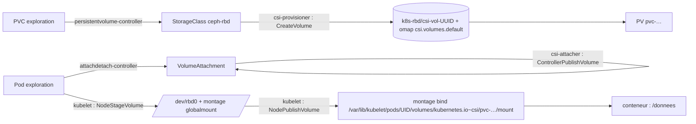

# Du PVC au bloc monté — un volume de `k8s-par1` suivi de bout en bout

> Note d'exploration (PLAT-1744, M16-E44). Sorties réelles abrégées d'un volume `exploration` de l'espace `wb-essais`, recueillies le `<DATE>`. Outil associé : `k8s-suivre-volume.sh ESPACE PVC` (`plateforme/outils`).

## 1. Les étages

## 2. Appel CSI → composant → effet → commande

| Appel | Composant (où lire le journal) | Effet observable | Commande |
|---|---|---|---|
| `CreateVolume` | provisioner *leader* : `csi-provisioner`, `csi-rbdplugin` | image `csi-vol-<UUID>` dans `k8s-rbd`, entrées omap `csi.volumes.default` → `csi.volume.<UUID>`, PV `pvc-…` | `rbd info`, `rados listomapvals`, `kubectl get pv -o jsonpath='{.spec.csi}'` |
| `ControllerPublishVolume` | `csi-attacher` (leader) | `VolumeAttachment` `attached: true` (presque sans effet côté Ceph pour RBD) | `kubectl get volumeattachment` |
| `NodeStageVolume` | *nodeplugin* du nœud : `csi-rbdplugin` ; kubelet | `rbd map` (sessions vers 10.10.30.51-53:3300), `/dev/rbdN`, `mkfs.ext4` au premier montage, montage `…/csi/rbd.csi.ceph.com/<sha256(volumeHandle)>/globalmount` | `lsblk`, `/sys/bus/rbd/devices/*/{pool,name}`, `findmnt`, `rbd status` (observateur 10.10.30.8x) |
| `NodePublishVolume` | *nodeplugin* du nœud ; kubelet | *bind* vers `/var/lib/kubelet/pods/<UID>/volumes/kubernetes.io~csi/<PV>/mount`, puis dans le conteneur | `findmnt`, `nsenter -t <PID> -m findmnt /donnees` |
| `NodeUnpublish` / `NodeUnstage` | idem | *bind* puis montage global retirés, `rbd unmap` | idem |
| `ControllerUnpublish` | `csi-attacher` | `VolumeAttachment` supprimé | `kubectl get volumeattachment` |
| `DeleteVolume` | provisioner | image en corbeille puis purgée (tâche mgr), entrées omap retirées | `rbd trash ls k8s-rbd`, `ceph rbd task list` |

## 3. Ce que nous avons vu (`<DATE>`, à remplacer par tes sorties)

- PVC `wb-essais/exploration` → PV `pvc-<…>` ; `volumeHandle` `0001-0024-<FSID>-<ID-POOL>-<UUID>` ; image `k8s-rbd/csi-vol-<UUID>`.
- `VolumeAttachment` `csi-<…>` vers `k8s-w0N`, créé à `<HEURE>`, attaché à `<HEURE>`.
- Sur `k8s-w0N` : `/dev/rbd0` (251:0), montage global `…/globalmount/<…>`, montage du pod `/var/lib/kubelet/pods/<UID>/…/mount`.
- Côté Ceph : observateur `10.10.30.8N` (carte VLAN 30 du travailleur), `client.<ID>`.
- CephFS : sous-volume `csi-vol-<…>` du groupe `csi` (`/volumes/csi/csi-vol-<…>/<…>`), montage `ceph` sur les deux nœuds, un `VolumeAttachment` par nœud (`attachRequired: true` dans le chart 3.18.1).

## 4. Pour le diagnostic

| Étage | Symptôme typique | Panne du palier 4 |
|---|---|---|
| admission, classe, provisioner | PVC `Pending` | M16-E35, M16-E38 |
| enregistrement du pilote, staging | `ContainerCreating`, `MountVolume.MountDevice failed` | M16-E36 |
| attachement | `Multi-Attach error` | M16-E37 |
| instantanés | `VolumeSnapshot` jamais prêt | M16-E42 |
