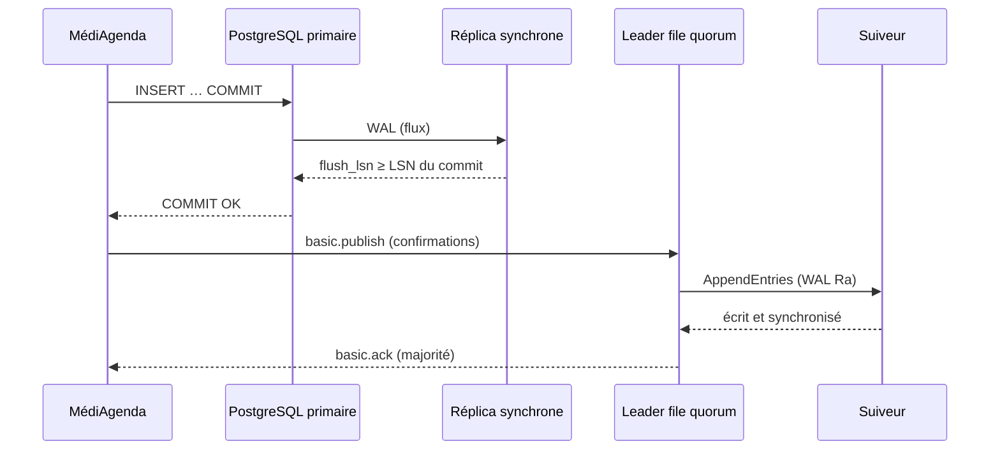

# Sous le capot : réplication synchrone, WAL et Raft des files quorum (M27-E24, PLAT-2824)

> Sorties relevées sur le lab de référence (recette, `mediagenda-db` ; `wb-essais/rabbitmq-essai`) : remplace-les par les tiennes.

## 1. Une validation PostgreSQL, octet par octet

```
mediagenda=# SELECT pg_current_wal_lsn(), pg_walfile_name(pg_current_wal_lsn());
 pg_current_wal_lsn |     pg_walfile_name
--------------------+--------------------------
 0/1A3F2B88         | 00000003000000000000001A
mediagenda=# BEGIN; CREATE TABLE wb_capot (id int, t text); INSERT INTO wb_capot VALUES (1, 'capot');
mediagenda=*# SELECT pg_current_wal_insert_lsn();   -- 0/1A3F6D10
mediagenda=*# COMMIT;
mediagenda=# SELECT pg_current_wal_insert_lsn();    -- 0/1A3F6D58 : l'enregistrement COMMIT
mediagenda=# SELECT application_name, sent_lsn, write_lsn, flush_lsn, replay_lsn, sync_state FROM pg_stat_replication;
 application_name |  sent_lsn  | write_lsn  | flush_lsn  | replay_lsn | sync_state
------------------+------------+------------+------------+------------+------------
 mediagenda-db-1  | 0/1A3F6D58 | 0/1A3F6D58 | 0/1A3F6D58 | 0/1A3F6D58 | quorum
 mediagenda-db-3  | 0/1A3F6D58 | 0/1A3F6D58 | 0/1A3F6D58 | 0/1A3F6D20 | quorum
mediagenda=# SHOW synchronous_standby_names;    -- ANY 1 ("mediagenda-db-1","mediagenda-db-3","mediagenda-db-2")
mediagenda=# SHOW synchronous_commit;           -- on
```

- `synchronous_standby_names` est **écrit par CNPG** à partir de `.spec.postgresql.synchronous` (`method: any`, `number: 1`) : les réplicas sains d'abord, puis les réplicas indisponibles, puis le primaire lui-même (documentation CNPG 1.30, « Required Data Durability ») ; avec `dataDurability: required`, la liste n'est jamais vide (les instances indisponibles y restent), d'où l'attente des validations sans réplica (M27-E19).
- Avec `synchronous_commit = on`, le `COMMIT` revient quand **un** réplica (`ANY 1`) a **écrit et synchronisé sur disque** le WAL jusqu'au LSN du commit : c'est `flush_lsn` qui compte. `remote_write` se contente de `write_lsn` (écrit, pas synchronisé : perdu si le réplica et sa machine tombent), `remote_apply` attend `replay_lsn` (lecture cohérente sur le réplica), `local` n'attend aucun réplica.
- `sync_state = quorum` : les deux réplicas sont candidats ; n'importe lequel suffit.

Coût mesuré (`\timing`, 50 `COMMIT` d'une ligne) : `on` 2,9 ms, `remote_write` 2,4 ms, `local` 0,9 ms : la synchrone coûte un aller-retour réseau et un `fsync` distant.

`pg_waldump` (dans le pod, après `SELECT pg_switch_wal();`, `pg_relation_filenode('wb_capot')` = 41234) :

```
postgres@mediagenda-db-2:/$ /usr/lib/postgresql/18/bin/pg_waldump -p /var/lib/postgresql/data/pgdata/pg_wal -s 0/1A3F2B88 -e 0/1A3F6D60 | grep -E 'Heap .*41234|COMMIT'
rmgr: Heap        len (rec/tot):     63/    63, tx:     918223, lsn: 0/1A3F6CD0, prev 0/1A3F6C98, desc: INSERT+INIT off: 1, flags: 0x00, blkref #0: rel 1663/16385/41234 blk 0
rmgr: Transaction len (rec/tot):    405/   405, tx:     918223, lsn: 0/1A3F6D10, prev 0/1A3F6CD0, desc: COMMIT 2026-11-20 10:14:03.215 CET; …
```

`wb_capot` supprimée ensuite (`DROP TABLE wb_capot;`).

## 2. Comment l'opérateur choisit un primaire

```
admin@adm01:~$ kubectl -n mediagenda-recette get lease mediagenda-db -o jsonpath='{.spec.holderIdentity} {.spec.leaseDurationSeconds}s {.spec.renewTime}{"\n"}'
mediagenda-db-2 15s 2026-11-20T09:14:41.120000Z
```

- Chaque pod a un **gestionnaire d'instance** (PID 1) qui pilote PostgreSQL et répond aux sondes : *startup* (démarrage, récupération), *liveness* (le processus vit ; sur le primaire, **contrôle d'isolement** : échec s'il ne joint ni l'API Kubernetes ni aucune autre instance), *readiness* (accepte des connexions).
- **Bascule demandée** (`kubectl cnpg promote mediagenda-db 1`) : l'opérateur pose la cible, l'ancien primaire s'arrête proprement (*fast*, archive ses derniers WAL) et **libère le bail** ; la cible prend le bail, se promeut (nouvelle *timeline*), les Services suivent ; l'ancien primaire redémarre en réplica (`pg_rewind` si nécessaire) ; `synchronous_standby_names` est réécrit. Journaux de l'opérateur : `Setting target primary`, `Waiting for the old primary to shut down`, puis promotion ; mesuré : 3,8 s d'écritures en échec.
- **Panne** : la sonde de disponibilité du primaire échoue ; après `failoverDelay` (0 s par défaut), l'opérateur passe la cible en « en attente », attend l'arrêt des récepteurs de WAL, puis choisit le réplica **le plus avancé** (LSN reçu) ; il ne peut se promouvoir qu'une fois le bail libéré ou expiré (15 s). Avec `failoverQuorum: true`, il refuse de promouvoir s'il ne peut pas prouver que le candidat a toutes les validations confirmées (cas `ANY 1` où le primaire **et** le réplica synchrone tombent ensemble).

## 3. Raft d'une file quorum

```
admin@adm01:~$ kubectl -n wb-essais exec rabbitmq-essai-server-0 -c rabbitmq -- rabbitmq-queues quorum_status --vhost essai essai-quorum
Status of quorum queue essai-quorum on node rabbit@rabbitmq-essai-server-0… :
┌───────────────────────────────────┬────────────┬───────────┬──────┬────────────────┬──────────────┬─────────────────┐
│ Node Name                         │ Raft State │ Membership│ Term │ Last Log Index │ Commit Index │ Snapshot Index  │
├───────────────────────────────────┼────────────┼───────────┼──────┼────────────────┼──────────────┼─────────────────┤
│ rabbit@rabbitmq-essai-server-1…   │ leader     │ voter     │ 3    │ 10 412         │ 10 412       │ 9 989           │
│ rabbit@rabbitmq-essai-server-0…   │ follower   │ voter     │ 3    │ 10 412         │ 10 412       │ 9 989           │
│ rabbit@rabbitmq-essai-server-2…   │ follower   │ voter     │ 3    │ 10 412         │ 10 412       │ 9 989           │
```

(Colonnes à relire sur ta version.) Après 10 000 publications confirmées, l'index validé a avancé d'autant (une entrée par commande Raft). `kubectl delete pod rabbitmq-essai-server-1` (leader) : un suiveur déclenche une élection, gagne avec la majorité (2 sur 3), **terme 4** ; perf-test en fond voit une latence p99 de 1,2 s pendant l'élection, aucun échec de publication confirmée. Au retour, le membre rattrape par réplication du journal (ou par instantané s'il est trop en retard) : `rabbitmq_detailed_raft_*` (famille `ra_metrics`) le montre.

Sur disque (`rabbitmq-diagnostics status` → *Data directory*) : `quorum/<nœud>/` contient le **WAL partagé de Ra** (`00000001.wal`…), où toutes les files quorum du nœud écrivent séquentiellement (un seul `fsync` regroupé), puis, par file, des **segments** (`*.segment`) où les entrées sont déplacées, et des instantanés ; `coordination/` contient les données de Khepri.

## 4. Khepri

Depuis RabbitMQ 4.2, les métadonnées (vhosts, utilisateurs, files, liaisons, politiques) sont dans **Khepri**, un magasin arborescent répliqué par **Ra** (le même Raft que les files quorum). En partition, seul le côté majoritaire peut modifier la topologie ; il n'y a rien à « réconcilier » au retour, contrairement à Mnesia et à `cluster_partition_handling`. Commande d'état du magasin de métadonnées trouvée dans `rabbitmq-diagnostics --help` de la 4.3 : `rabbitmq-diagnostics metadata_store_status` (membres Ra de Khepri, leader, terme, index) ; `check_if_metadata_store_is_initialized` sert de contrôle de santé. Depuis la 4.3, Khepri est le **seul** magasin pris en charge (Mnesia et `cluster_partition_handling` retirés).

## Schéma des deux chemins d'une écriture confirmée



## Ce qui change un geste d'exploitation

1. Avant de drainer un nœud qui porte un réplica de `mediagenda-db`, vérifier que l'**autre** réplica est en flux : sinon, `required` suspend les écritures.
2. Avant d'arrêter un nœud RabbitMQ (montée, maintenance) : `rabbitmq-queues check_if_node_is_quorum_critical` ; un nœud dont l'arrêt laisserait une file sans majorité doit attendre.
3. Une bascule CNPG sur panne prend au moins la durée du bail (15 s) : ne pas « aider » en supprimant des pods pendant ce temps.
