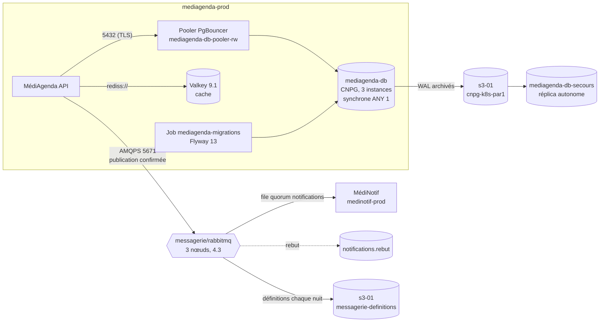

# Données et messagerie de MédiSphère (v1, étiquette `donnees-v1`)

> Page d'accueil du chantier « données et messagerie » (module 27). Décisions : [ADR-0270](adr/ADR-0270-donnees-et-messagerie.md).

## Vue d'ensemble

## Composants et versions

| Composant | Version | Où c'est déclaré | Appliqué par |
|---|---|---|---|
| CloudNativePG (opérateur), plugin Barman Cloud | 1.30.x, 0.15.x | `plateforme/k8s` (Helmfile, M16) | Helmfile |
| `mediagenda-db` recette / prod | PostgreSQL 18.6 | `plateforme/k8s/espaces/mediagenda-recette/` / `mediagenda/deploiement` (`components/dependances`, `overlays/prod`) | `kubectl apply` (recette, exception écrite) / Argo CD |
| Pooler `mediagenda-db-pooler-rw` | PgBouncer de l'image CNPG | là où vit la base de l'environnement | idem |
| `mediagenda-db-secours` | PostgreSQL 18.6 | `plateforme/k8s/espaces/mediagenda-secours/` | `kubectl apply` (exception écrite) |
| Flyway (migrations) | 13.11 Community | image `medisphere/mediagenda-migrations` (CI de `mediagenda/api`), Job dans `mediagenda/deploiement` | Argo CD (hook Sync, vague −1) |
| Valkey | 9.1.x | `mediagenda/deploiement` (là où il existe) | Argo CD |
| Cluster Operator, Messaging Topology Operator | 2.23.x, 1.20.x | `plateforme/donnees/vendor/rabbitmq/` | Argo CD (`rabbitmq-operateurs`) |
| RabbitMQ `messagerie/rabbitmq` | 4.3.x (décision 4.4 : `montee-rabbitmq-4.4.md`) | `plateforme/donnees/rabbitmq/` | Argo CD (`rabbitmq`) |
| Topologie (vhosts, files, politiques, utilisateurs, permissions) | — | `plateforme/donnees/topologie/medinotif-{recette,prod}/` | Argo CD (`rabbitmq-topologie`) + Topology Operator |
| MédiNotif | image signée par empreinte | `medinotif/deploiement` | Argo CD (ApplicationSet `medinotif`) |

## Identités (toutes dans OpenBao, lues par ESO)

| Application | Base | AMQP | Valkey |
|---|---|---|---|
| MédiAgenda | rôle dynamique `mediagenda-api-<env>` (membre de `mediagenda_api`) ; migrations : `mediagenda-migrateur-<env>` | `mediagenda-<env>` : **publication seule** sur `notifications` (`kv/mediagenda/<env>/amqp`) | `mediagenda` (ACL, `kv/mediagenda/<env>/valkey`) |
| MédiNotif | — | `medinotif-<env>` : **consommation seule** de `notifications` (`kv/medinotif/<env>/amqp`) | — |
| Plateforme | `openbao` (création des comptes dynamiques) | `sauvegarde-definitions` (étiquette `administrator`, aucune permission de vhost) ; `wb-checks` (`monitoring`) ; compte par défaut `rabbitmq-default-user` = **bris de glace** | compte d'administration (bris de glace) |

## Flux

Matrice : `docs/kubernetes/reseau/matrice-flux-cluster.md` (MédiAgenda → pooler 5432 ; MédiAgenda/MédiNotif → `messagerie` 5671 ; Prometheus → 9127, 9187, 15692 ; secours et export → `s3-01` 8333). Aucun flux de bordure permanent ajouté ; ceux de l'essai Patroni ont été retirés.

## Exploiter

| Besoin | Où |
|---|---|
| Tableau de bord | Grafana « Données et messagerie » (`m27-donnees`) |
| Alertes et premier geste | [RB-274](runbooks/RB-274-alertes-donnees.md) |
| Maintenance et bascule PostgreSQL ; redémarrage de RabbitMQ par roulement | [RB-270](runbooks/RB-270-postgresql-maintenance-bascule.md) ; [RB-271](runbooks/RB-271-rabbitmq-redemarrage-roulement.md) |
| Reprise sur le secours, définitions RabbitMQ | [RB-275](runbooks/RB-275-reprise-secours.md) |
| Écritures bloquées | [RB-276](runbooks/RB-276-ecritures-bloquees.md) |
| Consommateur arrêté, rejouer le rebut | [RB-277](runbooks/RB-277-consommateur-arrete.md) |
| Migration bloquée | [RB-278](runbooks/RB-278-migration-bloquee.md) |
| Cache Valkey | [RB-279](runbooks/RB-279-cache-valkey.md) |
| Chiffres | [dimensionnement](dimensionnement.md) |
| Comparaisons | [messagerie](comparatif-messagerie.md), [Patroni / CNPG](comparatif-patroni-cnpg.md) |
| Preuve de bout en bout | [démonstration](demonstration.md) |

## Passation au module 28 (KEDA)

- **Métrique** : profondeur de la file `notifications` du vhost de l'environnement (`messages_ready`), lue par le *scaler* `rabbitmq` de KEDA par l'API de gestion (HTTPS 15671) ; à recouper avec `rabbitmq_detailed_queue_messages_ready` dans Prometheus.
- **Identité** : un utilisateur `keda-<env>` dédié, étiquette `monitoring`, **sans** permission de lecture des messages (la lecture de la profondeur passe par l'API de gestion) ; secret dans OpenBao, `TriggerAuthentication` alimentée par ESO ; flux KEDA → `messagerie` 15671 à ouvrir.
- **À ne pas faire** : mettre MédiNotif de **production** à zéro réplica (`minReplicaCount` ≥ 1 en prod : une demande urgente ne doit pas attendre un démarrage à froid ; la mise à zéro reste réservée à la recette) ; dimensionner sur la file **de rebut**.
